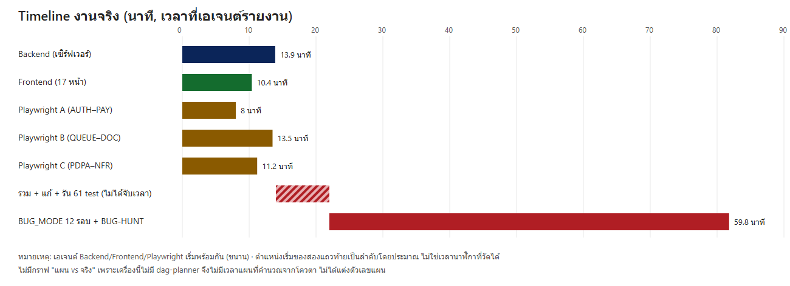
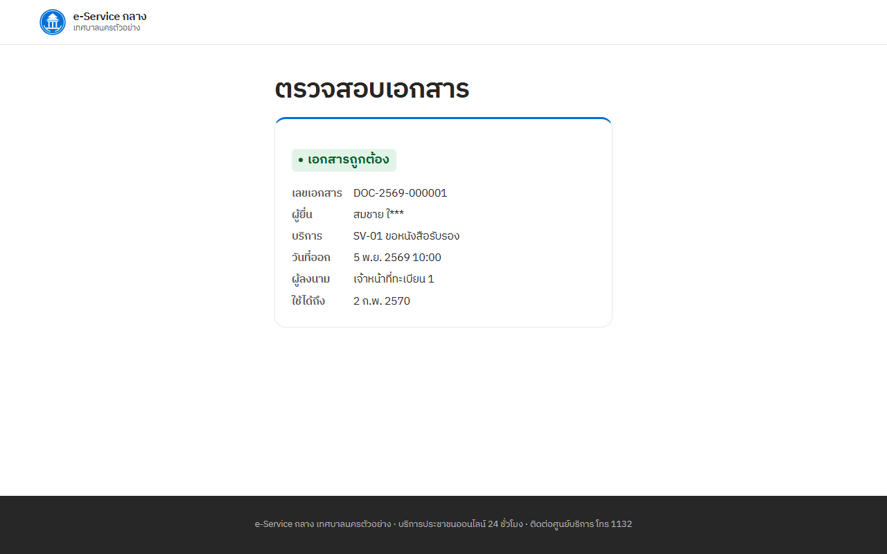
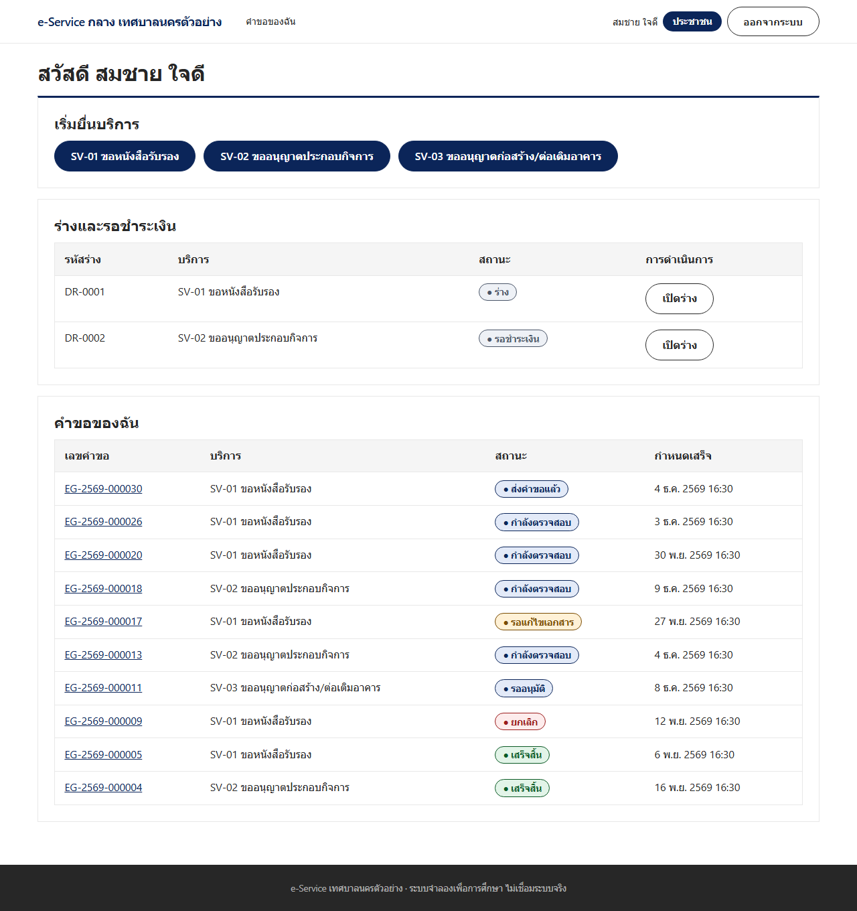
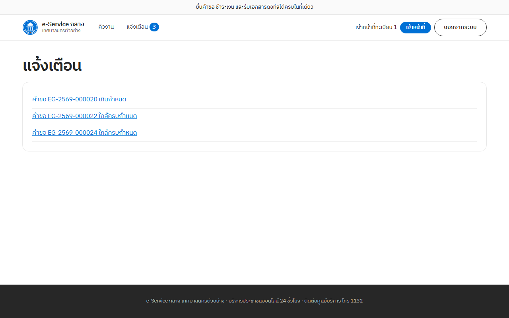
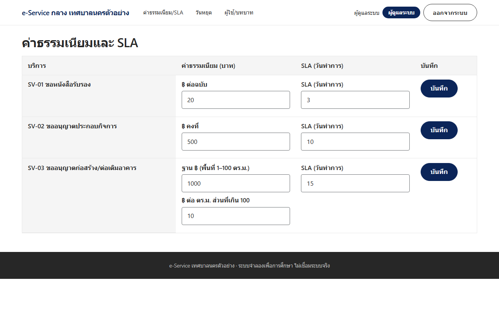
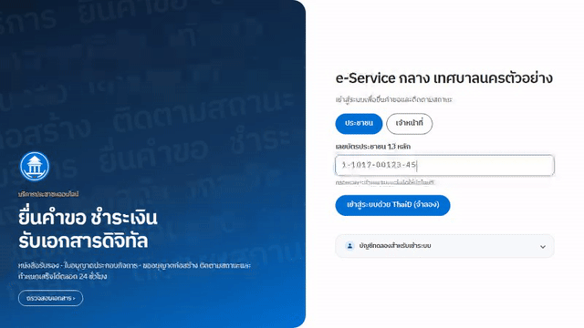
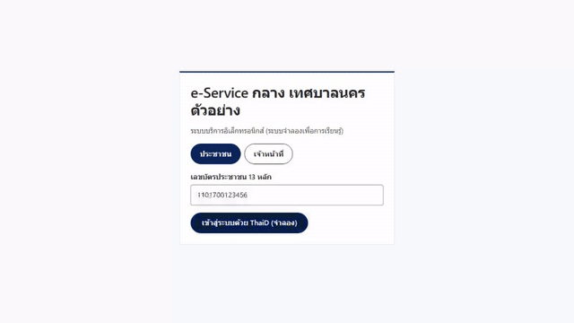

# cwn2026-training-ai-vibecode

งานฝึกอบรม CWN 2026 (AI + vibe coding) สรุปผลทั้งหมดไว้ที่ไฟล์นี้

| สัปดาห์ | งาน | โฟลเดอร์ | ผล |
|---|---|---|---|
| 1 | ทดสอบเว็บร้านสัตว์เลี้ยง PawPantry ด้วย Playwright ตาม test plan | [`week01/`](week01) | 41/42 ผ่านโหมดปกติ · เจอบั๊กจริง 1 · BUG_MODE ล้ม 5 |
| 1 | เว็บสุ่มร้านอาหาร (lunch-draw) | [`week01_website/`](week01_website) | – |
| 2 | **e-Service กลาง เทศบาลนครตัวอย่าง** (การบ้านหลัก) | [`week02_website/`](week02_website) | **61/61 ผ่าน · จับบั๊กได้ 12/12** |
| 2 | ชุดโจทย์จากผู้สอน (อ่านอย่างเดียว) | [`week2_student/`](week2_student) | – |

อ่านรายละเอียดของ Week 2 เพิ่มได้ที่ [`week02_website/README.md`](week02_website/README.md)

---

# Week 2 · e-Service กลาง เทศบาลนครตัวอย่าง

เว็บบริการภาครัฐสมมติ ประชาชนยื่นคำขอ 3 บริการและจ่ายเงินออนไลน์ เจ้าหน้าที่ตรวจและออกเอกสารดิจิทัล หัวหน้าอนุมัติ ผู้บริหารดู Dashboard ผู้ตรวจสอบดู Audit Trail
ThaiD, PromptPay และลายเซ็นดิจิทัลเป็นตัวจำลอง ไม่เชื่อมระบบจริง ไม่มีชื่อหรือตราหน่วยงานจริง

## ผลทั้งหมด (ตัวเลขมาจากการรันจริง)

| ขั้นตาม LAB | สถานะ | หลักฐาน |
|---|---|---|
| LAB 1 เข้าใจโจทย์ ตอบ 3 ข้อ | ✅ | เฉลยด้านล่าง |
| LAB 2 แผน DAG | ⚠️ ทำเองไม่ผ่าน dag-planner · มี blocks.json, dag.png, gantt-plan.png | [`week02_website/plan/PLAN.md`](week02_website/plan/PLAN.md) |
| LAB 3 สร้างเว็บ | ✅ รันได้ด้วย `node server.js` · ✅ Docker build + รัน test ผ่าน · ⚠️ มี REPORT.md/compare.png แต่เวลาแผนเป็นค่าสมมติ | [`week02_website/app/`](week02_website/app) |
| LAB 4 TEST-PLAN | ✅ **61 test ผ่านครบ 61** (ครอบ 51 TC) · GIF ระดับ P1 24 ไฟล์ | `week02_website/e2e/test-report/` (เปิด `index.html`) |
| LAB 5 BUG-HUNT | ✅ **จับได้ 12 จาก 12** | [`week02_website/BUG-HUNT.md`](week02_website/BUG-HUNT.md) |

**ระดับที่ทำ: ใช้งานได้จริง ไม่ใช่ mock** กฎธุรกิจคำนวณที่ฝั่งเซิร์ฟเวอร์ทั้งหมด (ค่าธรรมเนียม, SLA วันทำการ, RBAC, OTP ล็อก 15 นาที, เลขคำขอ, ลายเซ็น HMAC, แจ้งเตือน, Audit)
ข้อจำกัด: SQLite เก็บเฉพาะผู้ใช้ (เลขบัตรและเบอร์เข้ารหัส AES-256-GCM) ส่วนคำขอ ร่าง การชำระ ไฟล์ Audit แจ้งเตือนอยู่ในหน่วยความจำ หายเมื่อรีสตาร์ต · PDF เอกสารเป็น ASCII ไม่มีข้อความไทยในไฟล์ · QR เป็นภาพจำลอง

<!-- gallery:start -->
## ภาพประกอบ

### แผนภาพ DAG (LAB 2)


แผนอ่านได้ที่ [PLAN.md](week02_website/plan/PLAN.md) · Playwright ทั้งสามชุดไม่มีลูกศรจากบล็อกเว็บ (ทำขนานกัน) · บล็อกรวมและ BUG_MODE เป็น exclusive 🔒

### Timeline (LAB 3)



เวลาในแท่งสีมาจากที่เอเจนต์รายงานตอนจบงาน ส่วนขั้นรวม/แก้ไม่ได้จับเวลา (แท่งลายทแยง)

### Gantt แผน / Gantt จริง / แผน vs จริง (LAB 2–3)


⚠️ เวลา "แผน" เป็นค่าสมมติ (โควตา 4 บัญชีสมมติ) ที่ตั้งหลังทำเสร็จ เพราะไม่มี dag-planner · ไฟล์: [blocks.json](week02_website/plan/blocks.json) · [REPORT.md](week02_website/plan/REPORT.md)

### ภาพหน้าเว็บ (13 หน้า)

| | |
|---|---|
| **หน้าเข้าสู่ระบบ (ThaiD จำลอง / เจ้าหน้าที่)**<br> | **ตรวจเอกสารโดยไม่ต้องล็อกอิน (ชื่อผู้ยื่นปิดบัง)**<br> |
| **ประชาชน: รายการคำขอและเริ่มบริการ**<br> | **ยื่นคำขอ SV-03 พื้นที่ 101 ตร.ม. ค่าธรรมเนียม ฿1,010**<br> |
| **ประชาชน: รายละเอียดคำขอ สถานะ ไทม์ไลน์ SLA**<br> | **มือถือ 375px ไม่มี scroll แนวนอน**<br> |
| **เจ้าหน้าที่: คิวงานแยกแผนก เลขบัตรปิดบัง**<br> | **เจ้าหน้าที่: แจ้งเตือน SLA ใกล้ครบกำหนด/เกินกำหนด**<br> |
| **หัวหน้าฝ่าย: รายการรออนุมัติ**<br> | **ผู้บริหาร: Dashboard (ไม่มีข้อมูลส่วนบุคคล)**<br> |
| **ผู้ตรวจสอบ: Audit Trail**<br> | **ผู้ดูแลระบบ: ค่าธรรมเนียม/SLA**<br> |
| **เจ้าหน้าที่: รายละเอียดคำขอและปุ่มดำเนินการ**<br> |  |

### GIF ตอน Playwright รัน test ระดับ P1 (24 ไฟล์ · LAB 4)

ทุก test ผ่าน · เปิดรวมทั้งหมดได้ที่ week02_website/e2e/test-report/index.html

| | | |
|---|---|---|
| **TC-AUDIT-01**<br> | **TC-AUDIT-02**<br> | **TC-AUDIT-03**<br> |
| **TC-AUTH-01**<br> | **TC-AUTH-02**<br> | **TC-AUTH-03**<br> |
| **TC-DASH-01**<br> | **TC-DASH-02**<br> | **TC-DASH-04**<br> |
| **TC-FEE-01**<br> | **TC-NFR-01**<br> | **TC-NFR-02**<br> |
| **TC-NFR-02B**<br> | **TC-PAY-01**<br> | **TC-PDPA-01**<br> |
| **TC-PDPA-03**<br> | **TC-RBAC-01**<br> | **TC-RBAC-02**<br> |
| **TC-RBAC-03**<br> | **TC-RBAC-05**<br> | **TC-SUBMIT-01**<br> |
| **TC-SUBMIT-02**<br> | **TC-UPLOAD-01**<br> | **TC-UPLOAD-02**<br> |

หมายเหตุ: TC-NFR-02.gif แทบว่าง (5 KB) เพราะ test นั้นสแกน axe หลายหน้าอย่างรวดเร็ว ดู TC-NFR-02B สำหรับภาพการใช้คีย์บอร์ด · อีก 28 ข้อของ P1 เป็น test API อย่างเดียวจึงไม่มีวิดีโอ

<!-- gallery:end -->

## ผู้ใช้และสิ่งที่ทำได้

| บทบาท | ทำอะไร |
|---|---|
| ประชาชน | ล็อกอินเลขบัตร 13 หลัก (เช็ก checksum) + OTP · ลงทะเบียน/PDPA · ยื่น SV-01/02/03 3 ขั้น · แนบไฟล์ (ตรวจจากเนื้อไฟล์ ≤5 MB ≤5 ไฟล์) · บันทึกร่าง · จ่าย QR จำลอง · ดูสถานะ/SLA · ยกเลิก · ส่งแก้ไขใน 168 ชม. · ดาวน์โหลดเอกสาร |
| เจ้าหน้าที่ | คิวแยกแผนก · รับเรื่อง (1 คน ≤10 งาน) · ตีกลับ ≤2 ครั้ง · ส่งต่ออัตโนมัติ · อนุมัติ SV-01 · ออกเอกสาร · เลขบัตรปิดบัง/แสดงเต็มพร้อมเหตุผล · แจ้งเตือน SLA |
| หัวหน้าฝ่าย | อนุมัติ/ไม่อนุมัติ SV-02/03 |
| ผู้บริหาร | Dashboard กรองเดือน/บริการ · ส่งออก Excel/PDF (ไม่มีข้อมูลส่วนบุคคล) |
| ผู้ตรวจสอบ | Audit Trail 10 เหตุการณ์ กรอง ส่งออก CSV แก้/ลบไม่ได้ |
| ผู้ดูแลระบบ | ค่าธรรมเนียม/SLA · วันหยุด · ผู้ใช้/บทบาท |
| ทุกคน | `/verify/<รหัส>` ตรวจเอกสารโดยไม่ล็อกอิน · `/api/health` |

## Theme

อิงสไตล์ DJI (พื้นขาว การ์ดเหลี่ยมแบนไม่มีเงา ปุ่ม pill ปุ่มรองขอบ 1px KPI ตัวใหญ่ footer เทาถ่าน) ใช้ **น้ำเงินกรมท่าเข้ม `#0B2559`** เพื่อให้ดูทางการ ส้ม `#BE4E04` ใช้เฉพาะเครื่องหมายเล็ก
ปรับต่างจากเอกสารสไตล์: ใช้ Open Sans ตามด้วย Noto Sans Thai และลด letter-spacing เหลือ −0.01em เพื่อให้ไทยอ่านได้ · ใช้เทา `#595959` กับน้ำเงินกรมท่าแทน `#8c8c8c`/`#1890ff` ที่ไม่ผ่าน WCAG AA (TC-NFR-02 ตรวจด้วย axe) · ไม่มี hero carousel เพราะเป็นเว็บราชการ

## วิธีรัน

```powershell
cd week02_website/app
$env:TEST_MODE='1'; $env:BUG_MODE=''     # BUG_MODE='B03,B07' = เปิดบั๊ก
node server.js                           # http://localhost:3100 (Node 24 ไม่มี dependency)

cd ../e2e
npm install
npx playwright test --timeout=30000      # ใช้ reporter ตาม config → test-report/results.json
node make-gifs.js                        # GIF P1 → test-report/gifs + index.html
```

ffmpeg-static: npm 12 บล็อก install script ให้รัน `node node_modules/ffmpeg-static/install.js` หนึ่งครั้ง
ตัวแปรเสริม: `E2E_NOHOOK_URL=http://localhost:3101` (เว็บอีกตัวที่ไม่ตั้ง TEST_MODE) เพื่อให้ TC-NFR-03B ไม่ถูกข้าม

## เฉลยคำถามเช็กความเข้าใจ (LAB 1)

1. ก่อสร้าง 101 ตร.ม. = ฿1,000 + ฿10 × (101 − 100) = **฿1,010** (BR-05)
2. ชำระ อ. 1 ธ.ค. 69 16:30 (ไม่ใช่ "ก่อน 16:30") → D0 = พ. 2 ธ.ค. · SLA 3 วันทำการ (พฤ.3, ศ.4, ข้าม จ.7 ที่เป็นวันหยุด) → **อ. 8 ธ.ค. 69 เวลา 16:30** (BR-12)
3. ชุด Playwright กลางเขียนครั้งเดียวใช้กับเว็บของทุกกลุ่ม ถ้า `data-testid` ไม่ตรงกัน test หาองค์ประกอบไม่เจอ จึงต้องมี CONTRACT

## ข้อที่เคยล้มและเป็นความผิดของอะไร (LAB 4)

ทุกข้อเป็น **เว็บผิด** แก้ที่เว็บ ไม่ได้แก้ผลที่คาดหวังให้ตรงหน้าจอ

| อาการ | สาเหตุ | แก้ที่ |
|---|---|---|
| test หน้าเว็บล้มเกือบหมดรอบแรก | server ส่ง `/static/*` จากโฟลเดอร์ผิดชั้น | `app/server.js` |
| TC-AUTH-01 | `otp-step` อยู่ใน DOM ก่อนเลขบัตรผ่าน | `login.html`, `login.js` |
| TC-DASH-02 | ทันกำหนด % แสดง `100%` ต้อง `100.0%` (BR-25) | `dashboard.js` |
| TC-SUBMIT-01 | `row-owner` ต้องว่างเมื่อยังไม่มีผู้รับ | `queue.js` |
| TC-NFR-04 | ไฟล์ DB ชื่อ `app.db` แต่ test หา `egov.db` | `app/src/vault.js` |
| TC-NFR-01, TC-PAY-04 (บางรอบ) | race: แนบไฟล์เร็วก่อนสร้างร่างเสร็จ | `wizard.js` |

แก้ test 1 จุด (`upload.spec.js` TC-UPLOAD-01) โดย **เพิ่ม** การตรวจให้ error ชัดขึ้นตอนเปิด B02 ไม่ได้ลดเกณฑ์

## BUG-HUNT (B01–B12)

จับได้ **12 จาก 12** (agent รันครบ 12 รอบ ตารางเต็มใน `BUG-HUNT.md`) ผมสุ่มรันซ้ำเอง: B01 → TC-FEE-01 ล้ม · B12 → TC-WORKFLOW-04 ล้ม · ไม่เปิดบั๊กผ่าน
ข้อสังเกต: B03 ทำให้ **TC-NOTI-02 ล้มเพิ่ม** ซึ่งไม่อยู่ในรายการ "อาจล้มด้วย" ของ BUGS.md (ระดับ "ใกล้ครบกำหนด" ใช้ฟังก์ชันวันทำการตัวเดียวกับ SLA) ควรแจ้งผู้สอน

## สิ่งที่ต่างจากโจทย์ / ที่ยังไม่ได้ทำ

- **Docker:** `docker compose up --build` ทดสอบแล้ว: build ผ่าน, Playwright กับ container 60 ผ่าน / 1 ข้าม (NFR-03B)
- **ไม่มี `dag-planner`/`agent-team`/container `multi-account` ในเครื่อง:** เขียนแผนเอง (`plan/PLAN.md`, `plan/blocks.json`) และสร้าง `dag.png`, `gantt-plan.png`, `gantt-actual.png`, `compare.png`, `plan/REPORT.md` ด้วยสคริปต์ `e2e/make-plan-files.js` เวลา "แผน" เป็นค่าสมมติที่ตั้งหลังทำเสร็จ (ตามทางเลือกโควตาสมมติของ PROMPTS) ส่วนเวลา "จริง" คือ duration ที่เอเจนต์รายงาน ไม่ได้รันผ่านสกิล dag-planner งานสร้างเว็บและเขียน test ทำโดยเอเจนต์ย่อยของ Claude Code (Sonnet, effort low) ขนานกัน
- **จำนวน test:** 61 test ครอบ 51 TC เพราะ TC-SLA-01 แยก 9 test (แถว a–i) + TC-NFR-02B, TC-NFR-03B เพิ่ม 2 ข้อ
- **GIF 24 จาก P1 ทั้งหมด 52:** อีก 28 ข้อเรียก API อย่างเดียว ไม่เปิดเบราว์เซอร์จึงไม่มีวิดีโอ
- **ไม่มีเกณฑ์ให้คะแนนในชุดโจทย์** ยังไม่ได้เทียบกับเกณฑ์แยกของผู้สอน (ถ้ามี)
- **โมเดล:** agent ทุกตัวตั้งเป็น Sonnet low ตามที่ขอ แต่ไม่ได้สลับเป็น Haiku เมื่อ token เหลือต่ำกว่า 75% เพราะไม่เห็นตัวเลข token ที่เหลือ
- NFR-05 (HTTPS) ไม่มี TC และไม่ได้ทำ

## คำถามถึงผู้สอน/TA

1. หน้าร่าง `PENDING_PAYMENT` (`?draft=...`) ควรเปิดที่ขั้นไหน (เว็บเลือกขั้น 3)
2. `GET /api/drafts/:id` ควรคืนรายการไฟล์ และควรมี API ลบไฟล์หรือไม่ (เว็บเพิ่ม `files` และ `DELETE .../files/:fileId`)
3. ฟอร์มค่าธรรมเนียม/SLA บันทึกพร้อมกันหรือแยก และถ้าค่าไม่เปลี่ยนต้องมี `ADMIN_CHANGE` หรือไม่
4. `bell-count` ต้องอยู่ใน header ทุกหน้าของ officer/head หรือเฉพาะ `/notifications`
5. B03 ทำให้ TC-NOTI-02 ล้มเพิ่ม ยอมรับได้หรือไม่

---

# Week 1 · PawPantry (สรุป)

ทดสอบเว็บร้านสัตว์เลี้ยงตาม `week01/TEST-PLAN.md` ด้วย Playwright (`week01/e2e`)

| รอบ | ผล |
|---|---|
| โหมดปกติ (BUG_MODE=0) | 42 test · ผ่าน 41 · ล้ม 1 (TC-AUTH-02: ฟอร์มสมัครเปล่าไม่ขึ้น error ช่องยืนยันรหัสผ่าน = บั๊กของเว็บ) · ตัดสิน "ปล่อยได้" (P1 15/15, รวม 97.6%) |
| โหมดฝังบั๊ก (BUG_MODE=1) | 42 test · ผ่าน 37 · ล้ม 5 (TC-CPN-01, TC-CHK-02, TC-WISH-02, TC-WISH-03, TC-AUTH-02) · ตัดสิน "ไม่ปล่อย" |

รายงาน: `week01/e2e/test-report/` และ `week01/e2e/test-report-bugmode/BUG-REPORT.md`


