# cwn2026-training-ai-vibecode

งานฝึกอบรม CWN 2026 (AI + vibe coding) สรุปผลทั้งหมดไว้ที่ไฟล์นี้

| สัปดาห์ | งาน | โฟลเดอร์ | ผล |
|---|---|---|---|
| 1 | ทดสอบเว็บร้านสัตว์เลี้ยง PawPantry ด้วย Playwright ตาม test plan | [`week01/`](week01) | 41/42 ผ่านโหมดปกติ · เจอบั๊กจริง 1 · BUG_MODE ล้ม 5 |
| 1 | เว็บสุ่มร้านอาหาร (lunch-draw) | [`week01_website/`](week01_website) | – |
| 2 | **e-Service กลาง เทศบาลนครตัวอย่าง** (การบ้านหลัก) | [`week02_website/`](week02_website) | **Docker: 61/61 ผ่านรอบเดียว · BUG_MODE จับได้ 12/12** |
| 2 | **LAB 2–3 ทีมเอเจนต์ (dag-planner + agent-team)** | [`week02_website/egov-eservice/`](week02_website/egov-eservice) | **13/13 บล็อก · เว็บของทีม 79/79 · BUG_MODE 12/12** |
| 2 | ชุดโจทย์จากผู้สอน (อ่านอย่างเดียว) | [`week2_student/`](week2_student) | – |

อ่านรายละเอียดของ Week 2 เพิ่มได้ที่ [`week02_website/README.md`](week02_website/README.md)

---

# Week 2 · e-Service กลาง เทศบาลนครตัวอย่าง

เว็บบริการภาครัฐสมมติ ประชาชนยื่นคำขอ 3 บริการและจ่ายเงินออนไลน์ เจ้าหน้าที่ตรวจและออกเอกสารดิจิทัล หัวหน้าอนุมัติ ผู้บริหารดู Dashboard ผู้ตรวจสอบดู Audit Trail
ThaiD, PromptPay และลายเซ็นดิจิทัลเป็นตัวจำลอง ไม่เชื่อมระบบจริง ไม่มีชื่อหรือตราหน่วยงานจริง

## ผลทั้งหมด (ตัวเลขมาจากการรันจริง)

| ขั้นตาม LAB | สถานะ | หลักฐาน |
|---|---|---|
| LAB 1 เข้าใจโจทย์ ตอบ 3 ข้อ | ✅ | เฉลยด้านล่าง |
| LAB 2 แผน DAG | ✅ **dag-planner ใน container `multi-account`** · โควตาจริง yolo1–3 · 13 บล็อก · แผน 112.5 นาที · สายวิกฤต B01→B03→B05→B07→I01→X01 | [`week02_website/egov-eservice/`](week02_website/egov-eservice/README.md) (blocks.json · dag.png · gantt-plan.png · PLAN.md) |
| LAB 3 สร้างเว็บ | ✅ **agent-team รันแผนจริง เสร็จ 13/13 บล็อก** · 2,417,922 tokens · เวลาจริง 341.7 นาที (รวมรอโควตารีเซ็ต ~4 ชม.) · เว็บที่ทีมสร้างรันซ้ำบนเครื่องด้วย Docker **79/79 ผ่าน** · B01/B12 ล้มตรง TC | [`week02_website/egov-eservice/`](week02_website/egov-eservice/README.md) (gantt-actual.png · compare.png · REPORT.md · app/) |
| LAB 4 TEST-PLAN | ✅ **61/61 ผ่านในรอบเดียวกับ container Docker** (ครอบ 51 TC · 0 flaky · 2.4 นาที) · GIF P1 24 ไฟล์ · ข้อที่เคยล้มแยกเป็นเว็บผิด/test ผิด/สภาพแวดล้อม ใน README ของ week02 | `week02_website/e2e/test-report/` (เปิด `index.html`) |
| LAB 5 BUG-HUNT | ✅ **จับได้ 12 จาก 12 ใน Docker** (สร้าง container ใหม่ทุกบั๊ก · retries 0) + รวมบั๊ก 2 ชุดได้ผลรวมพอดี | [`week02_website/BUG-HUNT.md`](week02_website/BUG-HUNT.md) |

**ระดับที่ทำ: ใช้งานได้จริง ไม่ใช่ mock** กฎธุรกิจคำนวณที่ฝั่งเซิร์ฟเวอร์ทั้งหมด (ค่าธรรมเนียม, SLA วันทำการ, RBAC, OTP ล็อก 15 นาที, เลขคำขอ, ลายเซ็น HMAC, แจ้งเตือน, Audit)
ข้อจำกัด: SQLite เก็บเฉพาะผู้ใช้ (เลขบัตรและเบอร์เข้ารหัส AES-256-GCM) ส่วนคำขอ ร่าง การชำระ ไฟล์ Audit แจ้งเตือนอยู่ในหน่วยความจำ หายเมื่อรีสตาร์ต · PDF เอกสารเป็น ASCII ไม่มีข้อความไทยในไฟล์ · QR เป็นภาพจำลอง

<!-- gallery:start -->
## ภาพประกอบ

### แผนภาพ DAG จาก dag-planner (LAB 2)

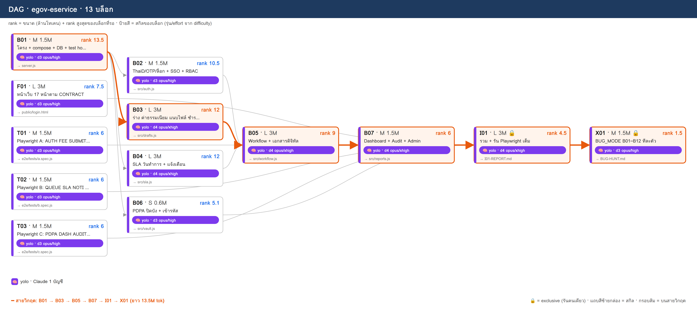

แผนจากโควตาจริงของ yolo1–3 · [PLAN.md](week02_website/egov-eservice/PLAN.md) · [blocks.json](week02_website/egov-eservice/blocks.json)

### ผล Playwright (LAB 4)

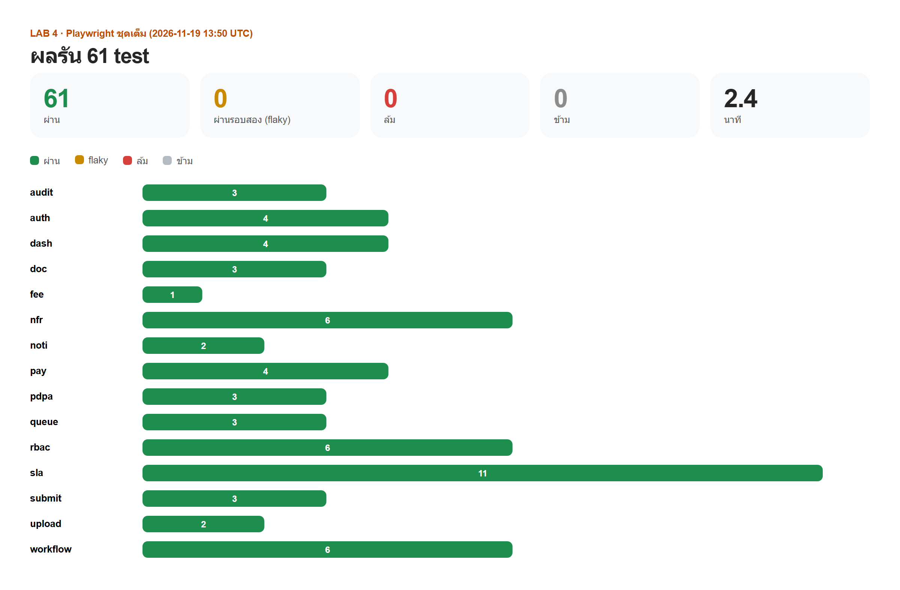

### BUG_MODE (LAB 5)

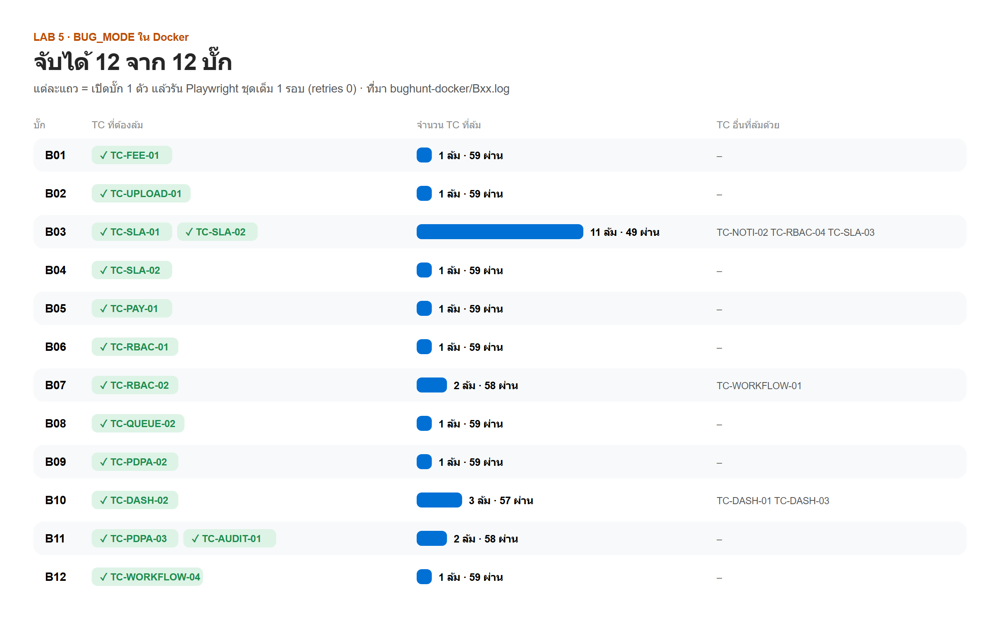

รายละเอียด expected → received ทุกบั๊ก: [BUG-HUNT.md](week02_website/BUG-HUNT.md)

### Gantt แผน / Gantt จริง / แผน vs จริง จาก dag-planner (LAB 2–3)

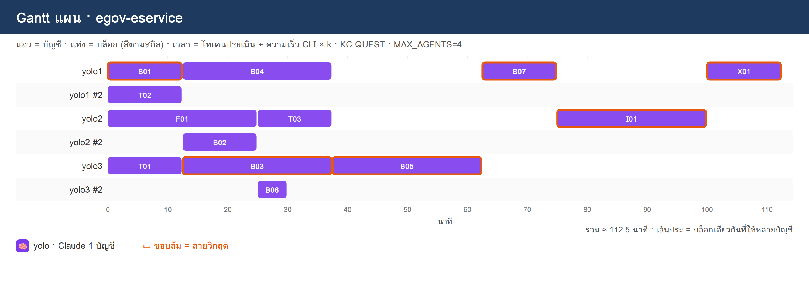

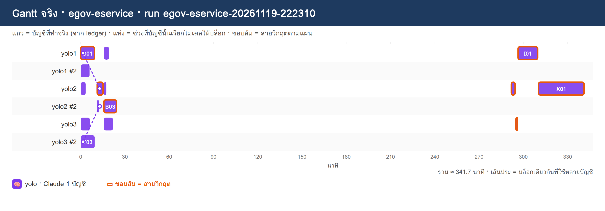

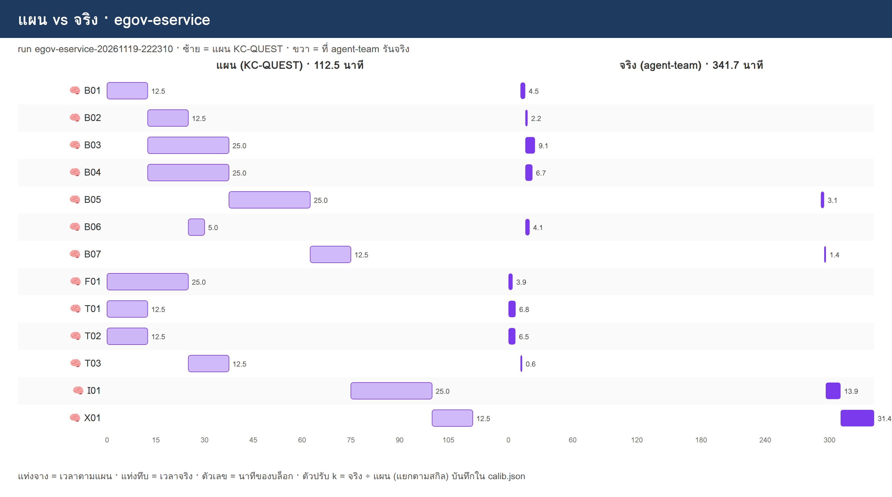

เสร็จ 13/13 บล็อก · เวลาจริงรวมช่วงรอโควตารีเซ็ต · [REPORT.md](week02_website/egov-eservice/REPORT.md)

### ภาพหน้าเว็บ (13 หน้า)

| | |
|---|---|
| **หน้าเข้าสู่ระบบ (ThaiD จำลอง / เจ้าหน้าที่)**<br>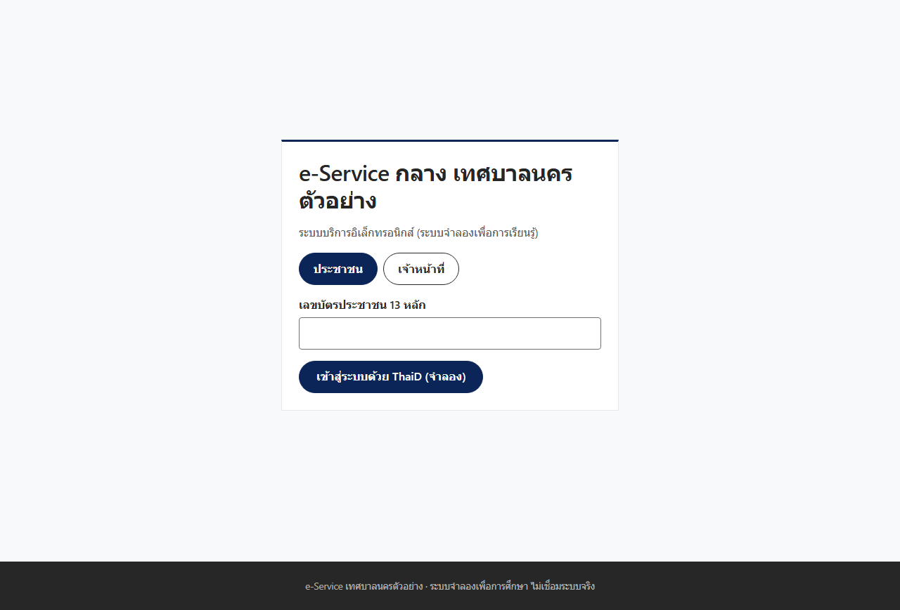 | **ตรวจเอกสารโดยไม่ต้องล็อกอิน (ชื่อผู้ยื่นปิดบัง)**<br> |
| **ประชาชน: รายการคำขอและเริ่มบริการ**<br> | **ยื่นคำขอ SV-03 พื้นที่ 101 ตร.ม. ค่าธรรมเนียม ฿1,010**<br>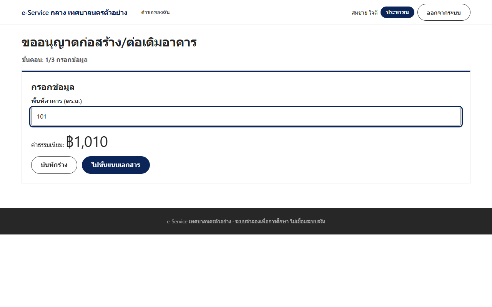 |
| **ประชาชน: รายละเอียดคำขอ สถานะ ไทม์ไลน์ SLA**<br> | **มือถือ 375px ไม่มี scroll แนวนอน**<br>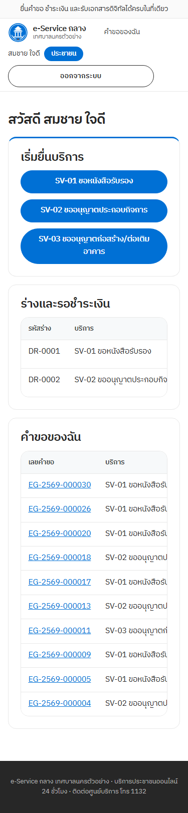 |
| **เจ้าหน้าที่: คิวงานแยกแผนก เลขบัตรปิดบัง**<br>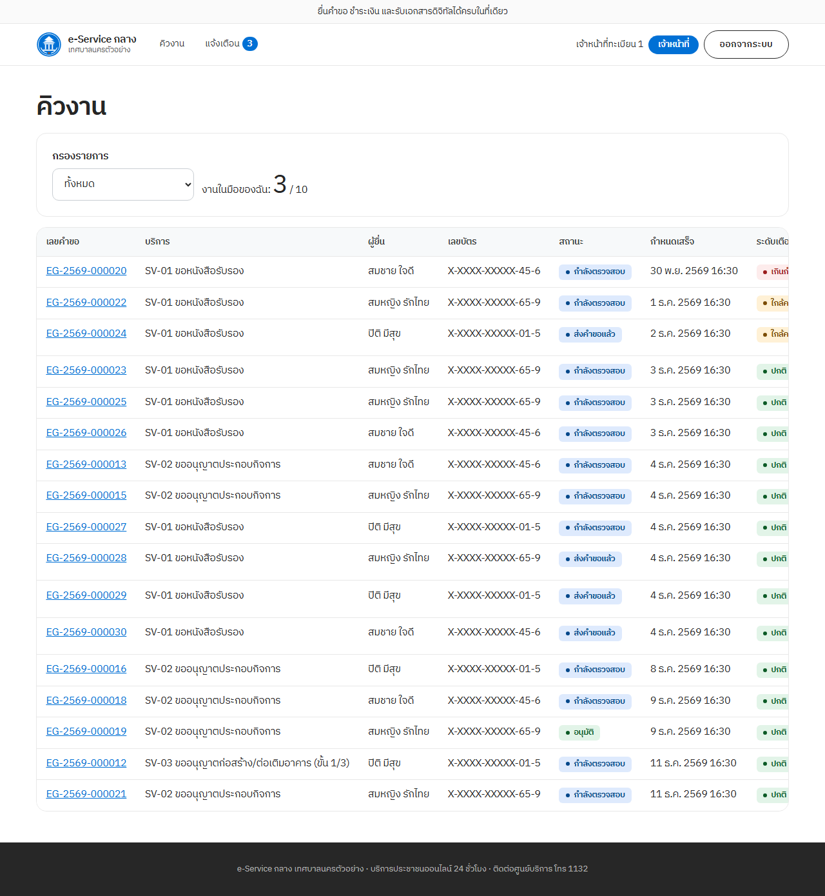 | **เจ้าหน้าที่: แจ้งเตือน SLA ใกล้ครบกำหนด/เกินกำหนด**<br> |
| **หัวหน้าฝ่าย: รายการรออนุมัติ**<br>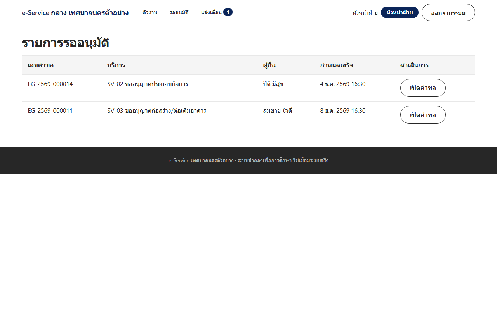 | **ผู้บริหาร: Dashboard (ไม่มีข้อมูลส่วนบุคคล)**<br>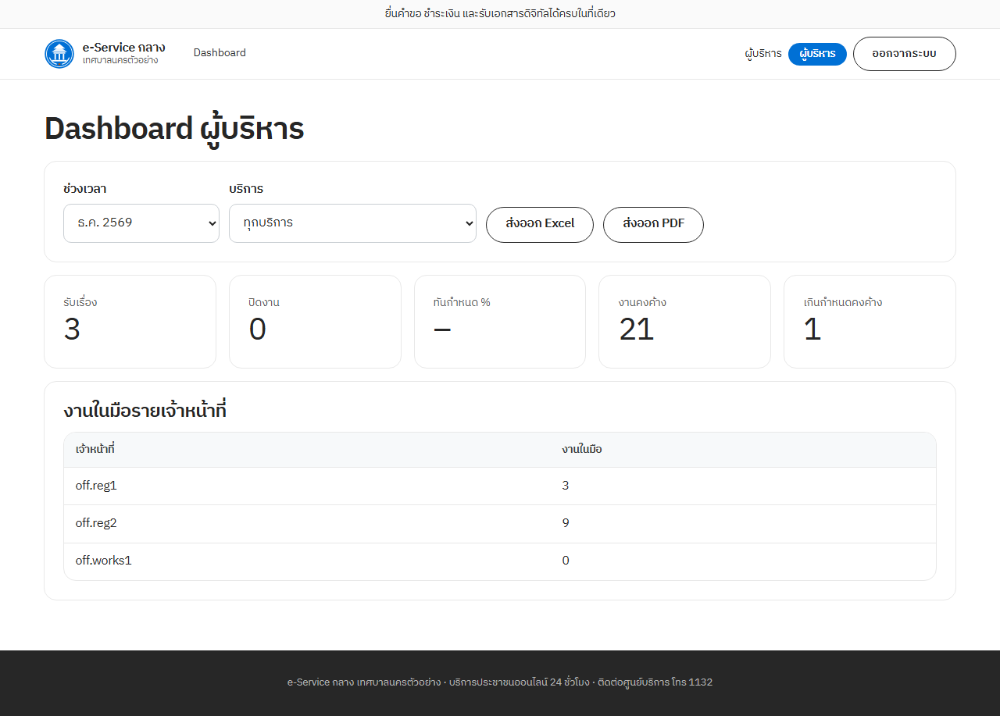 |
| **ผู้ตรวจสอบ: Audit Trail**<br>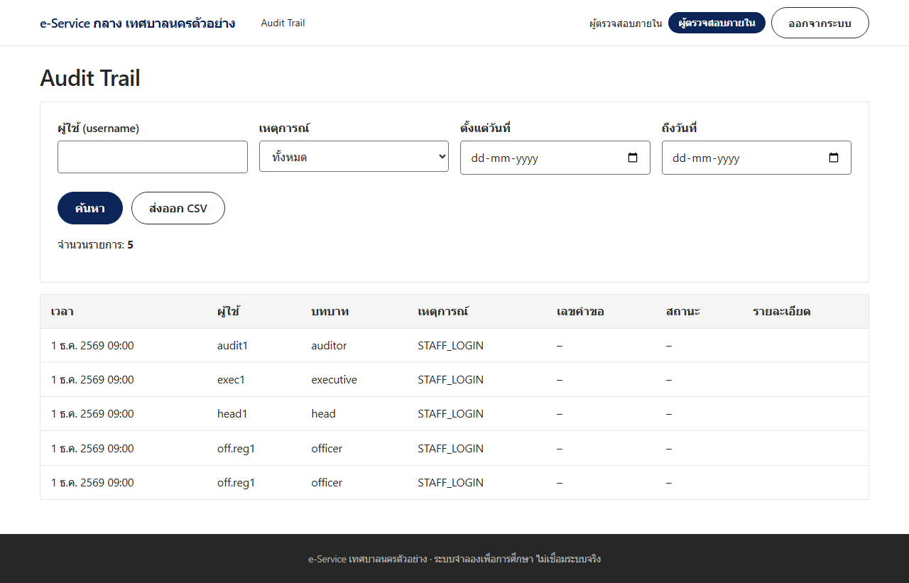 | **ผู้ดูแลระบบ: ค่าธรรมเนียม/SLA**<br> |
| **เจ้าหน้าที่: รายละเอียดคำขอและปุ่มดำเนินการ**<br>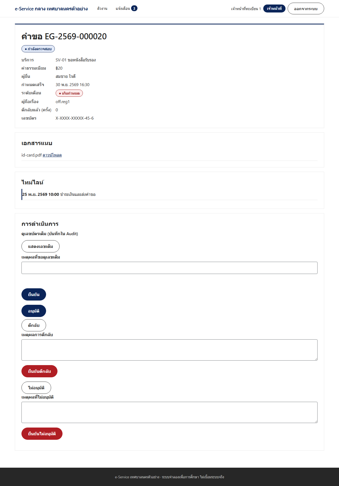 |  |

### GIF ตอน Playwright รัน test ระดับ P1 (24 ไฟล์ · LAB 4)

ทุก test ผ่าน · เปิดรวมทั้งหมดได้ที่ week02_website/e2e/test-report/index.html

| | | |
|---|---|---|
| **TC-AUDIT-01**<br> | **TC-AUDIT-02**<br> | **TC-AUDIT-03**<br> |
| **TC-AUTH-01**<br> | **TC-AUTH-02**<br> | **TC-AUTH-03**<br> |
| **TC-DASH-01**<br> | **TC-DASH-02**<br> | **TC-DASH-04**<br>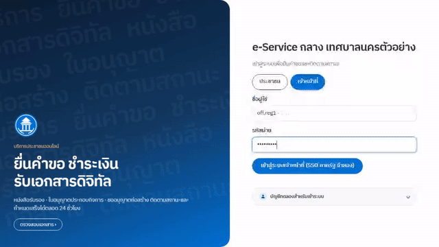 |
| **TC-FEE-01**<br> | **TC-NFR-01**<br> | **TC-NFR-02**<br> |
| **TC-NFR-02B**<br>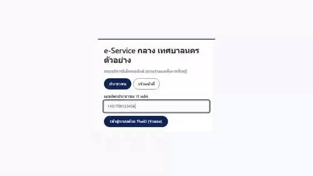 | **TC-PAY-01**<br> | **TC-PDPA-01**<br> |
| **TC-PDPA-03**<br>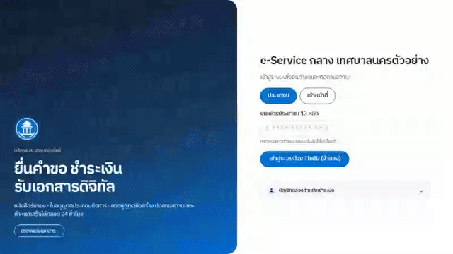 | **TC-RBAC-01**<br> | **TC-RBAC-02**<br>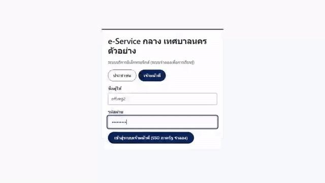 |
| **TC-RBAC-03**<br> | **TC-RBAC-05**<br> | **TC-SUBMIT-01**<br>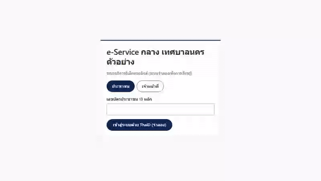 |
| **TC-SUBMIT-02**<br> | **TC-UPLOAD-01**<br> | **TC-UPLOAD-02**<br> |

หมายเหตุ: TC-NFR-02.gif แทบว่าง (5 KB) เพราะ test นั้นสแกน axe หลายหน้าอย่างรวดเร็ว ดู TC-NFR-02B สำหรับภาพการใช้คีย์บอร์ด · อีก 28 ข้อของ P1 เป็น test API อย่างเดียวจึงไม่มีวิดีโอ

<!-- gallery:end -->

## ผู้ใช้และสิ่งที่ทำได้

| บทบาท | ทำอะไร |
|---|---|
| ประชาชน | ล็อกอินเลขบัตร 13 หลัก (เช็ก checksum) + OTP · ลงทะเบียน/PDPA · ยื่น SV-01/02/03 3 ขั้น · แนบไฟล์ (ตรวจจากเนื้อไฟล์ ≤5 MB ≤5 ไฟล์) · บันทึกร่าง · จ่าย QR จำลอง · ดูสถานะ/SLA · ยกเลิก · ส่งแก้ไขใน 168 ชม. · ดาวน์โหลดเอกสาร |
| เจ้าหน้าที่ | คิวแยกแผนก · รับเรื่อง (1 คน ≤10 งาน) · ตีกลับ ≤2 ครั้ง · ส่งต่ออัตโนมัติ · อนุมัติ SV-01 · ออกเอกสาร · เลขบัตรปิดบัง/แสดงเต็มพร้อมเหตุผล · แจ้งเตือน SLA |
| หัวหน้าฝ่าย | อนุมัติ/ไม่อนุมัติ SV-02/03 |
| ผู้บริหาร | Dashboard กรองเดือน/บริการ · ส่งออก Excel/PDF (ไม่มีข้อมูลส่วนบุคคล) |
| ผู้ตรวจสอบ | Audit Trail 10 เหตุการณ์ กรอง ส่งออก CSV แก้/ลบไม่ได้ |
| ผู้ดูแลระบบ | ค่าธรรมเนียม/SLA · วันหยุด · ผู้ใช้/บทบาท |
| ทุกคน | `/verify/<รหัส>` ตรวจเอกสารโดยไม่ล็อกอิน · `/api/health` |

## ดีไซน์

อิง design spec แบบ showroom (พื้นขาว ปุ่มแคปซูลน้ำเงิน `#0070D5` สีเดียว ตัวอักษรหมึก `#262626` footer เทาถ่านติดล่างจอ) · ฟอนต์ไทย IBM Plex Sans Thai (ไฟล์ในโปรเจกต์) · มุมมน · หน้า login สองฝั่งพร้อมขั้น OTP แยก · ช่องเลขบัตรจัดรูปแบบอัตโนมัติ · ปุ่ม "จำลองสแกนจ่าย PromptPay" (เมื่อ TEST_MODE=1) · ตราสัญลักษณ์ออกแบบใหม่สำหรับเทศบาลนครตัวอย่าง (ไม่ใช้ตราหน่วยงานจริง) · ผ่าน WCAG AA (TC-NFR-02) · รายละเอียดและวิธีเข้าระบบด้วยบัญชีทดสอบ: [`week02_website/README.md`](week02_website/README.md#วิธีเข้าระบบ-บัญชีทดสอบจาก-test-data)

<!-- rerun:start -->
## LAB 2–3 · ทีมเอเจนต์ใน container `multi-account` (dag-planner + agent-team)

รันพรอมต์ขั้น 0–3 ของ PROMPTS จริงใน container `multi-account` ด้วยบัญชี Claude yolo1–yolo3 ที่ผู้ใช้ล็อกอินเอง รายละเอียดเต็ม: [`week02_website/egov-eservice/README.md`](week02_website/egov-eservice/README.md)

| ขั้น | ผลที่รันจริง |
|---|---|
| ขั้น 0 · doctor | Python · base skill agent-team/yolo/cyolo · ตัววาด PNG ✅ พร้อมใช้ · ชุดโจทย์ครบ 10 ไฟล์ใน `/workspace/egov-brief` |
| ขั้น 1 · `dag` + `plan` | 13 บล็อก · agent สูงสุด 4 · แผน 112.5 นาที · สายวิกฤต B01→B03→B05→B07→I01→X01 · KC-QUEST แจกงานจากโควตาจริง |
| ขั้น 2 · ตรวจแผน | Playwright ไม่มีลูกศรจากบล็อกเว็บ ✅ · บล็อกสุดท้าย exclusive 🔒 ✅ · output ไม่ซ้ำ ✅ · ทุกบล็อกมีบัญชี ✅ |
| ขั้น 3 · `export` `run` `report` | **13/13 บล็อก ok** · 2,417,922 tokens · จริง 341.7 นาที (รวมรอโควตารีเซ็ต ~4 ชม.) · resume 2 ครั้ง: timeout 600 s → ตั้ง timeout ต่อบล็อก, โควตา session ถึง 97% → รอรีเซ็ตแล้วใช้ sonnet/low |
| I01 (ในทีม) | 79 test ครอบ 51 TC ผ่าน 79/79 · ข้อที่ล้มระหว่างทางจำแนกเป็นเว็บผิดทั้งหมด |
| X01 (ในทีม) | BUG_MODE จับได้ 12/12 · รวมบั๊ก 2 ชุดได้ผลรวมพอดี |
| รันซ้ำบนเครื่อง | `docker compose up` → Playwright **79 passed (1.1m)** · B01 → TC-FEE-01 ล้ม · B12 → TC-WORKFLOW-04 ล้ม |


<!-- rerun:end -->
## วิธีรัน

```powershell
cd week02_website/app
$env:TEST_MODE='1'; $env:BUG_MODE=''     # BUG_MODE='B03,B07' = เปิดบั๊ก
node server.js                           # http://localhost:3100 (Node 24 ไม่มี dependency)

cd ../e2e
npm install
npx playwright test --timeout=30000      # ใช้ reporter ตาม config → test-report/results.json
node make-gifs.js                        # GIF P1 → test-report/gifs + index.html
```

ffmpeg-static: npm 12 บล็อก install script ให้รัน `node node_modules/ffmpeg-static/install.js` หนึ่งครั้ง
ตัวแปรเสริม: `E2E_NOHOOK_URL=http://localhost:3101` (เว็บอีกตัวที่ไม่ตั้ง TEST_MODE) เพื่อให้ TC-NFR-03B ไม่ถูกข้าม

## เฉลยคำถามเช็กความเข้าใจ (LAB 1)

1. ก่อสร้าง 101 ตร.ม. = ฿1,000 + ฿10 × (101 − 100) = **฿1,010** (BR-05)
2. ชำระ อ. 1 ธ.ค. 69 16:30 (ไม่ใช่ "ก่อน 16:30") → D0 = พ. 2 ธ.ค. · SLA 3 วันทำการ (พฤ.3, ศ.4, ข้าม จ.7 ที่เป็นวันหยุด) → **อ. 8 ธ.ค. 69 เวลา 16:30** (BR-12)
3. ชุด Playwright กลางเขียนครั้งเดียวใช้กับเว็บของทุกกลุ่ม ถ้า `data-testid` ไม่ตรงกัน test หาองค์ประกอบไม่เจอ จึงต้องมี CONTRACT

## ข้อที่เคยล้มและเป็นความผิดของอะไร (LAB 4)

ทุกข้อเป็น **เว็บผิด** แก้ที่เว็บ ไม่ได้แก้ผลที่คาดหวังให้ตรงหน้าจอ

| อาการ | สาเหตุ | แก้ที่ |
|---|---|---|
| test หน้าเว็บล้มเกือบหมดรอบแรก | server ส่ง `/static/*` จากโฟลเดอร์ผิดชั้น | `app/server.js` |
| TC-AUTH-01 | `otp-step` อยู่ใน DOM ก่อนเลขบัตรผ่าน | `login.html`, `login.js` |
| TC-DASH-02 | ทันกำหนด % แสดง `100%` ต้อง `100.0%` (BR-25) | `dashboard.js` |
| TC-SUBMIT-01 | `row-owner` ต้องว่างเมื่อยังไม่มีผู้รับ | `queue.js` |
| TC-NFR-04 | ไฟล์ DB ชื่อ `app.db` แต่ test หา `egov.db` | `app/src/vault.js` |
| TC-NFR-01, TC-PAY-04 (บางรอบ) | race: แนบไฟล์เร็วก่อนสร้างร่างเสร็จ | `wizard.js` |

**รอบ 2 (เว็บที่สร้างใหม่):** ล้ม 12 ข้อ ทั้งหมดเว็บผิด (otp-step, thaid-error, fee-error, upload-error ค้างใน DOM · /head/approvals เรียก API ผิดตัว · ปุ่มตีกลับสลับเปิด/ปิด · ค่าธรรมเนียมคิดฝั่ง client · aria-label ไม่ตรงข้อความ · row-owner · ช่อง from/to ของ Audit UNMASK · issue-btn โชว์ผิดคน) ไม่แก้ test เลย ตารางเต็มใน [REPORT.md](week02_website/plan/REPORT.md)
ow-owner, ช่อง from/to ของ Audit UNMASK, issue-btn โชว์ผิดคน) ไม่แก้ test เลย ตารางเต็มใน [REPORT/รายงาน I01](week02_website/plan/REPORT.md)

แก้ test 1 จุด (`upload.spec.js` TC-UPLOAD-01) โดย **เพิ่ม** การตรวจให้ error ชัดขึ้นตอนเปิด B02 ไม่ได้ลดเกณฑ์

## BUG-HUNT (B01–B12)

จับได้ **12 จาก 12** (agent รันครบ 12 รอบ ตารางเต็มใน `BUG-HUNT.md`) ผมสุ่มรันซ้ำเอง: B01 → TC-FEE-01 ล้ม · B12 → TC-WORKFLOW-04 ล้ม · ไม่เปิดบั๊กผ่าน
ข้อสังเกต: B03 ทำให้ **TC-NOTI-02 ล้มเพิ่ม** ซึ่งไม่อยู่ในรายการ "อาจล้มด้วย" ของ BUGS.md (ระดับ "ใกล้ครบกำหนด" ใช้ฟังก์ชันวันทำการตัวเดียวกับ SLA) ควรแจ้งผู้สอน

## สิ่งที่ต่างจากโจทย์ / ที่ยังไม่ได้ทำ

- **Docker:** `docker compose up --build` ทดสอบแล้ว: build ผ่าน และรัน Playwright ครบ **61/61 ผ่าน 0 ข้าม** กับ container (เว็บหลัก + container ที่ปิด TEST_MODE อีกตัวสำหรับ TC-NFR-03B + โฟลเดอร์ข้อมูลที่ mount ให้ TC-NFR-04 ตรวจ DB) · Dockerfile ตั้ง `TEST_MODE=1` เป็นค่าเริ่มต้น ถ้าใช้จริงต้องตั้ง `TEST_MODE=0`
- **LAB 2–3:** รันจริงด้วย dag-planner + agent-team ใน container `multi-account` (ด้านบน) · บล็อกกฎตัวเลขใช้ `yolo` แทน `review` เพราะไม่มีบัญชี Codex · F01 ส่งมาแค่ `login.html` I01 จึงสร้างหน้าที่เหลือ · โฟลเดอร์ `week02_website/plan/` และ `rerun/` เป็นรอบก่อนที่ยังไม่มี container เก็บไว้เป็นประวัติ
- **จำนวน test:** 61 test ครอบ 51 TC เพราะ TC-SLA-01 แยก 9 test (แถว a–i) + TC-NFR-02B, TC-NFR-03B เพิ่ม 2 ข้อ
- **GIF 24 จาก P1 ทั้งหมด 52:** อีก 28 ข้อเรียก API อย่างเดียว ไม่เปิดเบราว์เซอร์จึงไม่มีวิดีโอ
- **ไม่มีเกณฑ์ให้คะแนนในชุดโจทย์** ยังไม่ได้เทียบกับเกณฑ์แยกของผู้สอน (ถ้ามี)
- **โมเดล:** agent ทุกตัวตั้งเป็น Sonnet low ตามที่ขอ แต่ไม่ได้สลับเป็น Haiku เมื่อ token เหลือต่ำกว่า 75% เพราะไม่เห็นตัวเลข token ที่เหลือ
- NFR-05 (HTTPS) ไม่มี TC และไม่ได้ทำ

## คำถามถึงผู้สอน/TA

1. หน้าร่าง `PENDING_PAYMENT` (`?draft=...`) ควรเปิดที่ขั้นไหน (เว็บเลือกขั้น 3)
2. `GET /api/drafts/:id` ควรคืนรายการไฟล์ และควรมี API ลบไฟล์หรือไม่ (เว็บเพิ่ม `files` และ `DELETE .../files/:fileId`)
3. ฟอร์มค่าธรรมเนียม/SLA บันทึกพร้อมกันหรือแยก และถ้าค่าไม่เปลี่ยนต้องมี `ADMIN_CHANGE` หรือไม่
4. `bell-count` ต้องอยู่ใน header ทุกหน้าของ officer/head หรือเฉพาะ `/notifications`
5. B03 ทำให้ TC-NOTI-02 ล้มเพิ่ม ยอมรับได้หรือไม่

---

# Week 1 · PawPantry (สรุป)

ทดสอบเว็บร้านสัตว์เลี้ยงตาม `week01/TEST-PLAN.md` ด้วย Playwright (`week01/e2e`)

| รอบ | ผล |
|---|---|
| โหมดปกติ (BUG_MODE=0) | 42 test · ผ่าน 41 · ล้ม 1 (TC-AUTH-02: ฟอร์มสมัครเปล่าไม่ขึ้น error ช่องยืนยันรหัสผ่าน = บั๊กของเว็บ) · ตัดสิน "ปล่อยได้" (P1 15/15, รวม 97.6%) |
| โหมดฝังบั๊ก (BUG_MODE=1) | 42 test · ผ่าน 37 · ล้ม 5 (TC-CPN-01, TC-CHK-02, TC-WISH-02, TC-WISH-03, TC-AUTH-02) · ตัดสิน "ไม่ปล่อย" |

รายงาน: `week01/e2e/test-report/` และ `week01/e2e/test-report-bugmode/BUG-REPORT.md`


