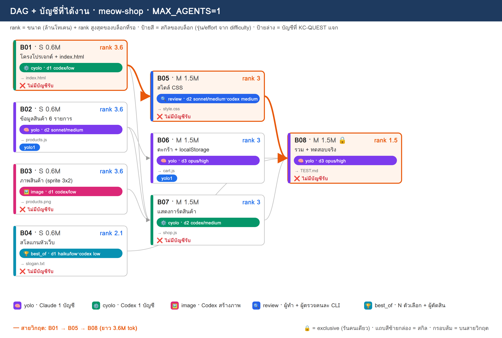
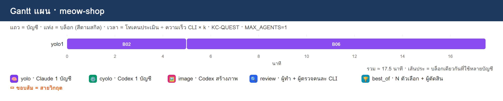

# PLAN · meow-shop

**โจทย์:** เว็บร้านอาหารแมว 'เหมียวช็อป' หน้าเดียว (HTML+CSS+JS ไม่มี server) มีสินค้า 6 รายการพร้อมรูป ตะกร้าสินค้าที่จำได้หลังรีเฟรช (localStorage) และสโลแกนหัวเว็บ พร้อมทดสอบว่าใช้งานได้จริง

วางแผนเมื่อ 11/11/2026 14:20 · MAX_AGENTS 1 · บัญชี yolo1 · ตัวปรับเวลา k (ยังไม่มี calib.json → k=1)

> แผนนี้ยังไม่ได้รันจริง — KC-QUEST เลือกบัญชีจากโควตา แล้วจำลองเวลาตาม dependency

## 1) โควตาของแต่ละบัญชี

| บัญชี | แพลน | ใช้ไป 5 ชม. | ใช้ไปสัปดาห์ | headroom | รีเซ็ต/หมดอายุ (ชม.) | U | slot | ที่มา |
|---|---|---|---|---|---|---|---|---|
| yolo1 | default | 4% | 9% | **91%** | 138.7 | 0.148 | 3 | team.py quota |

## 2) DAG + สกิล + บัญชี

**สายวิกฤต:** B01 → B05 → B08 · ยาว 3.6M tok

## 3) ตารางแจกงาน (เหตุผล KC-QUEST ทุกบล็อก)

| บล็อก | สกิล | ชื่อ | ขนาด · c | รอ | rank | บัญชี (บทบาท) | เริ่ม–จบ (นาที) | เหตุผล KC-QUEST |
|---|---|---|---|---|---|---|---|---|
| B02 | 🧠 yolo | ข้อมูลสินค้า 6 รายการ | S · 0.6 | – | 3.6 | yolo1 (ทำ) | 0.0–5.0 | ทำ: yolo1 35.1 (U=0.148 F=0.002 S=0.944 S=1.0 L=0.0) · 0.60M ≈ 5ชม. 1.56% / สัปดาห์ 0.2% |
| B06 | 🧠 yolo | ตะกร้า + localStorage | M · 1.5 | B02 | 3 | yolo1 (ทำ) | 5.0–17.5 | ทำ: yolo1 32.1 (U=0.148 F=0.005 S=0.905 S=0.833 L=0.0) · 1.50M ≈ 5ชม. 3.9% / สัปดาห์ 0.49% |
| **B01** | ⚙️ cyolo | โครงโปรเจกต์ + index.html | S · 0.6 | – | 3.6 | ❌ | unassigned | ไม่มีบัญชีชุดไหนปิดบล็อกนี้ได้ (แบ่งให้เล็กลง / เพิ่มบัญชี / ลด n) |
| B03 | 🖼️ image | ภาพสินค้า (sprite 3x2) | S · 0.6 | – | 3.6 | ❌ | unassigned | ไม่มีบัญชีชุดไหนปิดบล็อกนี้ได้ (แบ่งให้เล็กลง / เพิ่มบัญชี / ลด n) |
| **B05** | 🔍 review | สไตล์ CSS | M · 1.5 | B01 | 3 | ❌ | blocked | รอบล็อกที่ไม่มีบัญชีรับ |
| B07 | ⚙️ cyolo | แสดงการ์ดสินค้า | M · 1.5 | B01, B02, B03 | 3 | ❌ | blocked | รอบล็อกที่ไม่มีบัญชีรับ |
| B04 | 🏆 best_of | สโลแกนหัวเว็บ | S · 0.6 | – | 2.1 | ❌ | unassigned | ไม่มีบัญชีชุดไหนปิดบล็อกนี้ได้ (แบ่งให้เล็กลง / เพิ่มบัญชี / ลด n) |
| **B08** | 🧠 yolo | รวม + ทดสอบจริง | M · 1.5 | B04, B05, B06, B07 | 1.5 | ❌ | blocked | รอบล็อกที่ไม่มีบัญชีรับ |

## 4) Gantt แผน

## 5) รอบแจกงาน

| นาทีที่ | บล็อกที่เริ่ม |
|---|---|
| 0 | B02→yolo1 |
| 5 | B06→yolo1 |

## 6) สรุป

- บล็อก 8 · แจกได้ 2 · agent พร้อมกันสูงสุด 1/1
- เวลาประมาณ 17.5 นาที (แท่ง Gantt) · ไฟล์ผลของทีม: `/workspace/plans/meow-shop/app/`
- ⚠ บล็อกที่ไม่มีบัญชีรับ: B01, B03, B04, B05, B07, B08 → แบ่งให้เล็กลง / เพิ่มบัญชี / ลด n

ต่อไป: `dagplan.py export meow-shop` → `dagplan.py run meow-shop` → `dagplan.py report meow-shop`
