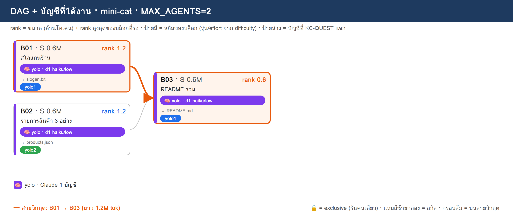
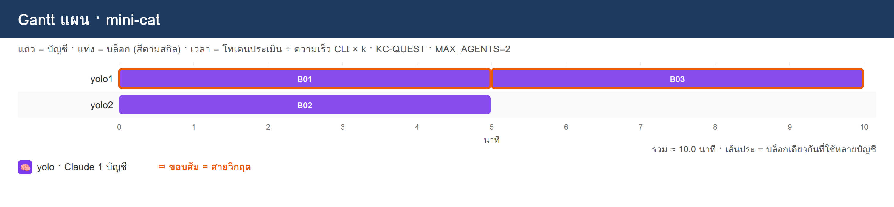

# PLAN · mini-cat

**โจทย์:** ทำไฟล์ข้อความสั้น ๆ 3 ไฟล์สำหรับร้านขนมแมว: สโลแกน รายการสินค้า 3 อย่าง และ README รวมทั้งสอง

วางแผนเมื่อ 11/11/2026 14:59 · MAX_AGENTS 2 · บัญชี yolo1, yolo2 · ตัวปรับเวลา k (ยังไม่มี calib.json → k=1)

> แผนนี้ยังไม่ได้รันจริง — KC-QUEST เลือกบัญชีจากโควตา แล้วจำลองเวลาตาม dependency

## 1) โควตาของแต่ละบัญชี

| บัญชี | แพลน | ใช้ไป 5 ชม. | ใช้ไปสัปดาห์ | headroom | รีเซ็ต/หมดอายุ (ชม.) | U | slot | ที่มา |
|---|---|---|---|---|---|---|---|---|
| yolo1 | default | 28% | 12% | **72%** | 138.0 | 0.148 | 3 | team.py quota |
| yolo2 | default | 28% | 12% | **72%** | 138.0 | 0.148 | 3 | team.py quota |

## 2) DAG + สกิล + บัญชี

**สายวิกฤต:** B01 → B03 · ยาว 1.2M tok

## 3) ตารางแจกงาน (เหตุผล KC-QUEST ทุกบล็อก)

| บล็อก | สกิล | ชื่อ | ขนาด · c | รอ | rank | บัญชี (บทบาท) | เริ่ม–จบ (นาที) | เหตุผล KC-QUEST |
|---|---|---|---|---|---|---|---|---|
| **B01** | 🧠 yolo | สโลแกนร้าน | S · 0.6 | – | 1.2 | yolo1 (ทำ) | 0.0–5.0 | ทำ: yolo1 31.5 (U=0.148 F=0.002 S=0.704 S=1.0 L=0.0) · 0.60M ≈ 5ชม. 1.56% / สัปดาห์ 0.2% · อันดับ 2 yolo2 31.5 |
| B02 | 🧠 yolo | รายการสินค้า 3 อย่าง | S · 0.6 | – | 1.2 | yolo2 (ทำ) | 0.0–5.0 | ทำ: yolo2 31.5 (U=0.148 F=0.002 S=0.704 S=1.0 L=0.0) · 0.60M ≈ 5ชม. 1.56% / สัปดาห์ 0.2% · อันดับ 2 yolo1 28.0 |
| **B03** | 🧠 yolo | README รวม | S · 0.6 | B01, B02 | 0.6 | yolo1 (ทำ) | 5.0–10.0 | ทำ: yolo1 23.8 (U=0.148 F=0.002 S=0.689 S=0.5 L=0.0) · 0.60M ≈ 5ชม. 1.56% / สัปดาห์ 0.2% · อันดับ 2 yolo2 23.8 |

## 4) Gantt แผน

## 5) รอบแจกงาน

| นาทีที่ | บล็อกที่เริ่ม |
|---|---|
| 0 | B01→yolo1, B02→yolo2 |
| 5 | B03→yolo1 |

## 6) สรุป

- บล็อก 3 · แจกได้ 3 · agent พร้อมกันสูงสุด 2/2
- เวลาประมาณ 10.0 นาที (แท่ง Gantt) · ไฟล์ผลของทีม: `/workspace/plans/mini-cat/app/`

ต่อไป: `dagplan.py export mini-cat` → `dagplan.py run mini-cat` → `dagplan.py report mini-cat`
