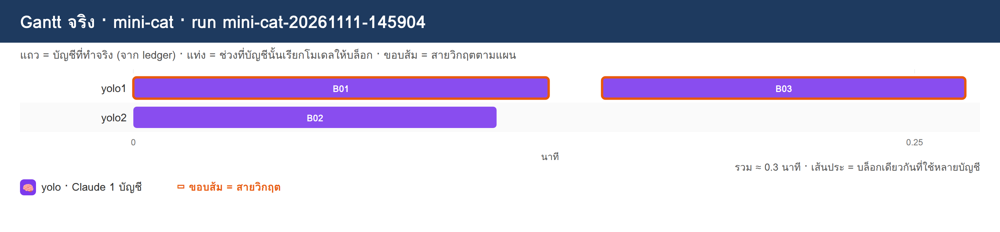
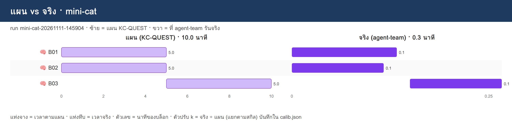

# REPORT · mini-cat

**run:** `mini-cat-20261111-145904` · `/workspace/.agent-team/mini-cat-20261111-145904` · โจทย์: ทำไฟล์ข้อความสั้น ๆ 3 ไฟล์สำหรับร้านขนมแมว: สโลแกน รายการสินค้า 3 อย่าง และ README รวมทั้งสอง

## ตารางบล็อก (แผน vs จริง)

| บล็อก | สกิล | บัญชีแผน | บัญชีจริง | นาทีแผน | นาทีจริง | tokens (ไม่รวม cache read) | ครั้ง | สถานะ | ไฟล์ผล |
|---|---|---|---|---|---|---|---|---|---|
| **B01** | 🧠 yolo | yolo1(ทำ) | yolo1(ทำ) | 5.00 | 0.13 | 13,557 | 1 | ok | ✅ slogan.txt |
| B02 | 🧠 yolo | yolo2(ทำ) | yolo2(ทำ) | 5.00 | 0.12 | 12,906 | 1 | ok | ✅ products.json |
| **B03** | 🧠 yolo | yolo1(ทำ) | yolo1(ทำ) | 5.00 | 0.12 | 11,397 | 1 | ok | ✅ README.md |

- tokens รวมของบล็อก **37,860** = ผลรวมจาก ledger ของ run (3 การเรียก) **37,860** ✅ ตรงกัน
- การเรียกที่ไม่ใช่บล็อก (ตรวจความพร้อม ฯลฯ): 0 ครั้ง · 0 tokens (ไม่นับในตาราง)
- เวลารวม: แผน 10.0 นาที · จริง 0.3 นาที
- บล็อกเสร็จ 3/3

## ภาพ

## ความต่างระหว่างแผนกับของจริง

- บัญชีจริงตรงกับแผนทุกบล็อก
- (export ส่งเป็นฝั่ง yolo/cyolo ไม่ผูกบัญชี เพื่อให้ failover ของ agent-team ทำงาน → agent-team เลือกบัญชีในฝั่งเองตามโหลด/โควตา ดู references/run.md)

## ตัวปรับเวลา k (calib.json)

`/workspace/plans/calib.json`: {"yolo": 0.0245}

k = นาทีจริง ÷ นาทีแผน (ก่อนคูณ k) แยกตามสกิล · `plan` ครั้งถัดไปคูณเวลาแต่ละบล็อกด้วย k ของสกิลนั้น
