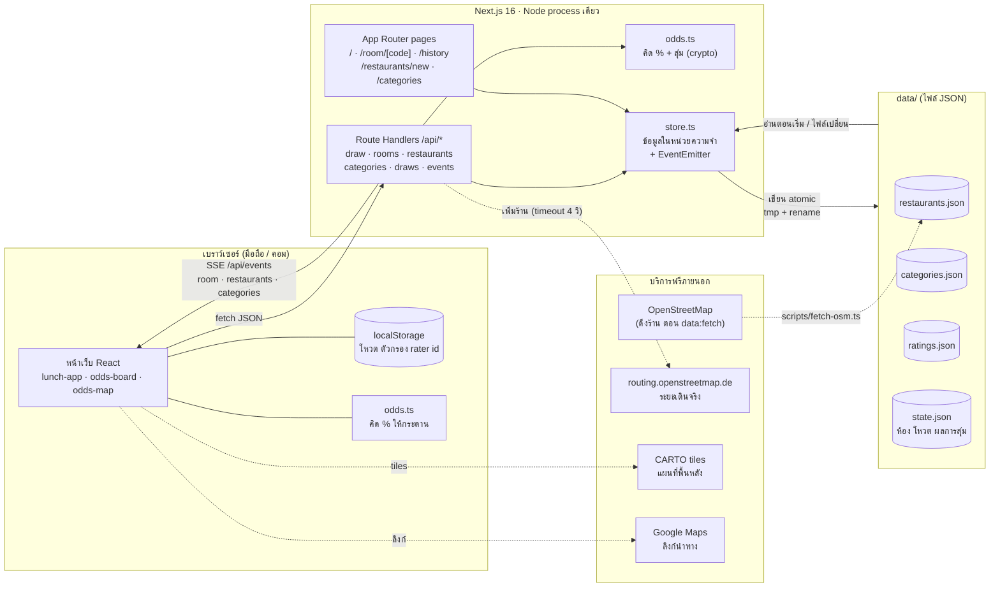
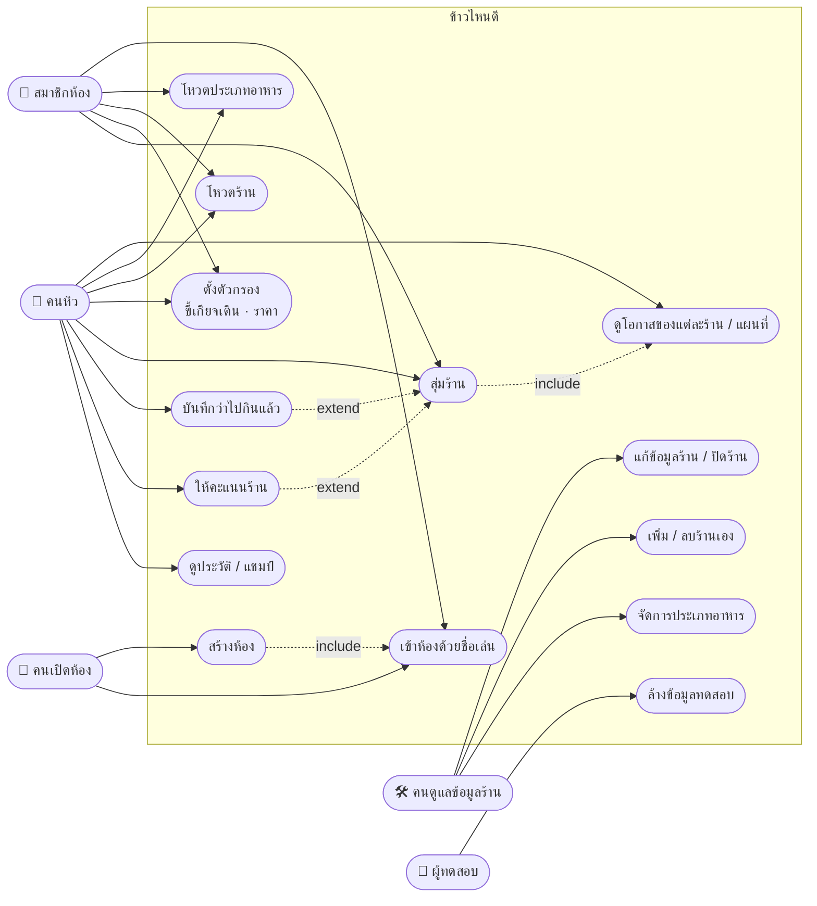
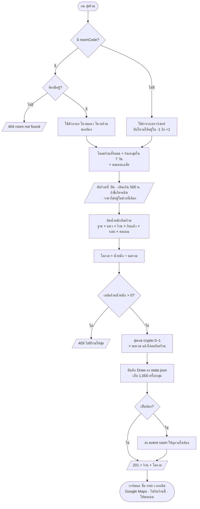
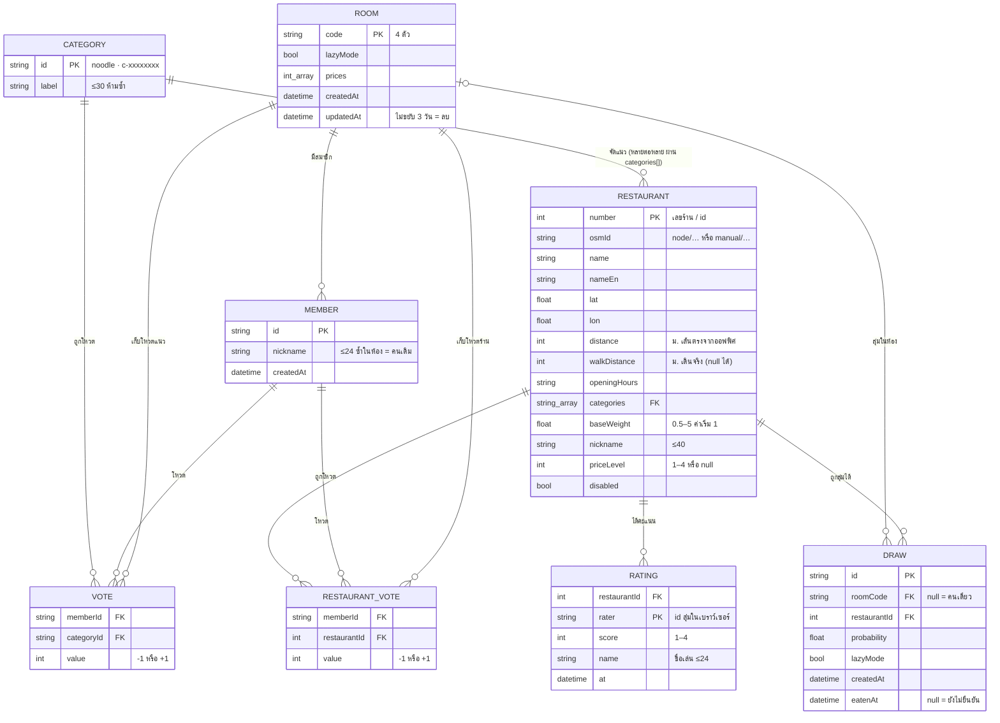
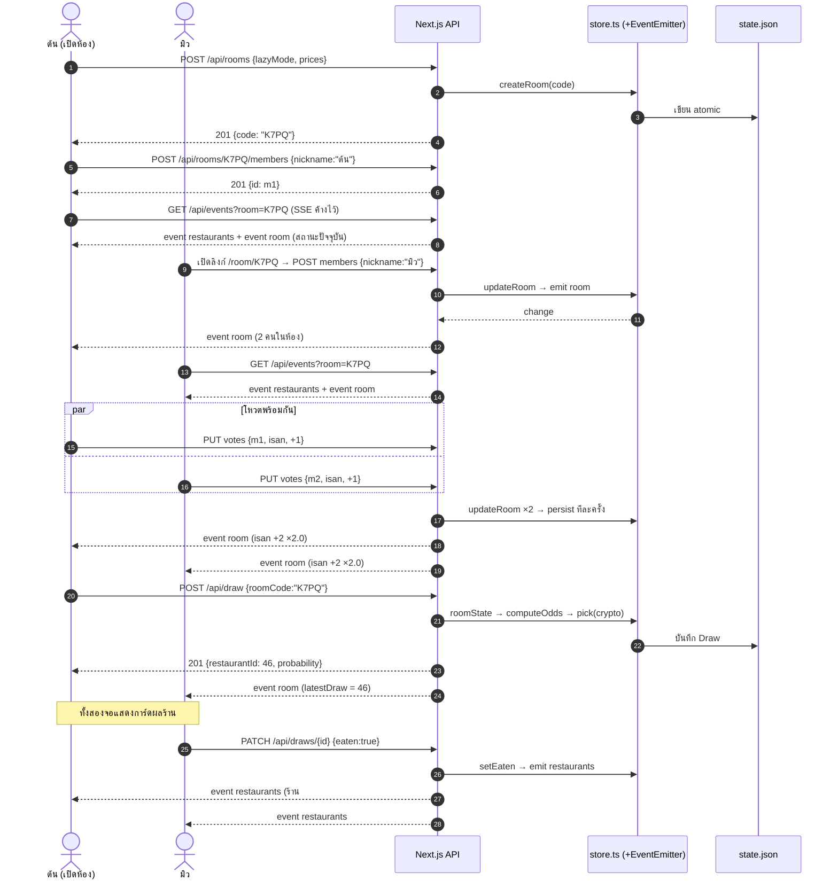

# 🏗️ Design — ข้าวไหนดี (lunch-draw)

ออกแบบจาก `02_REQUIREMENTS.md` มี 5 แผนภาพ ทุกภาพเขียนด้วย Mermaid (GitHub และ VS Code แสดงผลได้เลย) และแยกเป็นไฟล์ไว้ใน `03_design/` ด้วย

| # | แผนภาพ | ตอบคำถาม | ไฟล์ |
|---|---|---|---|
| 1 | Architecture | ระบบมีชิ้นส่วนอะไร คุยกันอย่างไร | `03_design/01-architecture.mmd` |
| 2 | Use Case | ใครทำอะไรกับระบบได้บ้าง | `03_design/02-use-case.mmd` |
| 3 | Flowchart | สุ่มร้านหนึ่งครั้ง ระบบคิดอะไรตามลำดับ | `03_design/03-flowchart-draw.mmd` |
| 4 | ERD | เก็บข้อมูลอะไร เชื่อมกันอย่างไร | `03_design/04-erd.mmd` |
| 5 | Sequence | ในห้อง โหวตและสุ่มร้านแล้วทุกจอเห็นพร้อมกันได้อย่างไร | `03_design/05-sequence-room.mmd` |

---

## 1. Architecture

**การตัดสินใจหลัก**

| เรื่อง | เลือก | เหตุผล | แลกกับ |
|---|---|---|---|
| ที่เก็บข้อมูล | ไฟล์ JSON ใน `data/` | ไม่ต้องดูแล database · commit ข้อมูลร้านลง git ได้ (NFR-07) | ต้องรันเป็น process เดียว · ไม่รองรับ Vercel |
| Realtime | Server-Sent Events | ทางเดียวพอ (server → จอ) · ไม่ต้องติดตั้งอะไรเพิ่ม | ต้องต่อค้างไว้ · ส่ง ping ทุก 20 วิ |
| สูตรโอกาส | ไฟล์เดียว `odds.ts` ใช้ทั้ง client และ server | % ที่เห็นตรงกับที่ใช้สุ่ม (NFR-05) | client ต้องได้ข้อมูลเหมือน server ทุกครั้ง |
| การสุ่ม | ทำที่ server เท่านั้น | ทุกคนในห้องเห็นผลเดียวกัน (NFR-04) | ต้องมีเน็ตถึง server |
| ตัวตน | ไม่มี login · ชื่อเล่นในห้อง · `rater` id สุ่มในเบราว์เซอร์ | ทีมไม่อยากสมัคร (สัมภาษณ์ข้อ 10) | ใครก็แก้ข้อมูลได้ (Q3) |
| แผนที่ | MapLibre + CARTO | ฟรี ไม่ต้องมี key (NFR-13) | ถ้าโหลด tiles ไม่ได้ ต้องยังวางหมุดได้ |

## 2. Use Case

> คนเปิดห้องก็คือสมาชิกคนแรก ทุกคนในห้องมีสิทธิ์เท่ากัน (ใครกดสุ่มร้านก็ได้) และทุกคนเป็น "คนดูแลข้อมูลร้าน" ได้เพราะไม่มี login

## 3. Flowchart — สุ่มร้านหนึ่งครั้ง (`POST /api/draw`)

## 4. ERD — ข้อมูลในไฟล์ JSON

| ไฟล์ | Entity | อยู่ใน git |
|---|---|---|
| `data/restaurants.json` | RESTAURANT | ✅ |
| `data/categories.json` | CATEGORY | ✅ |
| `data/ratings.json` | RATING | ✅ |
| `data/state.json` | ROOM (+ MEMBER, VOTE, RESTAURANT_VOTE ฝังใน room) · DRAW | ❌ gitignore |

ข้อมูลที่ **คำนวณ ไม่ได้เก็บ**: `lastEatenAt` (จาก DRAW), `ratingAvg` / `ratingCount` (จาก RATING), `manual` (จาก `osmId`), จำนวนร้านต่อแนว, คะแนนสุทธิของห้อง

## 5. Sequence — ห้อง: เข้าห้อง โหวต สุ่มร้าน

---

## 6. หน้าจอและ API

| หน้า | ใช้ทำอะไร | API ที่เรียก |
|---|---|---|
| `/` | สุ่มคนเดียว: กระดาน / แผนที่ โหวต ตัวกรอง สุ่มร้าน | `GET /api/restaurants`, `POST /api/draw`, `PATCH /api/draws/:id`, `PUT …/rating`, `PATCH /api/restaurants/:id`, SSE |
| `/room/[code]` | เหมือนหน้าแรก แต่โหวตและตัวกรองเป็นของห้อง | `+ /api/rooms/:code`, `…/members`, `…/votes`, SSE `?room=` |
| `/history` | ผลล่าสุด 30 รายการ + แชมป์ 7 วัน | อ่านจาก store ตอน render |
| `/restaurants/new` | เพิ่มร้านเอง | `POST /api/restaurants` |
| `/categories` | จัดการประเภทอาหาร | `/api/categories`, `/api/categories/:id` |

| Method | Path | สำเร็จ | ผิดพลาด |
|---|---|---|---|
| GET | `/api/restaurants` | 200 `{restaurants, categories}` | |
| POST | `/api/restaurants` | 201 `{number, distance, walkDistance}` | 400 |
| PATCH / DELETE | `/api/restaurants/:id` | 200 `{ok}` | 400 · 404 · 409 (ลบร้าน OSM) |
| PUT | `/api/restaurants/:id/rating` | 200 `{ok}` | 400 · 404 |
| GET / POST | `/api/categories` | 200 / 201 | 400 · 409 |
| PATCH / DELETE | `/api/categories/:id` | 200 | 400 · 404 · 409 |
| POST | `/api/draw` | 201 `{id, restaurantId, probability, …}` | 404 (ห้อง) · 409 (ไม่มีร้าน) |
| PATCH | `/api/draws/:id` | 200 | 400 · 404 |
| POST | `/api/rooms` | 201 `{code}` | |
| GET / PATCH | `/api/rooms/:code` | 200 room state | 400 · 404 |
| POST | `/api/rooms/:code/members` | 201 `{id, nickname}` | 400 · 404 |
| PUT | `/api/rooms/:code/votes` | 200 room state | 400 · 404 |
| GET | `/api/events[?room=]` | 200 `text/event-stream` | |
| POST | `/api/test/reset` | 200 `{restaurants}` | 404 ถ้าไม่ใช่ `LUNCH_TEST=1` |
