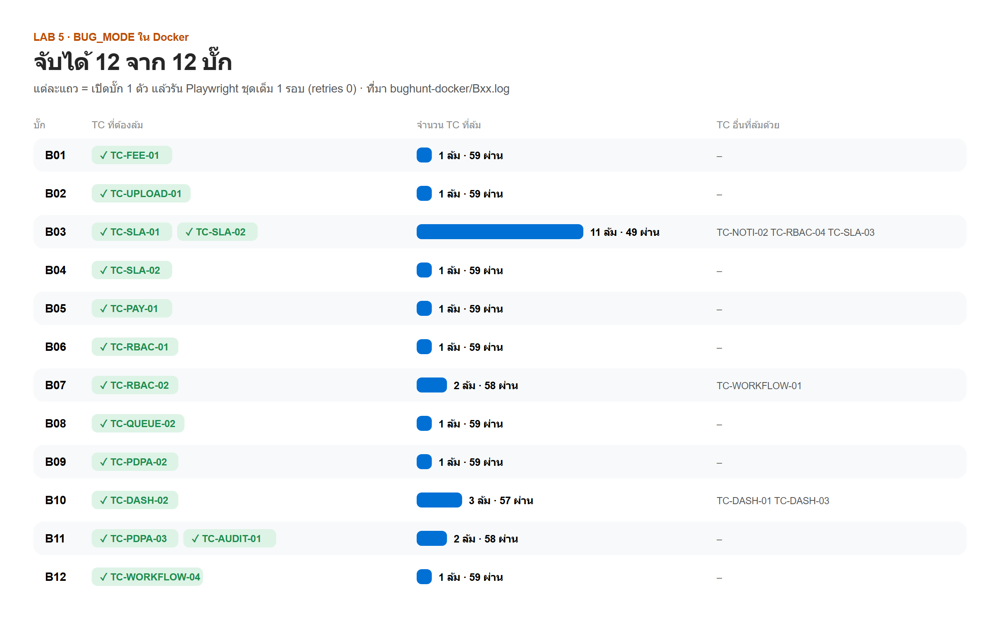

# BUG-HUNT · ผลพิสูจน์ว่า test จับบั๊กได้ (BUG_MODE B01–B12 ใน Docker)

**วิธีรัน** ([`bughunt-docker/run.sh`](bughunt-docker/run.sh)): ทุกบั๊กสร้าง container ใหม่ด้วย `BUG_MODE=Bxx docker compose up -d --force-recreate` (TEST_MODE=1 พอร์ต 3100) แล้วรัน Playwright ชุดเต็ม `npx playwright test --retries=0 --timeout=30000 --grep-invert "NFR-04"` โดยตั้ง `E2E_NOHOOK_URL=http://localhost:3101` (container อีกตัวที่ไม่เปิด TEST_MODE) ให้ TC-NFR-03B รันจริง
- รันครบ 60 test ต่อบั๊ก · ข้าม TC-NFR-04 เพราะต้องตรวจไฟล์ DB บนเครื่อง ซึ่งใน compose ปกติเก็บใน tmpfs ข้างใน container (NFR-04 ไม่เกี่ยวกับบั๊กใน BUGS.md)
- `retries=0` ข้อที่ล้มคือล้มจริงในรอบเดียว ไม่มีการรันซ้ำให้ผ่าน
- log ของแต่ละบั๊กอยู่ที่ `bughunt-docker/Bxx.log` · ค่า BUG_MODE ที่ container เห็นจริงอยู่ที่ `bughunt-docker/Bxx.env` · สรุปเวลาอยู่ที่ `bughunt-docker/summary.txt`

## ตารางผล (รอบ 3 · 2026-11-19)

| บั๊ก | คำอธิบาย | TC ที่ต้องล้ม | ล้มจริง | TC อื่นที่ล้มด้วย | ผล | หลักฐาน (expected → received) |
|---|---|---|---|---|---|---|
| B01 | SV-03 พื้นที่ 101 คิด ฿1,000 | TC-FEE-01 | ✅ | – | 1 ล้ม · 59 ผ่าน | `fee-total` `฿1,010` → `฿1,000` |
| B02 | ไฟล์ 5,242,880 ไบต์ถูกปฏิเสธ | TC-UPLOAD-01 | ✅ | – | 1 ล้ม · 59 ผ่าน | `size 5242880 must be accepted` แต่มี `upload-error` |
| B03 | SLA ไม่ข้ามวันหยุดในตาราง | TC-SLA-01 · TC-SLA-02 | ✅ | TC-SLA-03 · TC-RBAC-04 (BUGS.md อนุญาต) · TC-NOTI-02 | 11 ล้ม · 49 ผ่าน | TC-SLA-01 ล้ม 7 แถว · TC-NOTI-02 `10` → `9` |
| B04 | SLA ไม่หยุดนับตอนรอแก้ไข | TC-SLA-02 | ✅ | – | 1 ล้ม · 59 ผ่าน | `dueAt` `8 ธ.ค. 2569 16:30` → `4 ธ.ค. 2569 16:30` |
| B05 | QR อายุ 15:00 พอดียังจ่ายได้ | TC-PAY-01 | ✅ | – | 1 ล้ม · 59 ผ่าน | `410` → `200` |
| B06 | IDOR: ประชาชนเปิดคำขอคนอื่น | TC-RBAC-01 | ✅ | – | 1 ล้ม · 59 ผ่าน | `404` → `200` |
| B07 | เจ้าหน้าที่อนุมัติ SV-02 เองผ่าน API | TC-RBAC-02 | ✅ | TC-WORKFLOW-01 (BUGS.md อนุญาต) | 2 ล้ม · 58 ผ่าน | `403` → `200` |
| B08 | claim ข้ามการตรวจผู้ถือแล้ว | TC-QUEUE-02 | ✅ | – | 1 ล้ม · 59 ผ่าน | ผู้แพ้ที่เห็น `action-error` `1` → `0` |
| B09 | API คิวส่งเลขบัตรเต็ม | TC-PDPA-02 | ✅ | – | 1 ล้ม · 59 ผ่าน | พบ `"idNo":"1101700123456"` ใน `/api/officer/queue` |
| B10 | ทันกำหนด % หารด้วย "รับเรื่อง" | TC-DASH-02 | ✅ | TC-DASH-01 · TC-DASH-03 (BUGS.md อนุญาต) | 3 ล้ม · 57 ผ่าน | `–` → `0.0%` |
| B11 | unmask ไม่บันทึก Audit | TC-PDPA-03 · TC-AUDIT-01 | ✅ | – | 2 ล้ม · 58 ผ่าน | จำนวน Audit `16` → `15` |
| B12 | ตีกลับครั้งที่ 3 ได้ | TC-WORKFLOW-04 | ✅ | – | 1 ล้ม · 59 ผ่าน | `409` → `200` |

**จับได้ 12 จาก 12** ทุก TC ที่ต้องล้มล้มจริง ไม่มี TC ที่ควรล้มแต่ผ่าน และไม่มี test ที่ล้มแบบสุ่มปนในรอบนี้

**ข้อสังเกต:** B03 ทำให้ TC-NOTI-02 ล้มเพิ่ม ซึ่งไม่อยู่ในรายการ "อาจล้มด้วย" ของ BUGS.md สาเหตุคือระดับ "ใกล้ครบกำหนด" ที่ใช้ส่งแจ้งเตือน คำนวณด้วยฟังก์ชันนับวันทำการตัวเดียวกับ SLA จึงเป็นผลข้างเคียงที่อธิบายได้ ควรแจ้งผู้สอนให้เพิ่มในรายการ

## ทดสอบรวมบั๊ก (รันใน Docker รอบเดียวกัน)

| BUG_MODE | ผล | TC ที่ล้ม |
|---|---|---|
| `B03,B07` | 13 ล้ม · 47 ผ่าน | TC-SLA-01 (7 แถว) · TC-SLA-02 · TC-SLA-03 · TC-RBAC-04 · TC-NOTI-02 · TC-RBAC-02 · TC-WORKFLOW-01 = ผลรวมของ B03 (11) + B07 (2) พอดี |
| `B01,B05,B09` | 3 ล้ม · 57 ผ่าน | TC-FEE-01 · TC-PAY-01 · TC-PDPA-02 = ผลรวมพอดี |

## ประวัติการรัน

| รอบ | สิ่งที่เปลี่ยน | ผล |
|---|---|---|
| 1 ([`run1/`](bughunt-docker/run1)) | รันครั้งแรกใน Docker | จับได้ 12/12 แต่ TC-NFR-03 ล้มแบบสุ่มปนใน 7 จาก 12 รอบ |
| 2 ([`run2/`](bughunt-docker/run2)) | แก้ TC-NFR-03 ให้รอหน้าโหลดนิ่งก่อนจับเวลา | จับได้ 12/12 · NFR-03 ล้มแบบสุ่มเหลือ 1 รอบ (B08) |
| 3 (ไฟล์ในโฟลเดอร์นี้) | แก้ต้นเหตุ: ออกจากหน้าเดิม (`about:blank`) ก่อนล้าง cookie และ helper `gotoLogin` | จับได้ 12/12 · ไม่มีข้อที่ล้มแบบสุ่ม |

**ต้นเหตุที่ NFR-01/NFR-03 ล้มแบบสุ่ม (test ผิด ไม่ใช่เว็บผิด):** test ล้าง cookie ทั้งที่หน้าเดิมยังเปิดอยู่ สคริปต์ของหน้าเดิมเรียก API แล้วได้ 401 จึงสั่ง `location.href='/login'` ชนกับ `page.goto('/login')` ของ test (`net::ERR_ABORTED`) แก้ที่ลำดับขั้นของ test เท่านั้น ไม่ได้เปลี่ยนค่าที่ตรวจ

## สิ่งที่แก้ใน app สำหรับ BUG_MODE

ทุกอย่างทำงานเฉพาะเมื่อ `BUG_MODE` มีรหัสนั้น ถ้าไม่ตั้งค่า พฤติกรรมเหมือนเดิม
- `app/src/store.js` `resubmitCase`: B04 (ไม่เลื่อน `dueAt` ตามวันทำการที่รอแก้)
- `app/src/store.js` `queueItem`: B09 (ใส่ `idNo` เต็มใน response ของคิว หน้าจอยังใช้ `idMasked`)
- `app/src/routes.js` `GET /api/cases/:no`: B06 (ประชาชนข้ามการตรวจเจ้าของ)
- B01 B02 B03 B05 B07 B08 B10 B11 B12 มีจุดเปิดบั๊กอยู่แล้ว ผลรันด้านบนยืนยันว่าทำงานตรงตาม BUGS.md
