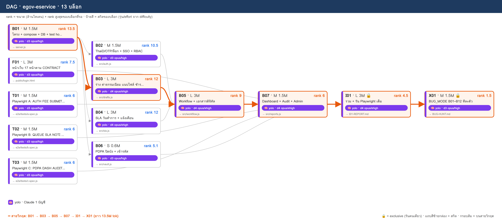
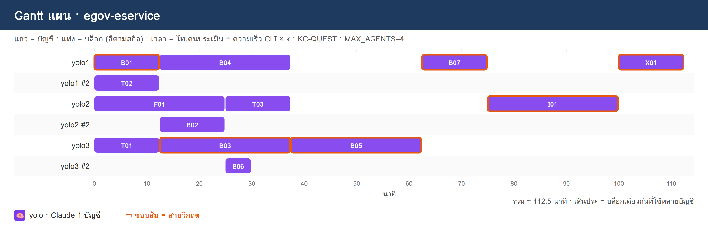

# PLAN · egov-eservice

**โจทย์:** สร้างเว็บ e-Service กลาง เทศบาลนครตัวอย่าง ตามชุดโจทย์ /workspace/egov-brief (README REQUIREMENTS CONTRACT TEST-DATA DECISIONS) รันด้วย docker compose คำสั่งเดียว รองรับ TEST_MODE=1 และ BUG_MODE ตาม BUGS.md พร้อมชุด Playwright ครบทุก TC ใน TEST-PLAN.md

วางแผนเมื่อ 19/11/2026 22:22 · MAX_AGENTS 4 · บัญชี yolo1, yolo2, yolo3 · ตัวปรับเวลา k (ยังไม่มี calib.json → k=1)

> แผนนี้ยังไม่ได้รันจริง — KC-QUEST เลือกบัญชีจากโควตา แล้วจำลองเวลาตาม dependency

## 1) โควตาของแต่ละบัญชี

| บัญชี | แพลน | ใช้ไป 5 ชม. | ใช้ไปสัปดาห์ | headroom | รีเซ็ต/หมดอายุ (ชม.) | U | slot | ที่มา |
|---|---|---|---|---|---|---|---|---|
| yolo1 | default | 0% | 38% | **62%** | 106.6 | 0.184 | 3 | team.py quota |
| yolo2 | default | 0% | 38% | **62%** | 106.6 | 0.184 | 3 | team.py quota |
| yolo3 | default | 0% | 38% | **62%** | 106.6 | 0.184 | 3 | team.py quota |

## 2) DAG + สกิล + บัญชี

**สายวิกฤต:** B01 → B03 → B05 → B07 → I01 → X01 · ยาว 13.5M tok

## 3) ตารางแจกงาน (เหตุผล KC-QUEST ทุกบล็อก)

| บล็อก | สกิล | ชื่อ | ขนาด · c | รอ | rank | บัญชี (บทบาท) | เริ่ม–จบ (นาที) | เหตุผล KC-QUEST |
|---|---|---|---|---|---|---|---|---|
| **B01** | 🧠 yolo | โครง + compose + DB + test hook | M · 1.5 | – | 13.5 | yolo1 (ทำ) | 0.0–12.5 | ทำ: yolo1 36.9 (U=0.184 F=0.008 S=0.961 S=1.0 L=0.0) · 1.50M ≈ 5ชม. 3.9% / สัปดาห์ 0.49% · อันดับ 2 yolo2 36.9 |
| F01 | 🧠 yolo | หน้าเว็บ 17 หน้าตาม CONTRACT | L · 3 | – | 7.5 | yolo2 (ทำ) | 0.0–25.0 | ทำ: yolo2 29.8 (U=0.184 F=0.016 S=0.922 S=0.556 L=0.0) · 3.00M ≈ 5ชม. 7.8% / สัปดาห์ 0.98% · อันดับ 2 yolo3 29.8 |
| T01 | 🧠 yolo | Playwright A: AUTH FEE SUBMIT UPLOAD PAY | M · 1.5 | – | 6 | yolo3 (ทำ) | 0.0–12.5 | ทำ: yolo3 28.6 (U=0.184 F=0.008 S=0.961 S=0.444 L=0.0) · 1.50M ≈ 5ชม. 3.9% / สัปดาห์ 0.49% · อันดับ 2 yolo1 24.7 |
| T02 | 🧠 yolo | Playwright B: QUEUE SLA NOTI WORKFLOW DOC | M · 1.5 | – | 6 | yolo1 (ทำ) | 0.0–12.5 | ทำ: yolo1 24.7 (U=0.184 F=0.008 S=0.922 S=0.444 L=0.333) · 1.50M ≈ 5ชม. 3.9% / สัปดาห์ 0.49% · อันดับ 2 yolo3 24.7 |
| **B03** | 🧠 yolo | ร่าง ค่าธรรมเนียม แนบไฟล์ ชำระเงิน | L · 3 | B01 | 12 | yolo3 (ทำ) | 12.5–37.5 | ทำ: yolo3 34.3 (U=0.184 F=0.016 S=0.883 S=0.889 L=0.0) · 3.00M ≈ 5ชม. 7.8% / สัปดาห์ 0.98% · อันดับ 2 yolo1 33.7 |
| B04 | 🧠 yolo | SLA วันทำการ + แจ้งเตือน | L · 3 | B01 | 12 | yolo1 (ทำ) | 12.5–37.5 | ทำ: yolo1 33.7 (U=0.184 F=0.016 S=0.844 S=0.889 L=0.0) · 3.00M ≈ 5ชม. 7.8% / สัปดาห์ 0.98% · อันดับ 2 yolo2 30.3 |
| B02 | 🧠 yolo | ThaiD/OTP/ล็อก + SSO + RBAC | M · 1.5 | B01 | 10.5 | yolo2 (ทำ) | 12.5–25.0 | ทำ: yolo2 29.1 (U=0.184 F=0.008 S=0.883 S=0.778 L=0.333) · 1.50M ≈ 5ชม. 3.9% / สัปดาห์ 0.49% · อันดับ 2 yolo3 28.5 |
| T03 | 🧠 yolo | Playwright C: PDPA DASH AUDIT RBAC NFR | M · 1.5 | – | 6 | yolo2 (ทำ) | 25.0–37.5 | ทำ: yolo2 26.8 (U=0.184 F=0.008 S=0.844 S=0.444 L=0.0) · 1.50M ≈ 5ชม. 3.9% / สัปดาห์ 0.49% · อันดับ 2 yolo3 23.5 |
| B06 | 🧠 yolo | PDPA ปิดบัง + เข้ารหัส | S · 0.6 | B01 | 5.1 | yolo3 (ทำ) | 25.0–30.0 | ทำ: yolo3 22.8 (U=0.184 F=0.003 S=0.867 S=0.378 L=0.333) · 0.60M ≈ 5ชม. 1.56% / สัปดาห์ 0.2% · อันดับ 2 yolo1 22.2 |
| **B05** | 🧠 yolo | Workflow + เอกสารดิจิทัล | L · 3 | B02, B03, B04 | 9 | yolo3 (ทำ) | 37.5–62.5 | ทำ: yolo3 29.5 (U=0.184 F=0.016 S=0.789 S=0.667 L=0.0) · 3.00M ≈ 5ชม. 7.8% / สัปดาห์ 0.98% · อันดับ 2 yolo1 29.2 |
| **B07** | 🧠 yolo | Dashboard + Audit + Admin | M · 1.5 | B05 | 6 | yolo1 (ทำ) | 62.5–75.0 | ทำ: yolo1 26.3 (U=0.184 F=0.008 S=0.805 S=0.444 L=0.0) · 1.50M ≈ 5ชม. 3.9% / สัปดาห์ 0.49% · อันดับ 2 yolo2 26.3 |
| **I01** | 🧠 yolo | รวม + รัน Playwright เต็ม | L · 3 | B05, B06, B07, F01, T01, T02, T03 | 4.5 | yolo2 (ทำ) | 75.0–100.0 | ทำ: yolo2 24.2 (U=0.184 F=0.016 S=0.766 S=0.333 L=0.0) · 3.00M ≈ 5ชม. 7.8% / สัปดาห์ 0.98% · อันดับ 2 yolo1 23.6 |
| **X01** | 🧠 yolo | BUG_MODE B01–B12 ทีละตัว | M · 1.5 | I01 | 1.5 | yolo1 (ทำ) | 100.0–112.5 | ทำ: yolo1 20.7 (U=0.184 F=0.008 S=0.766 S=0.111 L=0.0) · 1.50M ≈ 5ชม. 3.9% / สัปดาห์ 0.49% · อันดับ 2 yolo3 20.4 |

## 4) Gantt แผน

## 5) รอบแจกงาน

| นาทีที่ | บล็อกที่เริ่ม |
|---|---|
| 0 | B01→yolo1, F01→yolo2, T01→yolo3, T02→yolo1 |
| 12.5 | B03→yolo3, B04→yolo1, B02→yolo2 |
| 25 | T03→yolo2, B06→yolo3 |
| 37.5 | B05→yolo3 |
| 62.5 | B07→yolo1 |
| 75 | I01→yolo2 |
| 100 | X01→yolo1 |

## 6) สรุป

- บล็อก 13 · แจกได้ 13 · agent พร้อมกันสูงสุด 4/4
- เวลาประมาณ 112.5 นาที (แท่ง Gantt) · ไฟล์ผลของทีม: `/workspace/plans/egov-eservice/app/`

ต่อไป: `dagplan.py export egov-eservice` → `dagplan.py run egov-eservice` → `dagplan.py report egov-eservice`
