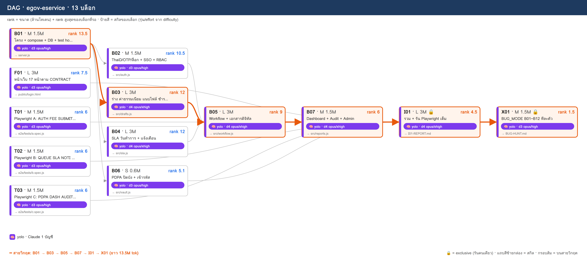
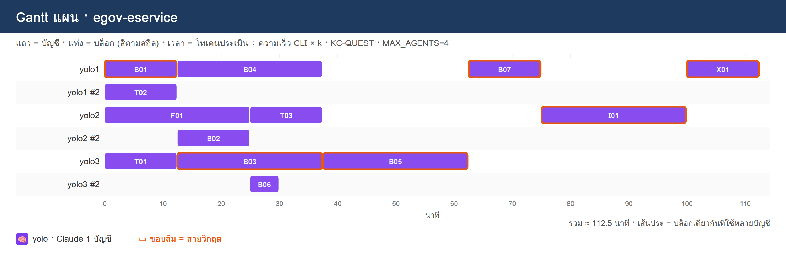
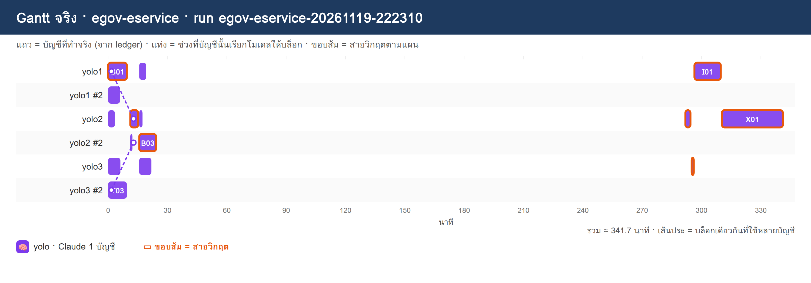
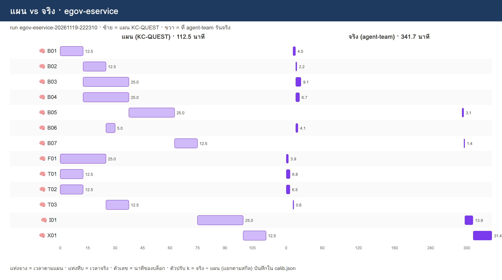

# egov-eservice · LAB 2–5 ด้วยทีมเอเจนต์ (dag-planner + agent-team)

ผลจากการรันพรอมต์ขั้น 0–3 ของ `week2_student/PROMPTS.md` ใน container `multi-account` (image `multi-account:1.0` build จาก `_souce_turtorial/01_week02/03_MultiAccount_Container/_solution`) ด้วยบัญชี Claude 3 บัญชี (yolo1–yolo3) ที่ล็อกอินโดยผู้ใช้ ทุกตัวเลขในหน้านี้มาจาก `PLAN.md` `REPORT.md` `run.json` และการรันซ้ำบนเครื่อง

## LAB 2 · แผน (dag-planner `dag` + `plan` จากโควตาจริง)





- 13 บล็อก · agent พร้อมกันสูงสุด 4 · แผน 112.5 นาที · สายวิกฤต **B01 → B03 → B05 → B07 → I01 → X01** (งานกฎตัวเลขใหญ่ B03/B05 และทุกอย่างไปรวมที่ I01)
- บล็อก Playwright T01–T03 ไม่มีลูกศรจากบล็อกเว็บ (อ่านได้แค่ TEST-PLAN CONTRACT TEST-DATA) · I01 และ X01 เป็น exclusive 🔒 · output ไม่ซ้ำกัน · ทุกบล็อกมีบัญชีรับ (ตรวจตามตารางขั้น 2 แล้ว)
- ต่างจากพรอมต์: บล็อกกฎตัวเลขใช้ `yolo` ความยาก 4 แทน `review` เพราะ `review` ต้องมีผู้ตรวจอีกฝั่ง (Codex) และไม่มีบัญชี Codex ที่ล็อกอิน
- ไฟล์: [blocks.json](blocks.json) · [PLAN.md](PLAN.md)

## LAB 3 · รันแผนจริง (dag-planner `export` + `run` + `report`)





**เสร็จ 13/13 บล็อก · tokens รวม 2,417,922 (ตรงกับ ledger ของ run)** · รายละเอียด: [REPORT.md](REPORT.md)

| บล็อก | ชื่อ | บัญชีจริง | รุ่น/effort | นาทีแผน | นาทีจริง | สถานะ |
|---|---|---|---|---|---|---|
| B01 | โครง + compose + DB + hook | yolo1 → yolo2 | opus/high | 12.5 | 4.5 | ok (ครั้งที่ 2) |
| B02 | ThaiD/OTP/ล็อก + SSO + RBAC | yolo2 | opus/high | 12.5 | 2.2 | ok |
| B03 | ร่าง ค่าธรรมเนียม ไฟล์ ชำระเงิน | yolo2 | opus/xhigh | 25.0 | 9.1 | ok |
| B04 | SLA วันทำการ + แจ้งเตือน | yolo3 | opus/xhigh | 25.0 | 6.7 | ok |
| B05 | Workflow + เอกสาร | yolo2 | sonnet/low | 25.0 | 3.1 | ok |
| B06 | PDPA | yolo1 | opus/high | 5.0 | 4.1 | ok |
| B07 | Dashboard + Audit + Admin | yolo3 | sonnet/low | 12.5 | 1.4 | ok |
| F01 | หน้าเว็บ | yolo2 | opus/high | 25.0 | 3.9 | ok (ส่งมาแค่ `login.html` · I01 สร้างอีก 16 หน้า) |
| T01–T03 | Playwright A/B/C | yolo3 · yolo1 · yolo3→yolo2 | opus/high | 12.5 ต่อบล็อก | 6.8 · 6.6 · 0.6 | ok (T03 ครั้งที่ 2) |
| I01 🔒 | รวม + รัน Playwright เต็ม | yolo1 | sonnet/low | 25.0 | 13.9 | ok |
| X01 🔒 | BUG_MODE B01–B12 | yolo2 | sonnet/low | 12.5 | 31.4 | ok |

**เวลารวม:** แผน 112.5 นาที · จริง 341.7 นาที ตามนาฬิกา ซึ่งรวมช่วงรอโควตา ~4 ชม. 20 นาที (22:53–03:15) ระหว่างที่ทีมไม่ได้ทำงาน · ตัวปรับเวลาใหม่ k (yolo) = 0.43 บันทึกใน `calib.json` ของ container

**สิ่งที่เกิดระหว่างรัน (ตามลำดับ):**
1. รอบแรก B01 และ T03 ล้มด้วย `timeout after 600s` (ค่าเริ่มต้นของ agent-team) บล็อกที่รอ B01 ถูกบล็อก → ตั้ง `timeout` ต่อบล็อกตามขนาด (S 1200 · M 2400 · L 3600 · I01/X01 5400 วินาที) แล้ว `team.py run graph.json --resume` (บล็อกที่สำเร็จไม่รันซ้ำ)
2. yolo1–yolo3 ใช้โควตาก้อนเดียวกัน (session % และเวลารีเซ็ตเท่ากัน) ถึง 80–97% agent-team หยุดส่งงานใหม่ B05 B07 I01 X01 ค้าง
3. หลังโควตารีเซ็ต 03:10 resume อัตโนมัติ 03:15 ด้วย `--set <node>.model=sonnet --set <node>.effort=low` สำหรับ 4 บล็อกที่เหลือ → จบครบ โควตา session หลังจบ 17%

## LAB 4 · ผลรันซ้ำบนเครื่อง (ยืนยันว่า "AI บอกว่าทำแล้ว" เป็นจริง)

```bash
cd app
TEST_MODE=1 PORT=3200 BASE_URL=http://localhost:3200 docker compose -p egov-agent up -d --build
cd e2e && npm ci && npx playwright install chromium
BASE_URL=http://localhost:3200 DB_DUMP_CMD='docker exec egov-agent-web-1 sh -c "cat /data/app.db*"' npx playwright test
```

**79 passed (1.1m) ในรอบเดียว** (79 test ครอบ 51 TC) · บันทึกใน [host-verify.txt](host-verify.txt)
- รอบแรกบนเครื่องล้ม 77 ข้อเพราะยังไม่ได้ติดตั้ง Chromium ของ Playwright เวอร์ชันนี้ (สภาพแวดล้อม) และ NFR-04 ล้มเพราะ `DB_DUMP_CMD` ใส่ single quote ซึ่ง cmd.exe ของ Windows ไม่รองรับ (สภาพแวดล้อม) แก้คำสั่งรันแล้วผ่าน ไม่ได้แก้โค้ดหรือ test
- ข้อที่ล้มระหว่าง I01 และการจำแนก (เว็บผิดทั้งหมด): [app/I01-REPORT.md](app/I01-REPORT.md)

## LAB 5 · BUG_MODE

X01 รายงาน **จับได้ 12/12** และรวมบั๊ก `B03,B07` · `B01,B05,B09` ได้ผลรวมพอดี → [app/BUG-HUNT.md](app/BUG-HUNT.md) · log ดิบ `app/e2e/bug-results/`
รันซ้ำบนเครื่องสองตัว: B01 → TC-FEE-01 ล้ม (1 failed · 78 passed) · B12 → TC-WORKFLOW-04 ส่วน A, B ล้ม (2 failed · 77 passed) ตรงกับ X01

## เปิดเว็บ

```bash
cd app && TEST_MODE=1 docker compose up -d --build   # http://localhost:3100
```

บัญชีทดสอบตาม TEST-DATA: ประชาชน `1101700123456` OTP `123456` · เจ้าหน้าที่ `off.reg1` / `head1` / `exec1` / `audit1` / `admin1` รหัสผ่าน `Test@1234`
