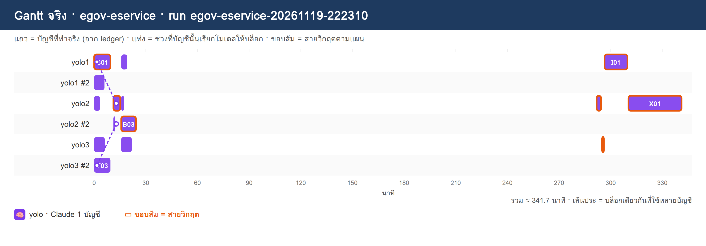
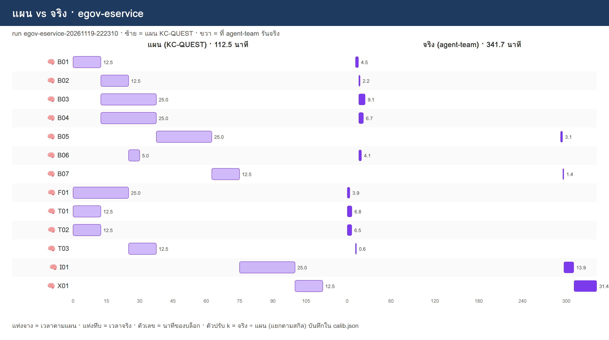

# REPORT · egov-eservice

**run:** `egov-eservice-20261119-222310` · `/workspace/.agent-team/egov-eservice-20261119-222310` · โจทย์: สร้างเว็บ e-Service กลาง เทศบาลนครตัวอย่าง ตามชุดโจทย์ /workspace/egov-brief (README REQUIREMENTS CONTRACT TEST-DATA DECISIONS) รันด้วย docker compose คำสั่งเดียว รองรับ TEST_MODE=1 และ BUG_MODE ตาม BUGS.md พร้อมชุด Playwright ครบทุก TC ใน TEST-PLAN.md

## ตารางบล็อก (แผน vs จริง)

| บล็อก | สกิล | บัญชีแผน | บัญชีจริง | นาทีแผน | นาทีจริง | tokens (ไม่รวม cache read) | ครั้ง | สถานะ | ไฟล์ผล |
|---|---|---|---|---|---|---|---|---|---|
| **B01** | 🧠 yolo | yolo1(ทำ) | yolo1(ทำ), yolo2(ทำ) | 12.50 | 4.52 | 508,172 | 2 | ok | ✅ server.js |
| B02 | 🧠 yolo | yolo2(ทำ) | yolo2(ทำ) | 12.50 | 2.20 | 112,391 | 1 | ok | ✅ src/auth.js |
| **B03** | 🧠 yolo | yolo3(ทำ) | yolo2(ทำ) | 25.00 | 9.10 | 245,265 | 1 | ok | ✅ src/drafts.js |
| B04 | 🧠 yolo | yolo1(ทำ) | yolo3(ทำ) | 25.00 | 6.73 | 192,439 | 1 | ok | ✅ src/sla.js |
| **B05** | 🧠 yolo | yolo3(ทำ) | yolo2(ทำ) | 25.00 | 3.13 | 157,282 | 1 | ok | ✅ src/workflow.js |
| B06 | 🧠 yolo | yolo3(ทำ) | yolo1(ทำ) | 5.00 | 4.07 | 129,568 | 1 | ok | ✅ src/vault.js |
| **B07** | 🧠 yolo | yolo1(ทำ) | yolo3(ทำ) | 12.50 | 1.42 | 68,487 | 1 | ok | ✅ src/reports.js |
| F01 | 🧠 yolo | yolo2(ทำ) | yolo2(ทำ) | 25.00 | 3.93 | 54,471 | 1 | ok | ✅ public/login.html |
| T01 | 🧠 yolo | yolo3(ทำ) | yolo3(ทำ) | 12.50 | 6.75 | 189,522 | 1 | ok | ✅ e2e/tests/a.spec.js |
| T02 | 🧠 yolo | yolo1(ทำ) | yolo1(ทำ) | 12.50 | 6.55 | 193,089 | 1 | ok | ✅ e2e/tests/b.spec.js |
| T03 | 🧠 yolo | yolo2(ทำ) | yolo3(ทำ), yolo2(ทำ) | 12.50 | 0.62 | 349,912 | 2 | ok | ✅ e2e/tests/c.spec.js |
| **I01** | 🧠 yolo | yolo2(ทำ) | yolo1(ทำ) | 25.00 | 13.87 | 176,353 | 1 | ok | ✅ I01-REPORT.md |
| **X01** | 🧠 yolo | yolo1(ทำ) | yolo2(ทำ) | 12.50 | 31.38 | 40,971 | 1 | ok | ✅ BUG-HUNT.md |

- tokens รวมของบล็อก **2,417,922** = ผลรวมจาก ledger ของ run (15 การเรียก) **2,417,922** ✅ ตรงกัน
- การเรียกที่ไม่ใช่บล็อก (ตรวจความพร้อม ฯลฯ): 0 ครั้ง · 0 tokens (ไม่นับในตาราง)
- เวลารวม: แผน 112.5 นาที · จริง 341.7 นาที
- บล็อกเสร็จ 13/13

## ภาพ

## ความต่างระหว่างแผนกับของจริง

- B01: แผน yolo1(ทำ) → จริง yolo1(ทำ), yolo2(ทำ)
- B03: แผน yolo3(ทำ) → จริง yolo2(ทำ)
- B04: แผน yolo1(ทำ) → จริง yolo3(ทำ)
- B05: แผน yolo3(ทำ) → จริง yolo2(ทำ)
- B06: แผน yolo3(ทำ) → จริง yolo1(ทำ)
- B07: แผน yolo1(ทำ) → จริง yolo3(ทำ)
- T03: แผน yolo2(ทำ) → จริง yolo3(ทำ), yolo2(ทำ)
- I01: แผน yolo2(ทำ) → จริง yolo1(ทำ)
- X01: แผน yolo1(ทำ) → จริง yolo2(ทำ)
- (export ส่งเป็นฝั่ง yolo/cyolo ไม่ผูกบัญชี เพื่อให้ failover ของ agent-team ทำงาน → agent-team เลือกบัญชีในฝั่งเองตามโหลด/โควตา ดู references/run.md)
- event worker_stop:  → โควตา 82% ≥ เกณฑ์ 80%
- event worker_switch: I01 yolo2→yolo1 บัญชี yolo2 หยุดรับงาน: โควตา 82% ≥ เกณฑ์ 80%
- event worker_stop:  → โควตา 87% ≥ เกณฑ์ 80%
- event worker_switch: B07 yolo1→yolo3 บัญชี yolo1 หยุดรับงาน: โควตา 87% ≥ เกณฑ์ 80%
- event worker_switch: I01 yolo1→yolo3 บัญชี yolo1 หยุดรับงาน: โควตา 87% ≥ เกณฑ์ 80%
- event worker_stop:  → โควตา 97% ≥ เกณฑ์ 80%
- event worker_switch: B05 yolo3→ บัญชี yolo3 หยุดรับงาน: โควตา 97% ≥ เกณฑ์ 80%
- event worker_switch: B07 yolo3→ บัญชี yolo3 หยุดรับงาน: โควตา 97% ≥ เกณฑ์ 80%
- event worker_switch: I01 yolo3→ บัญชี yolo3 หยุดรับงาน: โควตา 97% ≥ เกณฑ์ 80%
- event worker_switch: X01 yolo3→ บัญชี yolo3 หยุดรับงาน: โควตา 97% ≥ เกณฑ์ 80%

## ตัวปรับเวลา k (calib.json)

`/workspace/plans/calib.json`: {"yolo": 0.4334}

k = นาทีจริง ÷ นาทีแผน (ก่อนคูณ k) แยกตามสกิล · `plan` ครั้งถัดไปคูณเวลาแต่ละบล็อกด้วย k ของสกิลนั้น
