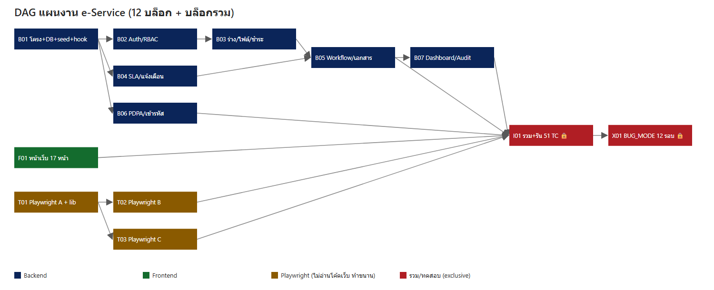
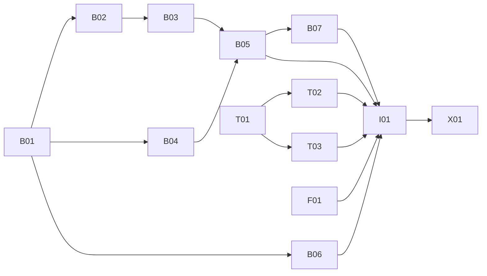

# แผนงาน e-Service กลาง (DAG)

แตกงานเป็น 12 บล็อก ใครสร้างอะไร ก่อน–หลัง และไฟล์ไหนห้ามชนกัน
(แผนนี้เขียนเป็นไฟล์เอง เพราะเครื่องนี้ไม่มีสกิล `dag-planner`/`agent-team` และ container `multi-account`)

## บล็อกงาน

| บล็อก | งาน | ผู้ทำ | เขียนไฟล์ | ต้องรอ | ความยาก |
|---|---|---|---|---|---|
| B01 | โครงโปรเจกต์ + Docker + SQLite + seed + นาฬิกาจำลอง + test hook | backend | `app/server.js`, `app/src/db.js`, `seed.js`, `clock.js`, `Dockerfile`, `docker-compose.yml` | – | กลาง |
| B02 | ยืนยันตัวตน ThaiD/OTP/ล็อก + SSO เจ้าหน้าที่ + session + RBAC | backend | `app/src/auth.js` | B01 | กลาง |
| B03 | ร่าง ค่าธรรมเนียม แนบไฟล์ (magic bytes) ชำระ QR เลขคำขอ | backend | `app/src/drafts.js`, `files.js`, `payments.js` | B01 B02 | สูง |
| B04 | SLA วันทำการ ระดับเตือน แจ้งเตือน ยกเลิกอัตโนมัติ | backend | `app/src/sla.js`, `notify.js` | B01 | สูง (กฎตัวเลขเยอะ) |
| B05 | Workflow: รับเรื่อง ตีกลับ ส่งต่อ อนุมัติ ออกเอกสาร ลายเซ็น PDF /verify | backend | `app/src/cases.js`, `documents.js` | B03 B04 | สูง |
| B06 | PDPA: ปิดบังเลขบัตร unmask เข้ารหัสที่เก็บ | backend | `app/src/crypto.js`, `mask.js` | B01 | กลาง |
| B07 | Dashboard + ส่งออก xlsx/pdf + Audit + CSV + Admin | backend | `app/src/reports.js`, `audit.js`, `admin.js` | B05 | กลาง |
| F01 | หน้าเว็บทั้ง 17 หน้า ตาม CONTRACT + theme | frontend | `app/public/**` | (ใช้สัญญา API ไม่ต้องรอ B) | สูง |
| T01 | Playwright AUTH FEE SUBMIT UPLOAD PAY | test A | `e2e/lib/common.js`, `tests/auth…pay` | – (ไม่อ่านโค้ดเว็บ) | กลาง |
| T02 | Playwright QUEUE SLA NOTI WORKFLOW DOC | test B | `e2e/tests/queue…doc` | T01 (lib) | กลาง |
| T03 | Playwright PDPA DASH AUDIT RBAC NFR | test C | `e2e/tests/pdpa…nfr` | T01 (lib) | กลาง |
| I01 | รวม + รันครบ 51 TC (ไม่เปิดบั๊ก) จนผ่าน 🔒 exclusive | ผม | แก้ตามที่ล้ม | B01–B07 F01 T01–T03 | สูง |
| X01 | ฝัง BUG_MODE B01–B12 + รัน 12 รอบ + ตาราง triage 🔒 exclusive | agent | `app/src/bugs.js`, `BUG-HUNT.md` | I01 | สูง |

## DAG

แบบ mermaid (แก้ไขง่าย):

- Playwright (T01–T03) ไม่มีลูกศรจากบล็อกเว็บ ทำขนานกันได้ เพราะอ่านแค่ TEST-PLAN + CONTRACT + TEST-DATA
- สายวิกฤต: B01 → B02 → B03 → B05 → B07 → I01 → X01 (ฝั่ง backend ยาวสุดและกฎตัวเลขเยอะสุด)
- บล็อกเดียวกันไม่เขียนไฟล์เดียวกัน: backend เขียนเฉพาะ `app/` (ยกเว้น `public/`) · frontend เขียนเฉพาะ `app/public/` · test เขียนเฉพาะ `e2e/`
- I01 และ X01 เป็นบล็อก exclusive (รันทีละบล็อก เพราะ test ใช้ฐานข้อมูล/นาฬิการ่วมกัน ต้องรัน `workers: 1`)

