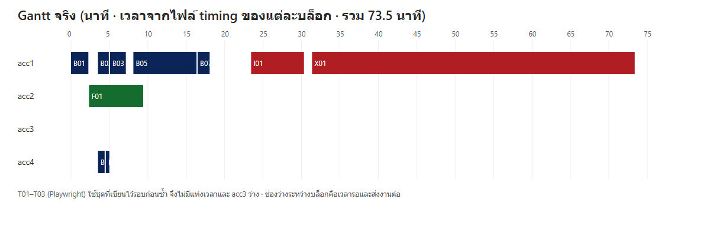
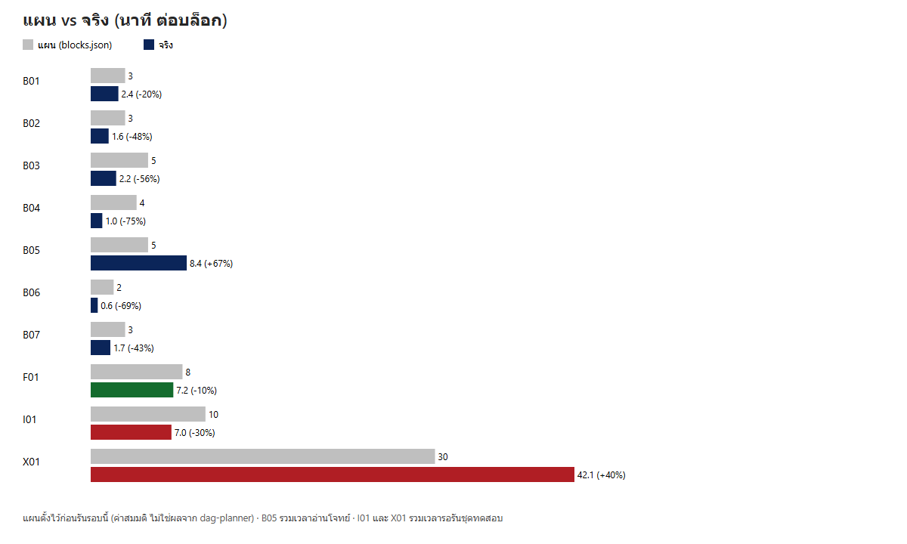

# REPORT: แผน vs จริง (e-Service กลาง)

> ข้อจำกัด: เครื่องนี้ไม่มีสกิล `dag-planner` และ container `multi-account` จึงไม่ได้ export/run ผ่านสกิล **แต่รันแผนจริงตาม blocks.json** ด้วยเอเจนต์ Claude Code แยกตามบัญชีสมมติ (acc1, acc2, acc4) บนบัญชีเดียว สร้างเว็บใหม่จากโจทย์ในโฟลเดอร์ `rerun/` โดยไม่ลอกโค้ดรอบก่อน เวลา "แผน" เป็นค่าสมมติที่ตั้งก่อนรันรอบนี้ ส่วน "จริง" คือ timestamp ที่เอเจนต์บันทึก (`rerun/timing/*.json`) · T01–T03 ใช้ชุด Playwright รอบก่อนซ้ำ

## แผน (blocks.json)

| บล็อก | งาน | สกิล | ความยาก | ต้องรอ | rank | บัญชี | เริ่ม–จบ (นาที) |
|---|---|---|---|---|---|---|---|
| B01 | โครงโปรเจกต์ + Docker + SQLite + seed + นาฬิกาจำลอง + test hook | backend | กลาง | – | 59 | acc1 | 0–3 |
| B02 | ยืนยันตัวตน ThaiD/OTP/ล็อก + SSO เจ้าหน้าที่ + RBAC | backend | กลาง | B01 | 56 | acc1 | 3–6 |
| B03 | ร่าง ค่าธรรมเนียม แนบไฟล์ (magic bytes) ชำระ QR เลขคำขอ | backend | สูง | B01, B02 | 53 | acc1 | 6–11 |
| B04 | SLA วันทำการ ระดับเตือน แจ้งเตือน ยกเลิกอัตโนมัติ | backend | สูง (กฎตัวเลข) | B01 | 52 | acc4 | 3–7 |
| B05 | Workflow: รับเรื่อง ตีกลับ ส่งต่อ อนุมัติ ออกเอกสาร ลายเซ็น PDF /verify ไฟล์แนบ | backend | สูง | B03, B04 | 48 | acc1 | 11–16 |
| B06 | PDPA: ปิดบังเลขบัตร unmask เข้ารหัส AES-GCM + blind index | backend | กลาง | B01 | 42 | acc4 | 7–9 |
| B07 | Dashboard + ส่งออก xlsx/pdf + Audit CSV + Admin (ค่าธรรมเนียม/SLA/วันหยุด/ผู้ใช้) | backend | กลาง (กฎตัวเลข) | B05 | 43 | acc1 | 16–19 |
| F01 | หน้าเว็บ 17 หน้า ตาม CONTRACT + ธีมน้ำเงินเข้ม | frontend | สูง | – | 48 | acc2 | 0–8 |
| T01 | Playwright A: lib + AUTH FEE SUBMIT UPLOAD PAY | playwright | กลาง | – | 50 | acc3 | 0–5 |
| T02 | Playwright B: QUEUE SLA NOTI WORKFLOW DOC | playwright | กลาง | T01 | 45 | acc3 | 5–10 |
| T03 | Playwright C: PDPA DASH AUDIT RBAC NFR | playwright | กลาง | T01 | 45 | acc4 | 9–14 |
| I01 | รวม + รันชุด Playwright เต็ม 51 TC (ไม่ตั้ง BUG_MODE) 🔒 | integrate | สูง | B05, B06, B07, F01, T02, T03 | 40 | acc1 | 19–29 |
| X01 | BUG_MODE B01–B12 ทีละตัว + ตาราง BUG-HUNT 🔒 | integrate | สูง | I01 | 30 | acc1 | 29–59 |

สายวิกฤต: B01 → B02 → B03 → B05 → B07 → I01 → X01 (backend มีกฎตัวเลขเยอะและต่อกันเป็นลูกโซ่) · รวมตามแผน 59 นาที

## จริง

| บล็อก | สถานะ | เวลาแผน (นาที) | เวลาจริง (นาที) | บัญชี |
|---|---|---|---|---|
| B01 | เสร็จ | 3 | 2.4 | acc1 |
| B02 | เสร็จ | 3 | 1.6 | acc1 |
| B03 | เสร็จ | 5 | 2.2 | acc1 |
| B04 | เสร็จ | 4 | 1.0 | acc4 |
| B05 | เสร็จ | 5 | 8.4 | acc1 |
| B06 | เสร็จ | 2 | 0.6 | acc4 |
| B07 | เสร็จ | 3 | 1.7 | acc1 |
| F01 | เสร็จ | 8 | 7.2 | acc2 |
| T01 | ใช้ซ้ำจากรอบก่อน | 5 | – | – |
| T02 | ใช้ซ้ำจากรอบก่อน | 5 | – | – |
| T03 | ใช้ซ้ำจากรอบก่อน | 5 | – | – |
| I01 | เสร็จ | 10 | 7.0 | acc1 |
| X01 | เสร็จ | 30 | 42.1 | acc1 |

รวมเวลาจริงตั้งแต่เริ่มบล็อกแรกถึงจบ X01: 73.5 นาที (รวมเวลารอ) · ผลบล็อกรวม: I01 ผ่าน 61/61 (รอบแรก 49 ผ่าน/12 ล้ม ทั้งหมดเป็นเว็บผิด) · X01 จับบั๊กได้ 12/12 ดู [BUG-HUNT](../rerun/BUG-HUNT.md)

## µ√«®·ºπµ“¡¢—Èπ 2

| µ√«® | º≈ |
|---|---|
| ∑ÿ° FR (FR-01..29) ¡’∫≈ÁÕ° backend √—∫º‘¥™Õ∫ | ?  §√‘ªµÏ make-plan-files.js µ√«® |
| Playwright ‰¡Ë¡’≈Ÿ°»√®“°∫≈ÁÕ°‡«Á∫ | ? |
| ∫≈ÁÕ° ÿ¥∑È“¬‡ªÁπ√«¡+∑¥ Õ∫ ?? | ? I01, X01 |
| ‰¡Ë¡’ Õß∫≈ÁÕ°‡¢’¬π‰ø≈χ¥’¬«°—π | ? „π°“√√—π®√‘ß·¬°‡ªÁπ mod-auth/drafts/sla/vault/cases/reports.js (blocks.json ©∫—∫‡¥‘¡∑’Ë√–∫ÿ routes.js √Ë«¡°—π ‰¡Ëµ√ß°—∫∑’Ë∑”®√‘ß) |
| ∑ÿ°∫≈ÁÕ°¡’∫—≠™’√—∫ | ? (acc1, acc2, acc4; acc3 «Ë“߇æ√“–„™È T01ñT03 ´È”) |
