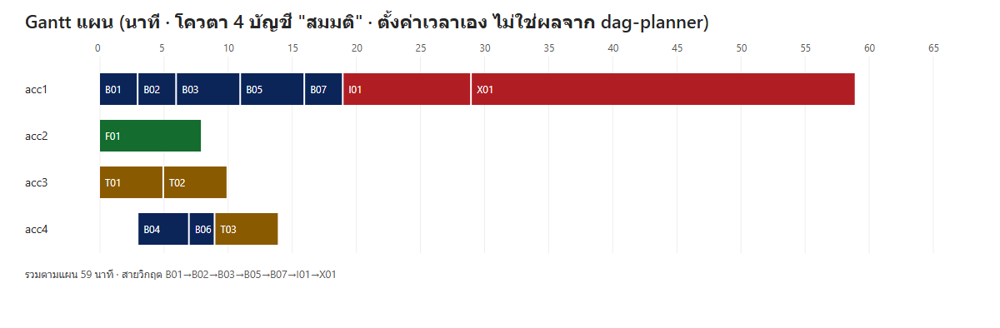

# REPORT: แผน vs จริง (e-Service กลาง)

> ข้อจำกัด: เครื่องนี้ไม่มีสกิล `dag-planner` และ container `multi-account` จึง **ไม่ได้ export/run ผ่านสกิล** เวลา "แผน" ด้านล่างเป็นค่าสมมติที่ตั้งเอง (ตั้งหลังทำเสร็จ ตามทางเลือก "โควตาสมมติ" ใน PROMPTS ขั้น 1) ส่วน "จริง" คือ duration ที่ระบบรายงานตอนเอเจนต์ Claude Code จบงานแต่ละตัว

## แผน (blocks.json)

| บล็อก | งาน | สกิล | ความยาก | ต้องรอ | rank | บัญชี | เริ่ม–จบ (นาที) |
|---|---|---|---|---|---|---|---|
| B01 | โครงโปรเจกต์ + Docker + SQLite + seed + นาฬิกาจำลอง + test hook | backend | กลาง | – | 59 | acc1 | 0–3 |
| B02 | ยืนยันตัวตน ThaiD/OTP/ล็อก + SSO เจ้าหน้าที่ + RBAC | backend | กลาง | B01 | 56 | acc1 | 3–6 |
| B03 | ร่าง ค่าธรรมเนียม แนบไฟล์ (magic bytes) ชำระ QR เลขคำขอ | backend | สูง | B01, B02 | 53 | acc1 | 6–11 |
| B04 | SLA วันทำการ ระดับเตือน แจ้งเตือน ยกเลิกอัตโนมัติ | backend | สูง (กฎตัวเลข) | B01 | 52 | acc4 | 3–7 |
| B05 | Workflow: รับเรื่อง ตีกลับ ส่งต่อ อนุมัติ ออกเอกสาร ลายเซ็น PDF /verify ไฟล์แนบ | backend | สูง | B03, B04 | 48 | acc1 | 11–16 |
| B06 | PDPA: ปิดบังเลขบัตร unmask เข้ารหัส AES-GCM + blind index | backend | กลาง | B01 | 42 | acc4 | 7–9 |
| B07 | Dashboard + ส่งออก xlsx/pdf + Audit CSV + Admin (ค่าธรรมเนียม/SLA/วันหยุด/ผู้ใช้) | backend | กลาง (กฎตัวเลข) | B05 | 43 | acc1 | 16–19 |
| F01 | หน้าเว็บ 17 หน้า ตาม CONTRACT + ธีมน้ำเงินเข้ม | frontend | สูง | – | 48 | acc2 | 0–8 |
| T01 | Playwright A: lib + AUTH FEE SUBMIT UPLOAD PAY | playwright | กลาง | – | 50 | acc3 | 0–5 |
| T02 | Playwright B: QUEUE SLA NOTI WORKFLOW DOC | playwright | กลาง | T01 | 45 | acc3 | 5–10 |
| T03 | Playwright C: PDPA DASH AUDIT RBAC NFR | playwright | กลาง | T01 | 45 | acc4 | 9–14 |
| I01 | รวม + รันชุด Playwright เต็ม 51 TC (ไม่ตั้ง BUG_MODE) 🔒 | integrate | สูง | B05, B06, B07, F01, T02, T03 | 40 | acc1 | 19–29 |
| X01 | BUG_MODE B01–B12 ทีละตัว + ตาราง BUG-HUNT 🔒 | integrate | สูง | I01 | 30 | acc1 | 29–59 |

สายวิกฤต: B01 → B02 → B03 → B05 → B07 → I01 → X01 (backend มีกฎตัวเลขเยอะและต่อกันเป็นลูกโซ่) · รวมตามแผน 59 นาที

## จริง

| กลุ่ม | สถานะ | เวลาแผน (นาที) | เวลาจริง (นาที) |
|---|---|---|---|
| Backend B01–B07 | เสร็จ | 25 | 13.9 |
| Frontend F01 | เสร็จ | 8 | 10.4 |
| Playwright A (T01) | เสร็จ | 5 | 8 |
| Playwright B (T02) | เสร็จ | 5 | 13.5 |
| Playwright C (T03) | เสร็จ | 5 | 11.2 |
| BUG_MODE X01 | เสร็จ | 30 | 59.8 |
| รวม + แก้ (I01) | เสร็จ (61/61 ผ่าน) | 10 | ไม่ได้จับเวลา |

บล็อกที่ล้ม: ไม่มีบล็อกที่ล้มถาวร ข้อที่ล้มระหว่างรวม (I01) และวิธีแก้ ดูตารางสาเหตุใน README

## ตรวจแผนตามขั้น 2

| ตรวจ | ผล |
|---|---|
| ทุก FR (FR-01..29) มีบล็อก backend รับผิดชอบ | ✅ สคริปต์ make-plan-files.js ตรวจแล้ว ไม่มี FR ตก |
| Playwright ไม่มีลูกศรจากบล็อกเว็บ | ✅ T01–T03 ไม่มี needs ที่เป็น B/F |
| บล็อกสุดท้ายเป็นรวม+ทดสอบ 🔒 | ✅ I01, X01 exclusive |
| ไม่มีสองบล็อกเขียนไฟล์เดียวกัน | ⚠️ ไฟล์ `routes.js` และ `time.js` แบ่งตามส่วน (ระบุในวงเล็บ) เพราะลดไฟล์ให้ง่ายตอนรัน ในแผนจริงควรแยกไฟล์ |
| ทุกบล็อกมีบัญชีรับ | ✅ |
