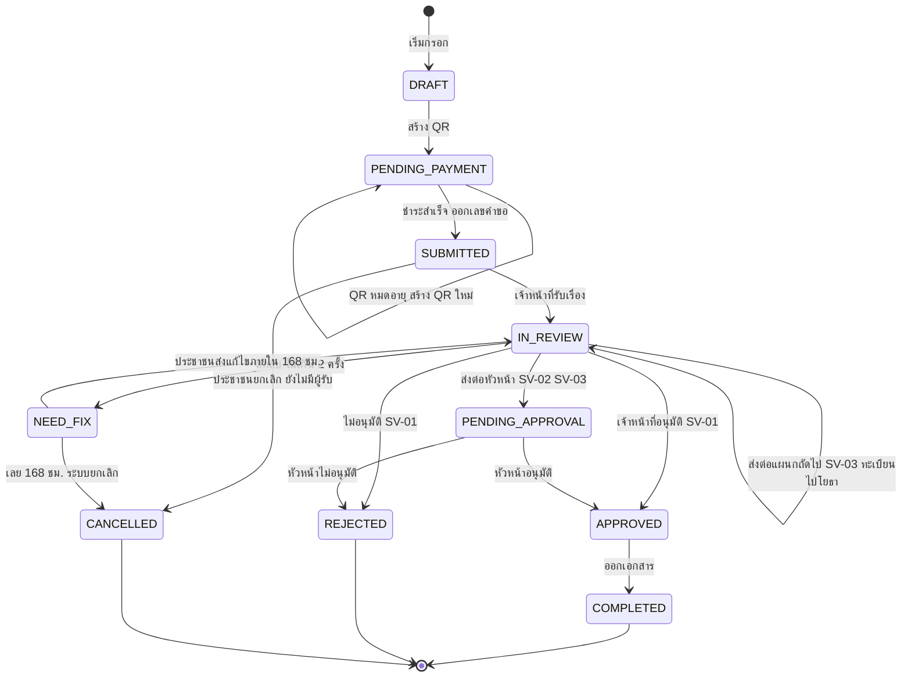

# REQUIREMENTS · e-Service กลาง เทศบาลนครตัวอย่าง

> แบบเดียวกับ LAB 2 ของผู้สอน: FR (ระบบต้องทำอะไร) · BR (กฎที่มีตัวเลข + ค่าขอบ 3 ค่า) · NFR (ดีแค่ไหน วัดได้)
> ที่มา: **[D]** = `brief/BRIEF.md` · **[R]** = กฎทั่วไป/คณิตศาสตร์/มาตรฐาน · **⚠️A-xx** = TA สมมติ (ดูตาราง 6) · เส้นทางที่ test ใช้อยู่ใน `CONTRACT.md`
> นาฬิกาทดสอบหลัง reset: อ. 1 ธ.ค. 2569 09:00 (+07:00) · วันหยุดใน seed: 7 ธ.ค. · 10 ธ.ค. · 31 ธ.ค. 2569 · 1 ม.ค. 2570

## 1. FR · ระบบต้องทำอะไร

| รหัส | ความต้องการเชิงฟังก์ชัน | มาจาก US | ที่มา |
|---|---|---|---|
| FR-01 | ประชาชนล็อกอินด้วยเลขบัตร 13 หลัก + OTP (ThaiD จำลอง ใช้เป็นตัวแทนของ D.DOPA/NDID ที่โจทย์ยกตัวอย่าง) และออกจากระบบได้ | US-C01a | [D] §1 US-C01 · §2 A1 (ThaiD/SSO) · ⚠️A-05 · Q-03 |
| FR-02 | ประชาชนเข้าครั้งแรกต้องผ่านหน้าลงทะเบียน (ชื่อจาก ThaiD, เบอร์, อีเมล, ยินยอม PDPA) | US-C01b | ⚠️A-07 (ต่อยอด [D] §1 US-C01 "ลงทะเบียน" · ข้อความยินยอมจริงเป็น Q-19) |
| FR-03 | เจ้าหน้าที่/หัวหน้า/ผู้บริหาร/ผู้ตรวจสอบ/ผู้ดูแลล็อกอินด้วย username + รหัสผ่าน (SSO จำลอง) และเข้าได้เฉพาะหน้าตามบทบาท (RBAC) | US-C01a US-O01a US-A01 US-A02 US-AD01 | [D] §2 A1 · ⚠️A-08 A-39 |
| FR-04 | แสดงแคตตาล็อก 3 บริการ ฟอร์มเฉพาะบริการ และคำนวณค่าธรรมเนียมทันที | US-C02a | [D] §1 US-C02 · ⚠️A-09 |
| FR-05 | แนบไฟล์ PDF/JPG/PNG ตรวจชนิดจากเนื้อไฟล์ ขนาดและจำนวน | US-C02b | [D] §2 A3 · ⚠️A-10 |
| FR-06 | ตรวจเอกสารบังคับครบก่อนไปขั้นชำระเงิน และบอกชื่อเอกสารที่ขาด | US-C02b | [D] §2 A3 |
| FR-07 | บันทึกร่างและกลับมาทำต่อ (ร่างไม่มีเลขคำขอ) | US-C02a | ⚠️A-14 A-47 (ร่างเป็นส่วนต่อยอดของ TA ไม่ได้อยู่ใน BRIEF) |
| FR-08 | ชำระด้วย PromptPay QR จำลอง ออกเลขคำขอและใบเสร็จเมื่อชำระสำเร็จ | US-C03 | [D] §1 US-C03 · ⚠️A-14 A-15 A-16 |
| FR-09 | ประชาชนดูรายการคำขอของตัวเอง สถานะ ไทม์ไลน์ กำหนดเสร็จ ระดับเตือน | US-C02c | [D] §1 US-C02 · §2 A2 |
| FR-10 | ประชาชนยกเลิกคำขอที่ "ส่งคำขอแล้ว" และยังไม่มีผู้รับเรื่อง (ก่อนกดมี confirm และแสดงข้อความไม่คืนค่าธรรมเนียม) · ลบร่าง (DRAFT / PENDING_PAYMENT ที่ยังไม่ชำระ) ได้ · ถ้ายกเลิกกับรับเรื่องพร้อมกัน สำเร็จฝั่งเดียว อีกฝั่ง 409 | US-C02c | ⚠️A-11 A-13 A-62 |
| FR-11 | ประชาชนส่งแก้ไขเมื่อถูกตีกลับภายใน 168 ชม. มิฉะนั้นระบบยกเลิกเอง | US-C02c | [D] §2 A2 · ⚠️A-21 A-29 A-46 |
| FR-12 | คิวงานของเจ้าหน้าที่แยกตามแผนก เรียงตามกำหนดเสร็จ กรองได้ | US-O01a | [D] §1 US-O01 · ⚠️A-18 A-34 |
| FR-13 | เจ้าหน้าที่รับเรื่อง (ครั้งละ 1 คน, งานในมือไม่เกิน 10) | US-O01a | [D] §1 US-O01 · ⚠️A-19 |
| FR-14 | เจ้าหน้าที่ตีกลับพร้อมเหตุผล (ไม่เกิน 2 ครั้ง) | US-O01b | [D] §2 A2 · ⚠️A-12 A-20 |
| FR-15 | ส่งต่ออัตโนมัติตามเส้นทางของบริการ (ทะเบียน → โยธา → หัวหน้า) ผู้ใช้เลือกปลายทางเองไม่ได้ | US-O01b US-O03a | [D] §2 A2 |
| FR-16 | อนุมัติ/ไม่อนุมัติตามอำนาจของบริการ (เจ้าหน้าที่ SV-01 · หัวหน้า SV-02/03) | US-O03a | [D] §2 A1 A2 |
| FR-17 | ออกเอกสารดิจิทัล (เลขเอกสาร ลายเซ็นจำลอง รหัสตรวจสอบ QR) และให้ประชาชนดาวน์โหลด PDF | US-O03b | [D] §1 US-O03 · §2 A3 · ⚠️A-22 A-23 |
| FR-18 | หน้า `/verify/<รหัส>` ตรวจเอกสารโดยไม่ต้องล็อกอิน (ชื่อผู้ยื่นปิดบัง) | US-O03b | ⚠️A-43 A-54 (หน้าตรวจสาธารณะเป็นส่วนต่อยอดของ TA) |
| FR-19 | คำนวณและแสดงกำหนดเสร็จ (SLA) และระดับเตือนทุกที่ที่แสดงคำขอ | US-O02 | [D] §1 US-O02 · ⚠️A-17 |
| FR-20 | แจ้งเตือนในระบบ (กระดิ่ง) ตามระดับและผู้รับ (ผู้ถือ / ทุกคนของแผนกถ้าไม่มีผู้ถือ / หัวหน้าที่ขั้นรออนุมัติ / ผู้ออกเอกสารที่ APPROVED · เกินกำหนดแจ้งหัวหน้าเพิ่ม) ไม่แจ้งซ้ำ | US-O02 | [D] §1 US-O02 · ⚠️A-30 A-31 |
| FR-21 | ปิดบังเลขบัตรทุกจอเจ้าหน้าที่ และปุ่ม "แสดงเลขเต็ม" พร้อมเหตุผล + Audit | US-O01b | [D] §2 B1 · ⚠️A-24 A-32 |
| FR-22 | Dashboard (รับเรื่อง ปิดงาน ทันกำหนด % คงค้าง เกินกำหนด งานในมือรายคน) กรองเดือน/บริการ | US-A01 | [D] §1 US-A01 |
| FR-23 | ส่งออกรายงาน Excel และ PDF (รายเดือน/รายปี) | US-A01 | [D] §2 A4 · ⚠️A-50 |
| FR-24 | Audit Trail: ดู กรอง ส่งออก CSV (อ่านอย่างเดียว) | US-A02 | [D] §1 US-A02 |
| FR-25 | ผู้ดูแลแก้ค่าธรรมเนียมและ SLA ของบริการ (ค่าธรรมเนียม 0–100,000 บาท · SLA 1–60 วันทำการ) | US-AD01 | ⚠️A-42 A-53 (BRIEF §2 A1 ระบุเพียงบทบาท "ผู้ดูแลระบบ") |
| FR-26 | ผู้ดูแลจัดการวันหยุด | US-AD01 | ⚠️A-02 A-42 A-57 |
| FR-27 | ผู้ดูแลจัดการผู้ใช้/บทบาท | US-AD01 | ⚠️A-42 A-57 (BRIEF §2 A1 ระบุเพียงชื่อบทบาท) |
| FR-28 | `GET /api/health` และ test hook (reset, clock, pay, tamper) เมื่อ `TEST_MODE=1` | ทุก US (เพื่อทดสอบ) | [R] ตามบท 04 |
| FR-29 | เจ้าหน้าที่/หัวหน้าเปิดดูและดาวน์โหลดไฟล์แนบของคำขอเพื่อตรวจเอกสาร (officer: แผนกตนเองขั้นปัจจุบันหรือเคยผ่าน · head: ทุกแผนก · citizen: ของตัวเอง · executive/auditor/admin: 403) | US-O01b | [D] §1 US-O01 ("ตรวจสอบเอกสาร") · ⚠️A-59 |

## 2. BR · กฎธุรกิจที่มีตัวเลข

| รหัส | กฎ | ค่าขอบที่ต้องทดสอบ (ต่ำกว่า / ที่ขอบ / เกินขอบ) → ผลที่คาดหวัง | มาจาก US | ที่มา |
|---|---|---|---|---|
| BR-01 | เลขบัตรต้องเป็นตัวเลข 13 หลักพอดี และหลักที่ 13 = (11 − (Σ dᵢ×(13−i), i=1..12) mod 11) mod 10 | 12 หลัก `110170012345` ✗ · 13 หลักถูก `1101700123456` ✓ ไปขั้น OTP · 14 หลัก `11017001234567` ✗ · 13 หลัก checksum ผิด `1101700123457` ✗ (ทุก ✗ แสดง "เลขบัตรประชาชนไม่ถูกต้อง") | US-C01a | [R] · [D] §2 A1 |
| BR-02 | OTP ทดสอบ `123456` · ผิดติดกัน 3 ครั้ง → ล็อกเลขบัตรนั้น 15 นาที นับจากครั้งที่ 3 · OTP ถูกรีเซ็ตตัวนับเป็น 0 · เมื่อปลดล็อกตัวนับเริ่มที่ 0 | ผิด 2 ครั้ง → ยังลองได้ (เหลือ 1 ครั้ง) · ผิดครั้งที่ 3 → ล็อก (HTTP 423) · +14:59 ยังล็อก แม้กรอก OTP ถูก · +15:00 ปลดล็อกและล็อกอินได้ · ผิดทันทีหลังปลดล็อก → นับเป็นครั้งที่ 1 (เหลือ 2 ครั้ง ไม่ล็อกซ้ำ) · ผิด 2 → ถูก → ผิด 2 อีก ไม่ล็อก | US-C01a | ⚠️A-05 A-06 · [R] |
| BR-03 | ลงทะเบียนครั้งแรก: ชื่อ-สกุลจาก ThaiD แก้ไม่ได้ · เบอร์มือถือ 10 หลักขึ้นต้น 0 บังคับ · อีเมลไม่บังคับ · ติ๊กยินยอม PDPA บังคับ | เบอร์ 9 หลัก ✗ · 10 หลัก ✓ · 11 หลัก ✗ · 10 หลักไม่ขึ้นต้น 0 ✗ · ไม่ติ๊กยินยอม → สมัครไม่ได้ · ติ๊ก → สมัครได้ | US-C01b | ⚠️A-07 |
| BR-04 | SV-01 ค่าธรรมเนียม ฿20 ต่อฉบับ จำนวน 1–5 ฉบับ | 0 ✗ "จำนวนฉบับต้อง 1–5 ฉบับ" · 1 → ฿20 · 5 → ฿100 · 6 ✗ ข้อความเดียวกัน | US-C02a | ⚠️A-09 |
| BR-05 | SV-03 ค่าธรรมเนียมตามพื้นที่ (จำนวนเต็ม ตร.ม.): 1–100 → ฿1,000 · 101–500 → ฿1,000 + ฿10 × (พื้นที่ − 100) · SV-02 ฿500 คงที่ | 0 ✗ "กรุณาระบุพื้นที่ 1–500 ตร.ม." · 1 → ฿1,000 · 100 → ฿1,000 · 101 → ฿1,010 · 500 → ฿5,000 · 501 ✗ "พื้นที่เกิน 500 ตร.ม. กรุณายื่นที่สำนักงาน" | US-C02a | ⚠️A-09 |
| BR-06 | ชนิดไฟล์ PDF/JPG/PNG ตรวจจากเนื้อไฟล์ (magic bytes) ไม่ใช่นามสกุลหรือ Content-Type | PDF/JPG/PNG จริง ✓ · ไฟล์ .txt เปลี่ยนชื่อเป็น .pdf ✗ · ไฟล์ .exe เปลี่ยนชื่อเป็น .png ✗ · .txt ส่ง Content-Type `application/pdf` ✗ | US-C02b | [D] §2 A3 · [R] · ⚠️A-49 |
| BR-07 | ขนาดต่อไฟล์ ≤ 5 MB = 5,242,880 ไบต์ · ไม่เกิน 5 ไฟล์ต่อคำขอ | 5,242,879 ✓ · 5,242,880 ✓ · 5,242,881 ✗ "ไฟล์ใหญ่เกิน 5 MB" · แนบครบ 5 ไฟล์ ✓ · ไฟล์ที่ 6 ✗ "แนบได้สูงสุด 5 ไฟล์ต่อคำขอ" | US-C02b | ⚠️A-10 |
| BR-08 | เอกสารบังคับต้องครบก่อนชำระ: SV-01 บัตรประชาชน · SV-02 บัตรประชาชน + แผนที่ตั้ง (ภาพสถานที่ไม่บังคับ) · SV-03 บัตรประชาชน + แบบแปลน (PDF เท่านั้น) + โฉนด | ขาด 1 ชิ้น → "ไปชำระเงิน" ใช้ไม่ได้ + "ยังขาดเอกสาร: <ชื่อ>" · ครบ ✓ · แบบแปลนเป็น JPG ✗ "แบบแปลนต้องเป็นไฟล์ PDF เท่านั้น" · เป็น PDF ✓ | US-C02b | [D] §2 A3 · ⚠️A-09 |
| BR-09 | เลขคำขอ `EG-<ปี พ.ศ.>-<ลำดับ 6 หลัก>` ออกเมื่อชำระสำเร็จ ลำดับเริ่มใหม่ทุกปี พ.ศ. ของเวลาชำระ · ร่างยังไม่มีเลข · 2 คนชำระพร้อมกันเลขต้องไม่ซ้ำ | ชำระ 31 ธ.ค. 2569 23:59 → `EG-2569-000031` (ถัดจากคำขอ seed 30 ใบ · TEST-DATA ตาราง 4.1/12) · ชำระ 1 ม.ค. 2570 00:00 → `EG-2570-000001` · ร่างไม่มีเลข · จ่ายพร้อมกัน 6 รายการได้ 6 เลขไม่ซ้ำ | US-C03 US-C02a | ⚠️A-14 · [R] |
| BR-10 | QR ใช้ได้ถ้า (เวลาชำระ − เวลาสร้าง) < 15:00 นาที | อายุ 14:59 ✓ ชำระได้ · 15:00 ✗ หมดอายุ (HTTP 410) ต้องกด "สร้าง QR ใหม่" · 15:01 ✗ | US-C03 | ⚠️A-15 |
| BR-11 | ยอดชำระต้องเท่าค่าธรรมเนียมพอดี · **ยอดถูกล็อกตอนคำขอเข้า PENDING_PAYMENT** (admin แก้ค่าธรรมเนียมภายหลังมีผลเฉพาะคำขอที่เข้า PENDING_PAYMENT หลังแก้ · QR ใหม่ของคำขอเดิมใช้ยอดที่ล็อกไว้) · callback ซ้ำ ref เดิมไม่สร้างรายการใหม่ ไม่เปลี่ยนเลขคำขอ (idempotent) · ใบเสร็จ `RC-<พ.ศ.>-<6 หลัก>` | ขาด ฿1 ✗ (HTTP 422) · ตรง ✓ · เกิน ฿1 ✗ · callback ซ้ำครั้งที่ 2 → เลขคำขอเดิม ไม่มีคำขอเพิ่ม · seed `PP-0001` (฿500) หลัง admin แก้ SV-02 เป็น ฿600: จ่าย ฿600 ✗ (422) จ่าย ฿500 ✓ | US-C03 | [R] · ⚠️A-16 A-42 |
| BR-12 | **D0** = วันที่ชำระ ถ้าเป็นวันทำการและก่อน 16:30:00 ไม่เช่นนั้นวันทำการถัดไป · **กำหนดเสร็จ** = วันทำการที่ N หลัง D0 เวลา 16:30 (N = SLA: SV-01 3 · SV-02 10 · SV-03 15) · คำนวณครั้งเดียวตอนชำระ ไม่คำนวณใหม่เมื่อเพิ่ม/ลบวันหยุดภายหลัง (A-42) | SV-01 ชำระ **อ.1 ธ.ค. 16:29** → ศ.4 ธ.ค. · **อ.1 ธ.ค. 16:30** → อ.8 ธ.ค. (D0 = พ.2, ข้าม จ.7) (ขอบวินาที 16:29:59 / 16:30:00 ผลเท่ากัน) · ศ.4 10:00 → ศ.11 ธ.ค. · ส.5 10:00 → จ.14 ธ.ค. · SV-02 (N=10) อ.1 ธ.ค. 09:00 → พฤ.17 ธ.ค. · SV-03 (N=15) อ.1 ธ.ค. 09:00 → พฤ.24 ธ.ค. · SV-01 พฤ.31 ธ.ค. 23:59 → พฤ.7 ม.ค. 70 (ตารางเต็ม TEST-PLAN SLA-01) | US-O02 | ⚠️A-01 A-02 A-03 A-09 A-42 |
| BR-13 | หยุดนับ SLA ระหว่าง NEED_FIX: กำหนดเสร็จใหม่ = กำหนดเดิม + จำนวนวันทำการใน (วันที่ตีกลับ, วันที่ส่งแก้ไข] (นับตามวันที่ ไม่ขึ้นกับเวลา · ไม่นับวันตีกลับ นับวันส่งแก้ · ใช้ตารางวันหยุด ณ เวลาที่ส่งแก้) | ชำระ อ.1 ธ.ค. 09:00 · ตีกลับ พ.2 11:00 · ส่งแก้ พฤ.3 10:00 → หยุด 1 วัน → อ.8 ธ.ค. 16:30 · ตีกลับและส่งแก้วันเดียวกัน → หยุด 0 วัน · ตีกลับ ศ.4 ส่งแก้ อ.8 ธ.ค. 17:00 (หลัง 16:30) → หยุด 1 วัน (อ.8; ส-อา และ จ.7 หยุด ไม่นับ) → ศ.4 + 1 = อ.8 ธ.ค. 16:30 (ส่งแก้หลังกำหนด จึงเป็น "เกินกำหนด" ทันที) | US-O02 | [D] §1 US-O02 · [R] · ⚠️A-42 |
| BR-14 | ระดับเตือน (เฉพาะคำขอที่ยังไม่ปิดและไม่อยู่ NEED_FIX): วันคงเหลือ = จำนวนวันทำการหลังวันนี้ถึงวันกำหนดเสร็จ (รวมวันกำหนด) · `ปกติ` ≥ 2 · `ใกล้ครบกำหนด` ≤ 1 และตอนนี้ ≤ กำหนดเสร็จ · `เกินกำหนด` ตอนนี้ > กำหนดเสร็จ | กำหนด ศ.4 ธ.ค. 16:30: อ.1 ปกติ (3) · พ.2 ปกติ (2) · พฤ.3 ใกล้ (1) · ศ.4 16:30:00 ใกล้ (0) · ศ.4 **16:30:01** เกินกำหนด · ศ.4 16:31 เกินกำหนด · กำหนด อ.8 ธ.ค.: พฤ.3 ปกติ (เหลือ 2: ศ.4, อ.8) · ศ.4 ใกล้ (เหลือ 1: อ.8) | US-O02 | ⚠️A-17 |
| BR-15 | แจ้งเตือนในกระดิ่ง ผู้รับ: คำขอมีผู้ถือ → ผู้ถือ · ไม่มีผู้ถือ (คิวแผนก) → เจ้าหน้าที่ทุกคนของแผนกนั้น · อยู่ขั้นหัวหน้า (PENDING_APPROVAL) → head · APPROVED (รอออกเอกสาร) → ผู้ออกเอกสาร · ระดับ "เกินกำหนด" แจ้ง head เพิ่มเสมอ (ไม่ซ้ำถ้า head เป็นผู้รับอยู่แล้ว) · **1 ครั้งต่อระดับต่อคำขอต่อคน** · ประเมินทุก request | ครั้งที่ 1 ที่ถึงระดับ → 1 รายการ · เปิดหน้า/เรียก API ซ้ำ 3 รอบ → ยัง 1 รายการ · "เกินกำหนด" เป็นรายการใหม่อีก 1 (ใกล้ 1 + เกิน 1) · PENDING_APPROVAL ใกล้ → head 1 · เกิน → head อีก 1 รายการ (ไม่ซ้ำ 2 ใบ) · APPROVED ใกล้ → ผู้ออกเอกสารเท่านั้น · เกิน → ผู้ออกเอกสาร + head | US-O02 | [D] §1 US-O02 · [R] · ⚠️A-30 A-31 |
| BR-16 | ลำดับคิว: กำหนดเสร็จเร็วสุดก่อน · เท่ากันเรียงเลขคำขอน้อยไปมาก | กำหนดต่างกัน → เร็วก่อน · กำหนดเท่ากัน (4 ธ.ค. 16:30: …-000013, -000015, -000027, -000028 …) → ตามเลขน้อยไปมาก | US-O01a | ⚠️A-18 |
| BR-17 | รับเรื่องได้ครั้งละ 1 คน | 2 browser กดพร้อมกัน → ผู้รับ 1 คน · คนที่ 2 HTTP 409 "มีเจ้าหน้าที่รับเรื่องนี้แล้ว" · กดซ้ำหลังมีผู้รับ → 409 | US-O01a | [R] |
| BR-18 | งานในมือสูงสุด 10 เรื่อง (นับ IN_REVIEW ที่ตัวเองถือ) · **ตรวจเฉพาะตอนกด "รับเรื่อง"** · คำขอที่ประชาชนส่งแก้กลับมาคืนผู้ถือเดิมโดยอัตโนมัติ แม้ทำให้งานในมือเกิน 10 (ไม่ถือว่าผิด) | มี 9 รับได้ (→ 10) · มี 10 รับเรื่องที่ 11 ✗ HTTP 409 "รับงานได้สูงสุด 10 เรื่อง" · อนุมัติ/ส่งต่อ/ตีกลับ 1 เรื่องแล้วรับได้อีก · ถือ 10 แล้วประชาชนส่งแก้คืน 1 เรื่อง → งานในมือ 11 (ไม่ error) แต่รับเรื่องใหม่ไม่ได้จนกว่าจะ < 10 | US-O01a | ⚠️A-19 |
| BR-19 | ตีกลับสูงสุด 2 ครั้งต่อคำขอ · เหตุผลตีกลับ/ไม่อนุมัติต้อง ≥ 10 ตัวอักษร (นับหลังตัดช่องว่างหัวท้าย) · เมื่อตีกลับครบ 2 ครั้ง: SV-01 เจ้าหน้าที่อนุมัติ/ไม่อนุมัติได้ตามปกติ · SV-02/SV-03 เจ้าหน้าที่ทำได้แค่ "ส่งต่อ" (พร้อมหมายเหตุ) ผู้ตัดสินไม่อนุมัติคือ head | ตีกลับครั้งที่ 1 ✓ · ครั้งที่ 2 ✓ · ครั้งที่ 3 ✗ ปุ่มหายและ API 409 · หลังครบ 2: SV-01 มีปุ่มอนุมัติ/ไม่อนุมัติ · SV-02 มีปุ่มส่งต่อ ไม่มีปุ่มไม่อนุมัติ · เหตุผล 9 ตัว ✗ · 10 ตัว ✓ · เว้นวรรคล้วน 10 ตัว ✗ | US-O01b US-O03a | ⚠️A-12 A-20 A-44 |
| BR-20 | เวลาแก้ไขของประชาชน 7 วันปฏิทิน (168 ชม.) นับจากเวลาตีกลับ · เลยแล้วระบบยกเลิกอัตโนมัติ | ตีกลับ 27 พ.ย. 14:00 → 167:59 (4 ธ.ค. 13:59) ส่งแก้ได้ · 168:00 (4 ธ.ค. 14:00) สถานะ "ยกเลิก" ส่งแก้ไม่ได้ (HTTP 409) | US-C02c | ⚠️A-21 A-46 |
| BR-21 | อำนาจและเส้นทาง: SV-01 ทะเบียน(ตรวจ+อนุมัติโดยเจ้าหน้าที่) → ออกเอกสาร · SV-02 ทะเบียน → หัวหน้าอนุมัติ → ออกเอกสาร · SV-03 ทะเบียน → โยธา → หัวหน้าอนุมัติ → ออกเอกสาร · ส่งต่ออัตโนมัติ · บทบาทเข้าได้เฉพาะหน้าตามสิทธิ์ | เจ้าหน้าที่อนุมัติ SV-02 ผ่าน API → 403 · หัวหน้าอนุมัติ SV-01 ที่ IN_REVIEW → 403 · เจ้าหน้าที่แผนกอื่นรับ/ตีกลับ → 403 · ผู้บริหาร/ผู้ตรวจ/ผู้ดูแลทำรายการคำขอ → 403 · ยังไม่ล็อกอิน → 401 (หน้า redirect `/login`) | US-O03a US-O01a US-C01a | [D] §2 A1 A2 · ⚠️A-27 A-28 A-39 |
| BR-22 | ประชาชนเห็นเฉพาะคำขอของตัวเอง · ยกเลิกได้เฉพาะ SUBMITTED ที่ยังไม่มีผู้รับเรื่อง · ก่อนกดยกเลิกมี confirm และหน้าคำขอที่ REJECTED/CANCELLED แสดงข้อความ `ค่าธรรมเนียมที่ชำระแล้วไม่คืน` · ลบร่างได้ (DRAFT/PENDING_PAYMENT) · ยกเลิกชนกับรับเรื่องพร้อมกันสำเร็จฝั่งเดียว | เปิดของคนอื่น (หน้า/API/เอกสาร/ร่าง) → 404 "ไม่พบคำขอ" เหมือนเลขที่ไม่มีจริง · SUBMITTED ไม่มีผู้รับ ยกเลิกได้ · มีผู้รับแล้ว (IN_REVIEW) ยกเลิกไม่ได้ ปุ่มหาย API 409 · ลบร่าง DRAFT ✓ · ร่างของคนอื่น 404 · ยกเลิก + รับเรื่องพร้อมกัน → ฝั่งหนึ่ง 200 อีกฝั่ง 409 และสถานะสุดท้ายสอดคล้องกัน | US-C02c | [D] §2 A1 · ⚠️A-11 A-13 A-62 |
| BR-23 | เอกสารดิจิทัล: อายุ SV-01 90 วัน · SV-02/03 1 ปี (วันสุดท้ายที่ใช้ได้ = SV-01: ออก + 89 วัน · SV-02/03: วันครบรอบปีถัดไป − 1 วัน ถ้าไม่มีวันนั้น (ออก 29 ก.พ.) ใช้ 28 ก.พ. เป็นวันครบรอบ) · `/verify/<รหัส>` ไม่ต้องล็อกอิน: ถูกต้อง → "เอกสารถูกต้อง" · หมดอายุ → "เอกสารหมดอายุ" · ลายเซ็นไม่ตรง → "ลายเซ็นไม่ถูกต้อง" · ไม่มีรหัส → "ไม่พบเอกสาร" (HTTP 404) · ชื่อผู้ยื่นปิดบัง = ชื่อเต็ม + อักษรแรกของนามสกุล + `***` (ไม่มีนามสกุล → ชื่อ + ` ***`) | SV-01 ออก 1 ธ.ค. 69: 28 ก.พ. 70 23:59 ✓ · 1 มี.ค. 70 00:00 หมดอายุ · SV-02/03 ออก 1 ธ.ค. 69: 30 พ.ย. 70 23:59 ✓ · 1 ธ.ค. 70 00:00 หมดอายุ · SV-02 ออก 29 ก.พ. 2571 (ค.ศ. 2028) → ใช้ได้ถึง 27 ก.พ. 2572 (ค.ศ. 2029) · SV-01 ออก 29 ก.พ. 2571 → 28 พ.ค. 2571 · tamper → ลายเซ็นไม่ถูกต้อง · รหัสไม่มี → ไม่พบเอกสาร · `สมชาย ใจดี` → `สมชาย ใ***` | US-O03b | ⚠️A-22 A-23 A-43 A-54 A-58 A-61 · [R] PDPA |
| BR-24 | เลขบัตรบนจอเจ้าหน้าที่ทุกบทบาท `X-XXXX-XXXXX-45-6` (เห็น 3 หลักท้าย) · ประชาชนเห็นของตัวเองเต็ม · API รายการ/คิว/รายละเอียดของเจ้าหน้าที่ห้ามมีเลขเต็มใน response JSON · "แสดงเลขเต็ม" (officer/head) ต้องกรอกเหตุผล + Audit `UNMASK` · **ผู้บริหารไม่เห็นข้อมูลส่วนบุคคล**: หน้า dashboard และไฟล์ส่งออกต้องไม่มีชื่อผู้ยื่น เลขบัตร (ตัวเลข 13 หลักติดกัน) หรือเบอร์โทร (0 ตามด้วย 9 หลัก) | เหตุผลว่าง ✗ (ไม่แสดง ไม่บันทึก) · มีเหตุผล ✓ เห็นเต็มในหน้านั้น + Audit 1 แถว · ผู้บริหาร/ผู้ตรวจ/ประชาชนเรียก unmask → 403 · regex `\d{13}` ใน response JSON ของ API เจ้าหน้าที่ที่ระบุใน CONTRACT → ไม่พบ · ข้อความหน้า `/dashboard` และเนื้อไฟล์ส่งออก: ไม่พบ `\d{13}` `0\d{9}` และชื่อ `สมชาย` `สมหญิง` `ปิติ` `มานะ` | US-O01b US-A01 | [D] §2 B1 · ⚠️A-24 A-32 A-55 |
| BR-25 | ตัวชี้วัด: รับเรื่อง = ชำระสำเร็จ (มีเลขคำขอ) ในเดือน (รวม CANCELLED ที่เคยชำระ) · ปิดงาน = COMPLETED + REJECTED ที่ closed_at ในเดือน (CANCELLED ไม่ใช่ปิดงาน) · **ทันกำหนด = closed_at ≤ กำหนดเสร็จ (รวมวินาทีที่ 16:30:00) นับทั้ง COMPLETED และ REJECTED** · ทันกำหนด % = ทัน ÷ ปิดงาน × 100 ทศนิยม 1 ตำแหน่ง ปัดครึ่งขึ้น (ปิดงาน 0 → `–`) · งานคงค้าง ณ ตอนนี้ = SUBMITTED+IN_REVIEW+NEED_FIX+PENDING_APPROVAL+APPROVED · เกินกำหนดคงค้าง = คงค้างที่ไม่ใช่ NEED_FIX และตอนนี้ > กำหนดเสร็จ | **ค่าขอบ "ทัน": ปิด 16:29:59 (ก่อน) → ทัน · 16:30:00 (ที่ขอบ) → ทัน · 16:30:01 (เกิน; หรือ 16:31) → ไม่ทัน** (กำหนด 3 ธ.ค. 16:30 · TC-DASH-04) · ปิดงาน 0 (ธ.ค.) → `–` · พ.ย. 6/7 → 85.7% · SV-02 พ.ย. 2/3 → 66.7% · ต.ค. 1/1 → 100.0% · คงค้าง 21 · เกินกำหนด 1 (ที่มา: TEST-DATA ตาราง 7) | US-A01 | [D] §1 US-A01 · [R] · ⚠️A-17 A-41 · DECISIONS ข้อ 18 |
| BR-26 | รายงานรายปี = รวมตัวเลขทุกเดือนแล้วคิด % จากยอดรวม (ไม่เฉลี่ย % รายเดือน) · ส่งออก Excel/PDF เท่าจอทุกช่อง · การส่งออกบันทึก Audit `EXPORT` · ไฟล์ส่งออกไม่มีข้อมูลส่วนบุคคล (BR-24) | ปี 2569: 7/8 = 87.5% (ถ้าเฉลี่ยผิด = 92.9%) · ไฟล์ส่งออก พ.ย. ตรงจอ 5 ช่อง · ส่งออก 1 ครั้ง → Audit 1 แถว · เนื้อไฟล์ไม่พบเลข 13 หลัก/เบอร์/ชื่อผู้ยื่น | US-A01 | [D] §2 A4 · [R] · ⚠️A-50 |
| BR-27 | Audit: บันทึก 10 เหตุการณ์ `STAFF_LOGIN` `CLAIM` `RETURN` `FORWARD` `APPROVE` `REJECT` `ISSUE` `UNMASK` `EXPORT` `ADMIN_CHANGE` (ฟิลด์: เวลา username บทบาท เหตุการณ์ เลขคำขอ สถานะก่อน→หลัง รายละเอียด) · กรองผู้ทำ/เหตุการณ์/ช่วงวันที่ (รวมวันเริ่มและวันจบ ตามเวลาไทย) · ส่งออก CSV · เพิ่มได้อย่างเดียว | `PUT`/`PATCH`/`DELETE` ทุกเส้นรวม admin → 405 · รายการ 30 พ.ย. 23:59:59 ไม่อยู่ในวันที่ 1 ธ.ค. · รายการ 1 ธ.ค. 00:00:00 และ 23:59:59 อยู่ในวันที่ 1 ธ.ค. · 2 ธ.ค. 00:00:00 ไม่อยู่ | US-A02 | [D] §1 US-A02 · [R] · ⚠️A-36 A-51 |
| BR-28 | ช่วงค่าที่ผู้ดูแลแก้ได้: ค่าธรรมเนียมจำนวนเต็ม 0–100,000 บาท · SLA จำนวนเต็ม 1–60 วันทำการ · วันหยุดซ้ำวันเดิม ✗ · ผู้ดูแลเปลี่ยนบทบาทตัวเอง ✗ | ค่าธรรมเนียม −1 ✗ (400 `INVALID_FEE`) · 0 ✓ · 100,000 ✓ · 100,001 ✗ · SLA 0 ✗ (400 `INVALID_SLA`) · 1 ✓ · 60 ✓ · 61 ✗ · เพิ่มวันหยุด 2026-12-07 ซ้ำ → 409 `DUPLICATE_HOLIDAY` · เปลี่ยนบทบาท `admin1` เอง → 409 `SELF_ROLE_CHANGE` | US-AD01 | ⚠️A-53 A-57 · Q-33 |
| BR-29 | สิทธิ์เปิด/ดาวน์โหลดไฟล์แนบ: officer = คำขอในแผนกตนเอง (ขั้นปัจจุบันหรือเคยผ่านขั้นนั้นแล้ว) · head = ทุกแผนก · citizen = ของตัวเอง (ของคนอื่น 404) · executive / auditor / admin = 403 · ยังไม่ล็อกอิน 401 | `…000025` (SV-01 ทะเบียน): `off.reg1` 200 · `off.works1` 403 (ไม่เคยผ่านโยธา) · `…000010` (SV-03 ที่ขั้นโยธา): `off.works1` 200 และ `off.reg1` 200 (เคยผ่านทะเบียน) · `…000012` (SV-03 ยังอยู่ขั้นทะเบียน): `off.works1` 403 · `head1` 200 ทุกใบ · `exec1` `audit1` `admin1` 403 · สมหญิงเปิดไฟล์ของ `…000005` (สมชาย) → 404 | US-O01b | [D] §1 US-O01 · ⚠️A-59 · DECISIONS ข้อ 18 · Q-32 |

## 3. NFR · ดีแค่ไหน วัดได้

| รหัส | คุณลักษณะ | เกณฑ์ | วิธีวัด | ที่มา |
|---|---|---|---|---|
| NFR-01 | Responsive | กว้าง 375 · 768 · 1280 px ไม่มี scroll แนวนอนทั้งหน้า (`document.documentElement.scrollWidth ≤ window.innerWidth`) และทำงานหลักจบได้ (ล็อกอิน + กรอกคำขอ SV-01 ถึงหน้าชำระเงิน) | Playwright `setViewportSize` + `evaluate` (TC-NFR-01) | [D] §2 B3 |
| NFR-02 | WCAG 2.1 AA | หน้าหลัก 13 หน้า (`/login` `/register` `/citizen` `/citizen/new/SV-01` `/citizen/cases/<เลข>` `/officer/queue` `/officer/cases/<เลข>` `/head/approvals` `/dashboard` `/audit` `/admin/services` `/notifications` `/verify/<รหัส>`): axe-core 0 violation ระดับ serious/critical (tags `wcag2a wcag2aa wcag21a wcag21aa`) · ระดับ moderate/minor บันทึกเป็น known issue ในรายงาน (ไม่ทำให้ TC ล้ม) | `@axe-core/playwright` (TC-NFR-02) | [D] §2 B3 · ⚠️A-25 |
| NFR-03 | ใช้คีย์บอร์ดอย่างเดียว + มี label | ล็อกอินประชาชน + กรอกคำขอ SV-01 ถึงปุ่ม "ไปชำระเงิน" โดยใช้ Tab/Enter/Space เท่านั้น · ทุก `input/select/textarea` มี label ที่ `getByLabel` หาเจอ | Playwright keyboard (TC-NFR-02) | [D] §2 B3 · [R] WCAG 2.1.1 3.3.2 |
| NFR-04 | PDPA เก็บข้อมูล (At rest) | เลขบัตรและเบอร์โทรเข้ารหัส (เช่น AES-256-GCM) · ในไฟล์/ตารางฐานข้อมูลไม่พบเลขบัตร 13 หลักหรือเบอร์ 10 หลักตรง ๆ · ขอบเขตที่ทดสอบคือ 2 ฟิลด์นี้ · ชื่อ อีเมล และไฟล์แนบ (บัตร/โฉนด) เป็นคำถาม Q-08 | inspection นอก Playwright (อ่านฐานข้อมูลที่ `DB_PATH` ด้วย fs/sqlite) (TC-NFR-04) | [D] §2 B1 ("ข้อมูลส่วนบุคคล") · ⚠️A-55 · Q-08 |
| NFR-05 | PDPA ระหว่างส่ง (In transit) | ตอน deploy ใช้ HTTPS (TLS) · เครื่อง local อยู่นอกขอบเขตการทดสอบ ไม่มี TC (บันทึกเป็น open item Q-08) | ตรวจ config ตอน deploy + `curl -I https://…` | [D] §2 B1 · Q-08 |
| NFR-06 | Availability ≥ 99.5% | วัดในห้องเรียนไม่ได้: ต้องมี `GET /api/health` ตอบ 200 `{"status":"ok"}` ไม่ต้องล็อกอิน (TC-NFR-03 ตรวจเฉพาะ health ไม่ได้พิสูจน์ 99.5%) · วิธีวัดจริง/เครื่องมือ monitor เป็นคำถาม Q-07 | Playwright `request.get` + Q-07 | [D] §2 B2 |
| NFR-07 | ผู้ใช้พร้อมกัน | จำนวนจริงเป็นคำถาม (Q-06) · ที่ทดสอบได้: รับเรื่องพร้อมกัน 2 browser context (BR-17) และเลขคำขอไม่ซ้ำเมื่อชำระพร้อมกัน 6 รายการ (BR-09) | TC-QUEUE-02, TC-PAY-03 | [D] §2 B2 |
| NFR-08 | เวลาโหลด | หน้า `/login` `/citizen` `/officer/queue` `/dashboard` `/audit` โหลดถึงเหตุการณ์ `load` ≤ 3 วินาที บนเครื่อง local | Playwright `performance.timing` หรือเวลาห่อ `goto` (TC-NFR-03) | ⚠️A-26 |
| NFR-09 | ทดสอบได้และผลซ้ำได้ | `TEST_MODE=1` เปิด test hook (ไม่ตั้ง → `/api/test/*` ตอบ 404) · reset 2 ครั้งผลเหมือนกัน · ทุกปุ่ม/ช่อง/ข้อความสำคัญมี `data-testid` ตาม CONTRACT | TC-NFR-03 | [R] ตามบท 04 |
| NFR-10 | เขตเวลาและรูปแบบแสดงผล | ทุกการคำนวณใช้ Asia/Bangkok · วันที่บนจอ `4 ธ.ค. 2569 16:30` · เงิน `฿1,010` · ค่าเวลาใน API เป็น ISO `+07:00` | assert ข้อความและ `data-iso` ในทุก TC ที่เกี่ยวข้อง | [R] · ⚠️A-04 A-51 |
| NFR-11 | สถานะไม่ใช้สีอย่างเดียว | `case-status` และ `sla-level` ต้องมีข้อความไม่ว่างเสมอ (นอกเหนือจากสี) | Playwright `textContent` ไม่ว่าง (TC-NFR-02) | [R] WCAG 1.4.1 |

## 4. แผนภาพสถานะคำขอ

| สถานะ | ข้อความบนจอ | ที่มา |
|---|---|---|
| DRAFT | ร่าง | ⚠️A-11 |
| PENDING_PAYMENT | รอชำระเงิน | ⚠️A-11 |
| SUBMITTED | ส่งคำขอแล้ว | [D] §2 A2 |
| IN_REVIEW | กำลังตรวจสอบ | [D] §2 A2 |
| NEED_FIX | รอแก้ไขเอกสาร | [D] §2 A2 |
| PENDING_APPROVAL | รออนุมัติ | ⚠️A-11 |
| APPROVED | อนุมัติ | [D] §2 A2 |
| COMPLETED | เสร็จสิ้น | [D] §2 A2 |
| REJECTED | ไม่อนุมัติ | ⚠️A-11 |
| CANCELLED | ยกเลิก | ⚠️A-11 |

SLA เดินตั้งแต่ชำระสำเร็จ หยุดระหว่าง NEED_FIX หยุดถาวรเมื่อ COMPLETED หรือ REJECTED (closed_at) · CANCELLED ไม่ใช่ "ปิดงาน" ใน Dashboard (ไม่นับ)

## 5. Traceability: US → FR → BR

| US | FR | BR | ครบ |
|---|---|---|---|
| US-C01a | FR-01 FR-03 | BR-01 BR-02 BR-21 | ✅ |
| US-C01b | FR-02 | BR-03 | ✅ |
| US-C02a | FR-04 FR-07 | BR-04 BR-05 BR-09 | ✅ |
| US-C02b | FR-05 FR-06 | BR-06 BR-07 BR-08 | ✅ |
| US-C02c | FR-09 FR-10 FR-11 | BR-12 BR-20 BR-22 | ✅ |
| US-C03 | FR-08 | BR-09 BR-10 BR-11 | ✅ |
| US-O01a | FR-03 FR-12 FR-13 | BR-16 BR-17 BR-18 (คิวแยกแผนกตาม A-34 · สิทธิ์ BR-21) | ✅ |
| US-O01b | FR-14 FR-15 FR-21 FR-29 | BR-19 BR-21 BR-24 BR-29 | ✅ |
| US-O02 | FR-19 FR-20 | BR-12 BR-13 BR-14 BR-15 | ✅ |
| US-O03a | FR-15 FR-16 | BR-12 BR-19 BR-21 (ป้ายขั้นตอน SV-03 ตาม A-40) | ✅ |
| US-O03b | FR-17 FR-18 | BR-23 (ผู้ออกเอกสารตาม A-27 ใน BR-21) | ✅ |
| US-A01 | FR-03 FR-22 FR-23 | BR-21 BR-24 BR-25 BR-26 | ✅ |
| US-A02 | FR-03 FR-24 | BR-27 | ✅ |
| US-AD01 | FR-03 FR-25 FR-26 FR-27 | BR-12 BR-27 BR-28 | ✅ |
| (ทุก US) | FR-28 | – | ✅ ตรวจผ่าน NFR-06 NFR-09 |

ตรวจย้อนกลับ: FR-01..FR-29 ทุกข้อมี US · BR-01..BR-29 ทุกข้อมี US และมี TC (ตาราง BR → TC ท้าย `TEST-PLAN.md`) · ไม่มีแถว ❌

## 6. สมมติฐาน (A-xx)

A-01 ถึง A-26 คัดจาก DECISIONS ข้อ 0–14 · A-53 ถึง A-56 จาก DECISIONS ข้อ 18 · A-27 ถึง A-52 และ A-57 ขึ้นไป TA เพิ่มเพื่อให้ทดสอบได้ · **สมมติฐานที่กระทบกฎหรือการตัดสินใจของหน่วยงานทุกข้อมีคำถาม Q-xx รองรับ (ตาราง 6.1)** ส่วนที่เป็นรายละเอียดการทดสอบล้วน ๆ ระบุ "ภายในทีม" ไม่ต้องถามหน่วยงาน

| รหัส | สมมติฐาน | ที่ |
|---|---|---|
| A-01 | นาฬิกาทดสอบหลัง reset = `2026-12-01T09:00:00+07:00` (อังคาร) | DECISIONS ข้อ 0 |
| A-02 | วันทำการ = จันทร์–ศุกร์ ที่ไม่อยู่ในตารางวันหยุด · seed: 2026-12-07, 2026-12-10, 2026-12-31, 2027-01-01 | ข้อ 0 |
| A-03 | เวลาตัดรอบ 16:30 ยื่นตั้งแต่ 16:30:00 นับเป็นวันทำการถัดไป | ข้อ 0 |
| A-04 | วันที่บนจอแบบ พ.ศ. ย่อ `4 ธ.ค. 2569 16:30` · เงินเป็นจำนวนเต็มบาท `฿1,010` | ข้อ 0 |
| A-05 | OTP โหมดทดสอบ `123456` เสมอ · ใช้ ThaiD จำลองเป็นตัวแทนของ D.DOPA/NDID ที่โจทย์ยกตัวอย่าง (ช่องทางอื่นไม่ทำในชุดนี้) | ข้อ 2 |
| A-06 | ผิดติดกัน 3 ครั้งล็อกเลขบัตร 15 นาทีนับจากครั้งที่ 3 | ข้อ 2 |
| A-07 | ลงทะเบียนครั้งแรก: ชื่อจาก ThaiD แก้ไม่ได้ · เบอร์ 10 หลักขึ้นต้น 0 บังคับ · อีเมลไม่บังคับ · ยินยอม PDPA บังคับ | ข้อ 2 |
| A-08 | เจ้าหน้าที่ใช้ปุ่ม "เข้าสู่ระบบเจ้าหน้าที่ (SSO ภาครัฐ จำลอง)" ด้วย username + รหัสผ่านจาก seed | ข้อ 2 |
| A-09 | แคตตาล็อก 3 บริการ ค่าธรรมเนียม SLA เอกสาร เส้นทาง ตามตาราง (ผู้ดูแลแก้ได้) | ข้อ 3 |
| A-10 | ไฟล์ละไม่เกิน 5 MB = 5,242,880 ไบต์ (รวมค่านี้) · ไม่เกิน 5 ไฟล์ต่อคำขอ | ข้อ 4 |
| A-11 | สถานะที่เพิ่มจาก 5 สถานะของโจทย์: DRAFT PENDING_PAYMENT PENDING_APPROVAL REJECTED CANCELLED | ข้อ 5 |
| A-12 | เหตุผลตีกลับ/ไม่อนุมัติ ≥ 10 ตัวอักษร | ข้อ 5 |
| A-13 | ไม่คืนค่าธรรมเนียมเมื่อไม่อนุมัติหรือยกเลิก · หน้าคำขอ REJECTED/CANCELLED แสดง `ค่าธรรมเนียมที่ชำระแล้วไม่คืน` (testid `no-refund-note`) และ confirm ก่อนกดยกเลิกมีข้อความเดียวกัน | ข้อ 5 · ข้อ 18 |
| A-14 | เลขคำขอ `EG-<พ.ศ.>-<6 หลัก>` ออกเมื่อชำระสำเร็จ เริ่มใหม่ทุกปี พ.ศ. ของเวลาชำระ | ข้อ 6 |
| A-15 | QR อายุ < 15:00 นาที | ข้อ 7 |
| A-16 | ใบเสร็จ `RC-<พ.ศ.>-<6 หลัก>` แสดงยอด วันเวลา เลขคำขอ | ข้อ 7 |
| A-17 | ระดับเตือน ปกติ / ใกล้ครบกำหนด / เกินกำหนด ตามวันคงเหลือ | ข้อ 8 |
| A-18 | ลำดับคิว: กำหนดเสร็จเร็วสุดก่อน เท่ากันเรียงเลขคำขอน้อยไปมาก | ข้อ 9 |
| A-19 | งานในมือสูงสุด 10 เรื่อง ตรวจเฉพาะตอนกด "รับเรื่อง" · คำขอที่ประชาชนส่งแก้กลับมาคืนผู้ถือเดิมโดยอัตโนมัติ แม้ทำให้เกิน 10 | ข้อ 9 · ข้อ 18 |
| A-20 | ตีกลับสูงสุด 2 ครั้งต่อคำขอ · ครบแล้ว SV-02/03 เจ้าหน้าที่ขั้นแผนกทำได้แค่ "ส่งต่อ" (พร้อมหมายเหตุ) · ผู้ตัดสินไม่อนุมัติคือ head · SV-01 เจ้าหน้าที่อนุมัติ/ไม่อนุมัติได้ตามปกติ | ข้อ 9 · ข้อ 18 |
| A-21 | เวลาแก้ไขของประชาชน 7 วันปฏิทิน (168 ชม.) นับจากตีกลับ เลยแล้วยกเลิกอัตโนมัติ | ข้อ 9 |
| A-22 | ลายเซ็นจำลอง = HMAC-SHA256 ของฟิลด์เอกสาร (ลำดับคงที่) ด้วยคีย์ทดสอบ | ข้อ 10 |
| A-23 | อายุเอกสาร SV-01 90 วัน · SV-02/03 1 ปี | ข้อ 10 |
| A-24 | เลขบัตรบนจอเจ้าหน้าที่ปิดบัง `X-XXXX-XXXXX-45-6` · ประชาชนเห็นของตัวเองเต็ม · ผู้บริหารไม่เห็นข้อมูลส่วนบุคคลเลย (ดู BR-24) | ข้อ 11 · ข้อ 18 |
| A-25 | WCAG ระดับ AA (2.1) | ข้อ 14 |
| A-26 | หน้าหลักโหลด ≤ 3 วินาทีบนเครื่อง local | ข้อ 14 |
| A-27 | **ผู้ออกเอกสาร** ของ SV-02/SV-03 = เจ้าหน้าที่ทะเบียนที่รับเรื่องขั้นแรก (ของ SV-01 = ผู้ถือเรื่องที่อนุมัติ) · เจ้าหน้าที่คนอื่น แม้แผนกเดียวกัน → 403 · ผู้ลงนามตาม DECISIONS ข้อ 10 (SV-01 เจ้าหน้าที่ · SV-02/03 หัวหน้า) | TA |
| A-28 | **ผู้ถือเรื่อง**: รับเรื่อง/ตีกลับ/ส่งต่อ/อนุมัติ SV-01 ได้เฉพาะเจ้าหน้าที่ของแผนกที่ถือเรื่องนั้น (claim ผ่าน) · แผนกอื่น/หัวหน้า/บทบาทอื่น → 403 · หัวหน้าไม่อนุมัติแทน SV-01 → 403 | TA |
| A-29 | หลังประชาชนส่งแก้ไข คำขอกลับ IN_REVIEW กับผู้ถือเดิมในขั้นเดิมโดยอัตโนมัติ ไม่ต้องรับใหม่ (ไม่ตรวจเพดาน 10 งาน A-19) · แนบไฟล์ใหม่ตอนส่งแก้ไขไม่บังคับ | TA · ข้อ 18 |
| A-30 | **แจ้งเตือน**: ประเมินทุก request ที่ไม่ใช่ `/api/test/*` · ประเมินเฉพาะระดับปัจจุบัน (ไม่ย้อนแจ้งระดับที่ข้ามไปเมื่อนาฬิกาเลื่อนข้าม) · หลัง reset ยังไม่มีแจ้งเตือนจนมี request แรก · `bell-count` = จำนวนรายการทั้งหมดของผู้ใช้ (ไม่มีสถานะอ่านแล้ว) · ข้อความ `คำขอ <เลข> <ใกล้ครบกำหนด/เกินกำหนด>` | TA |
| A-31 | **ผู้รับแจ้งเตือน**: มีผู้ถือ → ผู้ถือ · ไม่มีผู้ถือ → เจ้าหน้าที่ทุกคนของแผนกที่เรื่องอยู่ · ขั้นหัวหน้า (PENDING_APPROVAL) → head · APPROVED → ผู้ออกเอกสาร · ระดับ "เกินกำหนด" แจ้ง head เพิ่มเสมอ (ไม่ซ้ำถ้า head เป็นผู้รับอยู่แล้ว) | ข้อ 18 |
| A-32 | เหตุผลของ "แสดงเลขเต็ม" ต้องไม่ว่าง (หลังตัดช่องว่าง) ไม่กำหนดความยาวขั้นต่ำ | TA |
| A-33 | ป้ายระดับ SLA ของคำขอ NEED_FIX = `หยุดนับ` · คำขอปิดแล้ว (COMPLETED/REJECTED/CANCELLED) = `ปิดแล้ว` | TA |
| A-34 | **คิวเจ้าหน้าที่** = SUBMITTED + IN_REVIEW + APPROVED(รอออกเอกสาร) ที่ขั้นปัจจุบันอยู่ที่แผนกของเจ้าหน้าที่ · NEED_FIX และ PENDING_APPROVAL ไม่อยู่ในคิว · ตัวกรอง all / unclaimed (SUBMITTED หรือ IN_REVIEW ที่ไม่มีผู้ถือ) / mine (IN_REVIEW ที่ฉันถือ) · แถว APPROVED มี `data-owner` ว่าง · หัวหน้าเห็นทุกแผนกแบบอ่านอย่างเดียว | TA |
| A-35 | **seed ประวัติ**: คำขอ COMPLETED ในอดีตมีเอกสารในระบบเพียง 1 ใบ (DOC-2569-000001) ที่เหลือถือว่าออกจากระบบเดิม · seed ไม่สร้างแจ้งเตือนและ Audit · seed ไม่ใช้วันหยุดราชการจริงนอกตาราง (เช่น 23 ต.ค.) · กำหนดเสร็จของ seed เก็บเป็นค่าตายตัวตาม TEST-DATA (ไม่คำนวณใหม่ตอน reset) | TA |
| A-36 | การส่งออก Audit CSV ก็บันทึก `EXPORT` (detail `audit-csv`) · `STAFF_LOGIN` บันทึกเฉพาะล็อกอินสำเร็จ · รายการที่ผิดพลาด/ถูกปฏิเสธไม่บันทึก (ยกเว้นเหตุการณ์ที่สำเร็จจริง) | TA |
| A-37 | นาฬิกาทดสอบ "แช่แข็ง" ไม่เดินเอง เปลี่ยนเฉพาะ `PUT /api/test/clock` และกลับเป็นค่า A-01 หลัง reset | TA |
| A-38 | รูปแบบ error ของ API `{"code","message"}` · สถานะ HTTP ที่ DECISIONS ไม่ระบุ: ตรวจข้อมูลผิด 400 · ยังไม่ล็อกอิน 401 · QR หมดอายุ 410 · ยอดไม่ตรง 422 · OTP ผิด 401 · ถูกล็อก 423 · ข้อความ error ทั้งหมดใน CONTRACT เป็นข้อกำหนดของ TA | TA |
| A-39 | **สิทธิ์เข้าหน้า**: `/dashboard` เฉพาะ executive · `/audit` เฉพาะ auditor · `/admin/*` เฉพาะ admin · `/notifications` และ `/head/approvals`: officer+head / head · `/officer/queue` officer + head (อ่านอย่างเดียว) · `/citizen*` เฉพาะ citizen · อื่น ๆ → 403 (หน้า "ไม่มีสิทธิ์เข้าถึงหน้านี้") | TA |
| A-40 | ป้ายขั้นตอน SV-03: ขั้น 1 `ขั้นตอน 1/3 · ฝ่ายทะเบียน` · ขั้น 2 `ขั้นตอน 2/3 · ฝ่ายโยธา` (ตาม DECISIONS) · ขั้น 3 `ขั้นตอน 3/3 · หัวหน้าฝ่าย` · SV-01/SV-02 ไม่แสดง `case-step` | TA |
| A-41 | Dashboard: ตัวกรองบริการใช้กับทุกตัวชี้วัด · งานคงค้างและเกินกำหนดคงค้างคิด ณ ตอนนี้ ไม่ขึ้นกับเดือน · งานในมือรายเจ้าหน้าที่ไม่ขึ้นกับตัวกรอง · ค่า `period-select` = `YYYY-MM` (ค.ศ.) หรือ `YYYY` = ทั้งปี · กรณีปัดครึ่งขึ้นที่ x.x5 ไม่มีใน seed จึงไม่มี TC | TA |
| A-42 | ผู้ดูแลแก้ได้: ค่าธรรมเนียมและ SLA ของ 3 บริการ (ไม่เพิ่ม/ลบบริการ) วันหยุด และบทบาท/แผนกผู้ใช้ · **ยอดถูกล็อกตอนคำขอเข้า PENDING_PAYMENT** ค่าที่แก้มีผลเฉพาะคำขอที่เข้า PENDING_PAYMENT หลังแก้ · QR ใหม่ของคำขอเดิมใช้ยอดที่ล็อก · กำหนดเสร็จคำนวณครั้งเดียวตอนชำระ ไม่คำนวณใหม่เมื่อเพิ่ม/ลบวันหยุด · การขยายจากหยุดนับ (ส่งแก้) ใช้ตารางวันหยุด ณ เวลาที่ส่งแก้ | TA · ข้อ 18 |
| A-43 | `/verify`: ถ้าลายเซ็นไม่ตรงและหมดอายุพร้อมกันแสดง "ลายเซ็นไม่ถูกต้อง" · พบ (ถูกต้อง/หมดอายุ/ลายเซ็นไม่ถูกต้อง) = HTTP 200 · ไม่พบ = 404 · วันที่ "ใช้ได้ถึง" = วันสุดท้ายที่ใช้ได้ (SV-01: ออก + 89 วัน · SV-02/03: ออก + 1 ปี − 1 วัน) หมดอายุตั้งแต่ 00:00 ของวันถัดไป | TA |
| A-44 | ความยาวเหตุผลนับหลังตัดช่องว่างหัวท้าย · TC ใช้อักขระ ASCII เท่านั้น (เลี่ยงสระ/วรรณยุกต์ที่นับต่างกันได้) | TA |
| A-45 | ช่อง `thaid-id-input` ไม่จำกัด maxlength (ต้องพิมพ์ 14 ตัวได้) ตรวจตอนกดส่ง · ข้อความผิดเดียว "เลขบัตรประชาชนไม่ถูกต้อง" ทุกกรณี | TA |
| A-46 | ยกเลิกอัตโนมัติเมื่อเลย 168 ชม.: ประเมินเมื่อมี request (ตามนาฬิกา) เวลาที่ลงไทม์ไลน์ = ตีกลับ + 168 ชม. | TA |
| A-47 | รหัสร่าง `DR-0001` และ ref ชำระ `PP-0001` เรียงต่อเนื่องไม่รีเซ็ตรายปี · seed: DR-0001 (DRAFT) DR-0002 (PENDING_PAYMENT, ref PP-0001, QR สร้าง 08:55) | TA |
| A-48 | เลขใบเสร็จ RC ลำดับตรงกับเลขคำขอ (1 ชำระสำเร็จ = 1 ใบเสร็จ = 1 คำขอ) · เลขเอกสาร `DOC-<พ.ศ. ของเวลาออก>-<6 หลัก>` เริ่มใหม่ทุกปี | TA |
| A-49 | ตรวจไฟล์จาก magic bytes เท่านั้น (ไม่ดูนามสกุล/Content-Type) · ไฟล์ที่ถูกปฏิเสธไม่ถูกเก็บและไม่นับจำนวน · นับจำนวนไฟล์รวมทุกช่องแนบ | TA |
| A-50 | รูปแบบไฟล์ส่งออก Dashboard: Excel (.xlsx) ชีตแรก คอลัมน์ A ป้าย B ค่าตามที่แสดงบนจอ · PDF มีบรรทัด `<ป้าย>: <ค่า>` (ดู CONTRACT) | TA |
| A-51 | แอตทริบิวต์ `data-iso` บนองค์ประกอบวันเวลาเป็น ISO +07:00 · ช่องกรองวันที่ของ Audit เป็น `YYYY-MM-DD` ปี ค.ศ. | TA |
| A-52 | ประชาชนดาวน์โหลดเอกสารได้เฉพาะของตัวเอง (ของคนอื่น → 404) | TA |
| A-53 | ค่าที่ admin แก้ได้: ค่าธรรมเนียมจำนวนเต็ม 0–100,000 บาท (−1 ✗ 0 ✓ 100,000 ✓ 100,001 ✗) · SLA จำนวนเต็ม 1–60 วันทำการ (0 ✗ 1 ✓ 60 ✓ 61 ✗) | ข้อ 18 |
| A-54 | ปิดบังชื่อบนหน้า verify และหน้าที่คนไม่ล็อกอินเห็น = ชื่อเต็ม + อักษรแรกของนามสกุล + `***` เช่น `สมชาย ใ***` | ข้อ 18 |
| A-55 | เข้ารหัส at rest ตรวจแบบ inspection นอก Playwright (เปิดฐานข้อมูลดู) · ขอบเขตที่ทดสอบ = เลขบัตร + เบอร์โทร | ข้อ 18 |
| A-56 | ค่าตั้งต้นจำนวนฉบับ SV-01 (`qty-input`) = 1 (test ใช้ `fill` เสมอ) | ข้อ 18 |
| A-57 | **การจัดการของ admin**: ค่าธรรมเนียม/SLA นอกช่วง → 400 `INVALID_FEE` / `INVALID_SLA` · เพิ่มวันหยุดซ้ำวันเดิม → 409 `DUPLICATE_HOLIDAY` · วันเสาร์/อาทิตย์เพิ่มได้ (ไม่มีผล) · admin เปลี่ยนบทบาท/แผนกของตัวเอง → 409 `SELF_ROLE_CHANGE` · ข้อความ error ตาม CONTRACT | TA |
| A-58 | ปิดบังชื่อ: ถ้าไม่มีนามสกุล แสดงชื่อ + ` ***` (เช่น `มานะ ***`) · seed ทุกคนมีนามสกุลจึงทดสอบกรณีนี้ไม่ได้ | TA |
| A-59 | **ไฟล์แนบ**: `GET /api/cases/:caseNo/files` (รายการ) และ `GET /api/files/:fileId` (เนื้อไฟล์) · "เคยผ่าน" = คำขอเคยอยู่ที่ขั้นของแผนกนั้นแล้ว · officer ทะเบียนเห็นทุกคำขอที่เข้าขั้นทะเบียน (ทุกใบที่ชำระแล้ว) · officer โยธาเห็นเฉพาะ SV-03 ที่ถึงขั้น 2 แล้ว · ไฟล์ของ seed เป็นไฟล์เล็กที่ระบบสร้างเอง | TA · ข้อ 18 |
| A-60 | seed มีหัวหน้าฝ่ายคนเดียว (`head1`) รับผิดชอบทุกแผนก (SV-03 ขั้น 3 ก็เป็น `head1`) | TA |
| A-61 | ออกเอกสารวันที่ 29 ก.พ.: SV-01 ใช้ได้ถึงออก + 89 วัน (29 ก.พ. 2571 → 28 พ.ค. 2571) · SV-02/03 ครบรอบปีใช้ 28 ก.พ. (→ ใช้ได้ถึง 27 ก.พ. 2572) | TA |
| A-62 | **ลบร่าง/ยกเลิกชนกัน**: ลบร่างได้เฉพาะ DRAFT และ PENDING_PAYMENT ที่ยังไม่ชำระ (`DELETE /api/drafts/:id` → 204 · ref ชำระของร่างนั้นกลายเป็น 404) · ยกเลิกกับรับเรื่องพร้อมกัน: ฝั่งเดียวสำเร็จ (ยกเลิก 200 + รับเรื่อง 409 `INVALID_STATE` หรือรับเรื่อง 200 + ยกเลิก 409 `CANNOT_CANCEL`) | TA |
| A-63 | **ข้อตกลงการตรวจในการทดสอบ**: ตรวจเนื้อ PDF เฉพาะ content-type `application/pdf` + บรรทัด ASCII ที่เครื่องอ่านได้ (ตาม CONTRACT) ข้อความไทยตรวจผ่านหน้าเว็บ · ไฟล์ JPEG/PNG ทดสอบเป็นโครงจริงแต่ไม่มีภาพ ตัวตรวจดูเฉพาะ magic bytes · เว็บต้องรับ body ≥ 6 MB · `DB_PATH` ชี้ไฟล์ฐานข้อมูลให้ TC-NFR-04 | TA · ข้อ 18 |

### 6.1 สมมติฐาน → คำถาม (ทุก A ที่กระทบกฎมี Q)

| A | Q ที่รองรับ |
|---|---|
| A-01 | ภายในทีม (ค่าตั้งต้นการทดสอบ) |
| A-02 | Q-11 |
| A-03 | Q-10 |
| A-04 | ภายในทีม (รูปแบบแสดงผล) |
| A-05 | Q-03 |
| A-06 | Q-12 |
| A-07 | Q-19 |
| A-08 | Q-03 |
| A-09 | Q-01 Q-02 |
| A-10 | Q-09 |
| A-11 | Q-14 |
| A-12 | Q-27 |
| A-13 | Q-05 |
| A-14 | Q-28 |
| A-15 | Q-21 |
| A-16 | Q-28 |
| A-17 | Q-15 |
| A-18 | Q-20 |
| A-19 | Q-20 Q-30 |
| A-20 | Q-13 Q-36 |
| A-21 | Q-13 |
| A-22 | Q-04 |
| A-23 | Q-22 |
| A-24 | Q-29 |
| A-25 | Q-25 |
| A-26 | Q-06 |
| A-27 | Q-17 |
| A-28 | Q-17 |
| A-29 | Q-30 |
| A-30 | Q-15 |
| A-31 | Q-31 |
| A-32 | Q-27 |
| A-33 | ภายในทีม (ป้ายแสดงผล) |
| A-34 | Q-20 |
| A-35 | ภายในทีม (ข้อมูลทดสอบ) |
| A-36 | Q-18 |
| A-37 | ภายในทีม (นาฬิกาทดสอบ) |
| A-38 | ภายในทีม (รูปแบบ API) |
| A-39 | Q-16 Q-24 |
| A-40 | Q-14 |
| A-41 | Q-23 Q-24 |
| A-42 | Q-16 Q-34 |
| A-43 | Q-22 |
| A-44 | Q-27 |
| A-45 | ภายในทีม (UI ทดสอบ) |
| A-46 | Q-13 |
| A-47 | ภายในทีม (รหัสร่าง/ref) |
| A-48 | Q-28 |
| A-49 | Q-09 |
| A-50 | Q-23 |
| A-51 | ภายในทีม (รูปแบบ ISO) |
| A-52 | Q-32 |
| A-53 | Q-33 |
| A-54 | Q-29 |
| A-55 | Q-08 |
| A-56 | ภายในทีม (ค่าตั้งต้นฟอร์ม) |
| A-57 | Q-16 Q-33 |
| A-58 | Q-29 |
| A-59 | Q-32 |
| A-60 | Q-35 |
| A-61 | Q-22 |
| A-62 | Q-36 |
| A-63 | ภายในทีม (วิธีตรวจ) |

## 7. คำถามถึงหน่วยงาน (Q-xx)

| รหัส | คำถาม | เกี่ยวกับ | ความสำคัญ |
|---|---|---|---|
| Q-01 | ระยะเวลาดำเนินการตามกฎหมาย/ข้อบัญญัติจริงของแต่ละบริการ (หนังสือรับรอง ประกอบกิจการ ก่อสร้าง) กี่วันทำการ นับวันเริ่มและตัดรอบอย่างไร | A-09 A-03 | สูง |
| Q-02 | ค่าธรรมเนียมจริงของแต่ละบริการ และสูตรตามพื้นที่ก่อสร้าง ค่าธรรมเนียมอื่น (ใบแทน ค่าส่ง) | A-09 | สูง |
| Q-03 | สเปกการเชื่อม ThaiD / SSO ภาครัฐจริง และช่องทางยืนยันตัวตนอื่นที่โจทย์ระบุ (D.DOPA, NDID): ใช้ช่องทางไหน ระดับการยืนยัน IAL OAuth/OIDC ข้อมูลที่ได้กลับ กรณียืนยันไม่ผ่าน | A-05 A-07 | สูง |
| Q-04 | ลายเซ็นดิจิทัลที่ถูกต้องตาม พ.ร.บ.ว่าด้วยธุรกรรมทางอิเล็กทรอนิกส์ ใช้ CA/ผู้ให้บริการรายใด ใบรับรองของบุคคลหรือของหน่วยงาน ตราประทับเวลา | A-22 | สูง |
| Q-05 | นโยบายการคืนเงินเมื่อไม่อนุมัติ ยกเลิก หรือชำระซ้ำ/เกิน | A-13 | สูง |
| Q-06 | จำนวนผู้ใช้พร้อมกัน (Concurrent Users) ที่ต้องรองรับ ช่วงพีค และเป้าเวลาตอบสนอง | NFR-07 | กลาง |
| Q-07 | วิธีวัด Availability 99.5% (ช่วงเวลา การนับ downtime ที่แจ้งล่วงหน้า เครื่องมือ monitor) | NFR-06 | กลาง |
| Q-08 | มาตรฐานการเข้ารหัสที่ต้องใช้ (At rest: อัลกอริทึม การจัดการคีย์ · In transit: TLS เวอร์ชัน) และขอบเขต "ข้อมูลส่วนบุคคล" (ชื่อ อีเมล ไฟล์บัตร/โฉนดต้องเข้ารหัสด้วยหรือไม่ นอกเหนือเลขบัตรและเบอร์) | NFR-04 NFR-05 A-55 | สูง |
| Q-09 | ขนาดไฟล์สูงสุด จำนวนไฟล์ และชนิดไฟล์ที่ยอมรับจริง (เช่น เอกสารสแกน TIFF, DWG ของแบบแปลน) | A-10 | กลาง |
| Q-10 | เวลาตัดรอบรับเรื่องจริง (16:30 หรืออื่น) และถือเวลาชำระหรือเวลาที่ธนาคารยืนยัน | A-03 | กลาง |
| Q-11 | ปฏิทินวันหยุดทางการที่ใช้ (วันหยุดราชการ วันหยุดพิเศษของเทศบาล) และผู้มีสิทธิ์แก้ | A-02 | กลาง |
| Q-12 | นโยบายล็อกเลขบัตรเมื่อกรอก OTP ผิด (จำนวนครั้ง ระยะเวลา การปลดล็อกโดยเจ้าหน้าที่) | A-06 | ต่ำ |
| Q-13 | จำนวนครั้งที่ตีกลับได้ และระยะเวลาให้ประชาชนแก้ไขก่อนยกเลิก | A-20 A-21 | กลาง |
| Q-14 | สถานะคำขออย่างเป็นทางการที่หน่วยงานใช้ (ชื่อ และสถานะที่ต้องแจ้งประชาชน) | A-11 | ต่ำ |
| Q-15 | ช่องทางแจ้งเตือนจริง (อีเมล SMS LINE) นอกเหนือกระดิ่งในระบบ และเกณฑ์ "ใกล้ครบกำหนด" ที่ต้องการ | A-17 A-30 | กลาง |
| Q-16 | ผู้ดูแลระบบทำอะไรได้บ้าง และต้องมีผู้อนุมัติร่วมเมื่อแก้ค่าธรรมเนียม/บทบาทหรือไม่ | A-42 | กลาง |
| Q-17 | ผู้ลงนามเอกสารเมื่อมีหลายขั้นตอน และใครมีสิทธิ์กดออกเอกสาร | A-27 | สูง |
| Q-18 | ระยะเวลาเก็บ Audit Trail ไฟล์แนบ และบันทึกคำขอ (กี่ปี) รวมถึงการเก็บแบบสำรอง | BR-27 A-36 | สูง |
| Q-19 | ข้อความขอความยินยอม PDPA ฉบับจริง ระยะเวลาเก็บข้อมูลส่วนบุคคล และสิทธิ์ขอลบ | A-07 | สูง |
| Q-20 | เพดานงานในมือต่อเจ้าหน้าที่ (10 เรื่อง) และการจัดคิวแบบอื่น (ตามภาระงาน) | A-19 | ต่ำ |
| Q-21 | อายุ QR PromptPay จริง และวิธียืนยันยอดจากธนาคาร (callback/ตรวจสอบย้อนหลัง) | A-15 | กลาง |
| Q-22 | อายุเอกสารที่ออกของแต่ละบริการ และกรณีเพิกถอนเอกสาร | A-23 | กลาง |
| Q-23 | รูปแบบรายงานรายเดือน/ปีที่หน่วยงานใช้จริง (คอลัมน์ ปีงบประมาณหรือปีปฏิทิน) | A-41 A-50 | ต่ำ |
| Q-24 | ใครดู Dashboard ได้บ้าง (ผู้บริหารเท่านั้น หรือรวมหัวหน้าฝ่าย) | A-39 | ต่ำ |
| Q-25 | อุปกรณ์/เบราว์เซอร์ที่ต้องรองรับ ภาษา (ไทย/อังกฤษ) และระดับ WCAG ที่กฎกระทรวงกำหนดจริง | A-25 | กลาง |
| Q-26 | การสำรองข้อมูลและกู้คืน (RPO/RTO) และแผนเมื่อระบบกลางภาครัฐล่ม | NFR-06 | กลาง |
| Q-27 | ความยาวขั้นต่ำของเหตุผลตีกลับ/ไม่อนุมัติ (10 ตัวอักษร) และเหตุผลแสดงเลขเต็ม (ไม่ว่าง) | A-12 A-32 A-44 | ต่ำ |
| Q-28 | รูปแบบเลขคำขอ ใบเสร็จ เลขเอกสาร (ปีที่ใช้ พ.ศ./ปีงบประมาณ รีเซ็ตรายปี จำนวนหลัก) | A-14 A-16 A-48 | กลาง |
| Q-29 | รูปแบบการปิดบังเลขบัตรและชื่อ (เห็น 3 หลักท้าย / ชื่อ + อักษรแรกของนามสกุล) และใครเห็นข้อมูลเต็มได้ | A-24 A-54 A-58 | สูง |
| Q-30 | หลังประชาชนส่งแก้ไข กลับผู้ถือเดิมอัตโนมัติหรือเข้าคิวใหม่ และเพดานงานในมือเมื่อเกิน 10 | A-19 A-29 | กลาง |
| Q-31 | ผู้รับแจ้งเตือนในแต่ละระดับ (ผู้ถือ/ทั้งแผนก/หัวหน้า/ผู้ออกเอกสาร) | A-31 | กลาง |
| Q-32 | ไฟล์แนบ: ใครเปิด/ดาวน์โหลดได้ (เจ้าหน้าที่แผนกใด หัวหน้า ผู้ตรวจ) และเก็บนานเท่าไร | A-52 A-59 | สูง |
| Q-33 | ช่วงค่าที่ผู้ดูแลแก้ได้ (ค่าธรรมเนียมสูงสุด SLA สูงสุด) และการป้องกัน (วันหยุดซ้ำ เปลี่ยนบทบาทตัวเอง) | A-53 A-57 | กลาง |
| Q-34 | แก้ค่าธรรมเนียม/วันหยุดขณะมีคำขอค้าง: ล็อกยอดตอนเข้ารอชำระ และไม่คำนวณกำหนดเสร็จใหม่ ถูกต้องหรือไม่ | A-42 | กลาง |
| Q-35 | จำนวนหัวหน้าฝ่าย (คนเดียวทุกแผนก หรือหัวหน้าต่อแผนก) และการมอบอำนาจเมื่อหัวหน้าไม่อยู่ | A-60 | กลาง |
| Q-36 | หลังตีกลับครบ 2 ครั้ง ใครมีอำนาจไม่อนุมัติ (SV-02/03: head) และกติกายกเลิก/ลบร่างเมื่อชนกับการรับเรื่อง | A-20 A-62 | กลาง |
